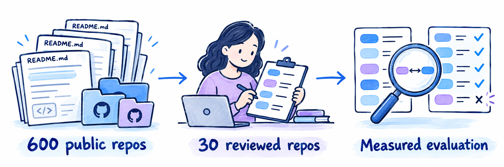
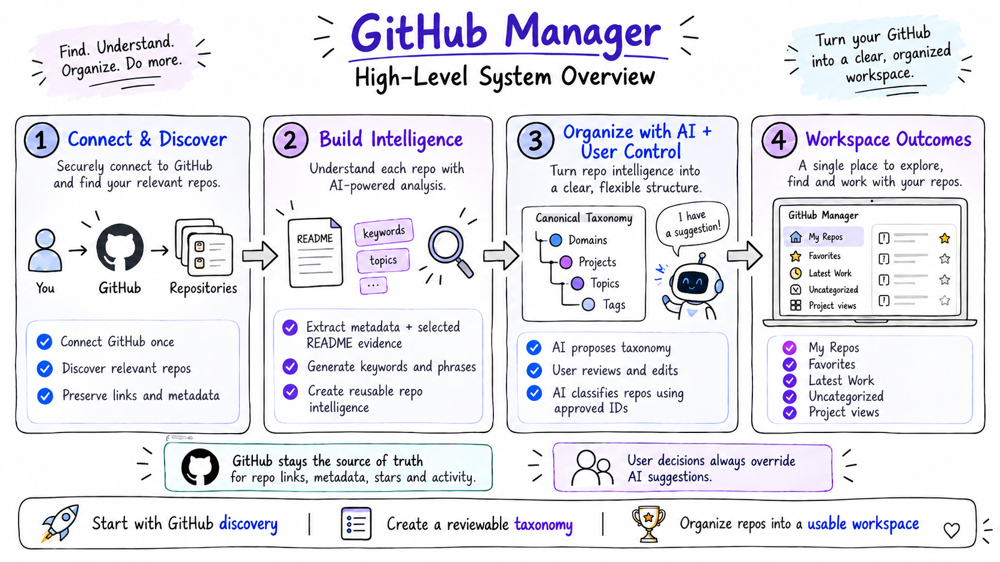
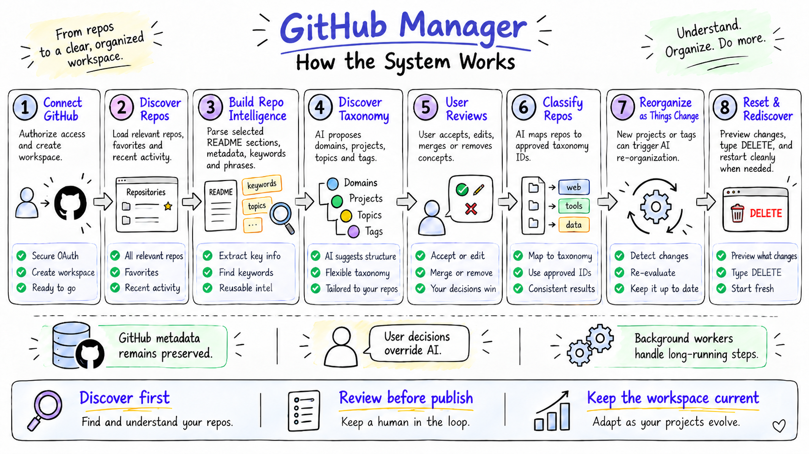
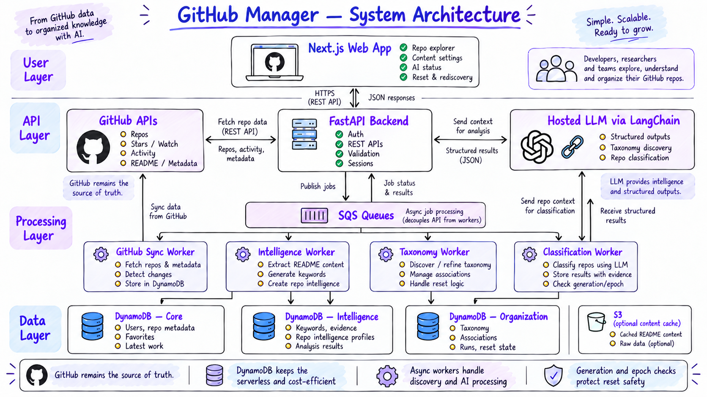

# GitHub Manager

**An AI-powered workspace for discovering, understanding, and organizing the GitHub repositories that matter to you.**


GitHub Manager brings owned, collaborated-on, contributed-to, starred, and watched repositories into one personalized workspace. Rather than asking developers to manually maintain endless folders and lists, it uses **background AI organization** to propose a useful structure of domains, projects, topics, and tags—while keeping the user in control.

> **Project status:** Architecture and MVP scope are defined; this README describes the intended product and design, **not a claim that every feature is implemented**.

- The authoritative technical specification is [docs/system-design.md](docs/system-design.md)
- The Codex review and execution guide is [docs/system-design-execution.md](docs/system-design-execution.md).

## GitHub Manager - Detailed Features Demo, Deep Dive, System Design

[](https://nkaul.github.io/github-manager-demo)

▶️ [Explore the GitHub Manager demo](https://nkaul.github.io/github-manager-demo) — feature walkthroughs, architecture video and podcast, and illustrated system design.


## Evaluation

[](eval/ai-system-design/evaluation/reviewed-30-v1/ground-truth-evaluation-explained.md)

[Read the ground-truth evaluation, explained in plain language](eval/ai-system-design/evaluation/reviewed-30-v1/ground-truth-evaluation-explained.md): how we collected the corpus, confirmed human reference labels, and checked retrieval, classification, and results with Ragas and Promptfoo. Includes charts, tables, and the limits of the thirty-repository evaluation.


---

## Why — The problem we are solving

### GitHub has repositories. Developers need an organized workspace.

The typical developer, architect, researcher, or technical leader works across repositories belonging to different products, initiatives, teams, and GitHub organizations. Those repositories accumulate over time, while the mental model of *how they fit together* is usually scattered across memory, notes, naming conventions, and bookmarks.

GitHub offers repository lists, stars, watches, topics, and **GitHub Projects for planning work**. But these do not automatically provide a **personal, cross-organization taxonomy of related repositories** built around the actual products, platforms, domains, and capabilities a person works on.

Common pain points include:

- **Fragmented discovery:** A meaningful repository may be owned personally, shared by a team, directly accessible, contributed to, starred, or watched.
- **No unified personal project structure:** Several repos may collectively form one application or platform, and one repo may be relevant to multiple initiatives.
- **Manual upkeep:** Maintaining lists, custom tags, and category assignments takes time and quickly becomes stale.
- **Poor visibility into active work:** Recent activity by the *user* is different from a repo that was merely updated by someone else.
- **Growing inconsistency:** Labels such as `Agent Platform`, `AI Agents`, and `Agent Framework` often proliferate without a common vocabulary.
- **High cognitive overhead:** Finding the right repository should not require remembering its exact name, organization, or location.

### Our goal

**Offload the repetitive work of repository discovery and organization to AI running in the background.**

GitHub Manager should progressively understand what repositories do, suggest a sensible organization, maintain it as new content arrives, and make relevant work easy to find. Users spend their time reviewing exceptions and making meaningful decisions—not repeatedly classifying everything by hand.

Three product promises guide the design:

1. **Find what matters:** Show relevant repositories without dumping every publicly readable or broadly accessible repository into *My Repos*.
2. **Organize with minimal effort:** Generate a starting taxonomy, classify repos, avoid duplicate concepts, and automatically revisit organization when it changes.
3. **Keep the user in control:** Human-created/accepted organization wins; GitHub-owned repository data stays intact; AI suggestions are explainable and reversible.

---

## What — The product at a glance

### High-level system overview



*From GitHub discovery to reusable repository intelligence, a reviewable taxonomy, and an organized personal workspace.*

- **Connect & discover:** Securely connect to GitHub and collect relevant repository relationships and metadata.
- **Build intelligence:** Extract high-signal repository metadata, selected README sentences, and meaningful keywords/phrases.
- **Organize with AI + user control:** Propose domains, projects, topics, and tags, then classify against approved canonical IDs.
- **Deliver a usable workspace:** Explore *My Repos*, *Favorites*, *Latest Work*, *Uncategorized*, and domain/project views.

### Core workspace views

| View | What it shows |
|---|---|
| **My Repos** | Repositories owned, directly collaborated on, team-granted, or identified as contributed to; avoids every merely readable repo. |
| **Favorites** | Repositories starred or watched by the user, including repos outside My Repos when available through authorized GitHub APIs. |
| **Latest Work** | Repositories with qualifying **user-specific** work in a configurable period, **14 days by default**. |
| **Uncategorized** | Repositories without a current project assignment—even when they already have technology tags. |
| **Domains & Projects** | User-defined or AI-proposed collections of related work; repositories may belong to multiple projects. |
| **Topics & Tags** | Cross-cutting functional subjects and specific technologies/labels, respectively. |
| **AI Organization** | Classification coverage, job progress, suggestions, freshness, history, and reorganization controls. |
| **Settings → Content** | Create, rename, edit, archive, merge, and manage domains, projects, topics, tags, descriptions, and aliases. |

### The organization model

| Concept | Meaning | Examples |
|---|---|---|
| **Domain** | Broad technical or business area | AI & Machine Learning, Manufacturing Analytics |
| **Project** | Logical application, platform, or initiative that can span several repositories | GitHub Manager, AI Agent Framework |
| **Topic** | Reusable functional theme or capability | RAG, Data Harmonization, Agent Orchestration |
| **Tag** | Specific technology, framework, or descriptive attribute | Python, FastAPI, AWS, Experimental |

A project has a primary domain; a repo may belong to **multiple projects** and have multiple topics and tags. **GitHub-native topics remain preserved as GitHub metadata**, separate from locally managed topics and tags. Favorites, Latest Work, and Uncategorized are smart views—not physical projects.

### Salient capabilities

**GitHub integration and trustworthy metadata**

- GitHub OAuth-based sign-in through an adapter supporting GitHub App or OAuth App integration, subject to organization-permission validation.
- Discovery across owned, collaborator, team, and identified contribution relationships, with stars/watches tracked separately.
- Preserved GitHub-provided repo links, names, descriptions, ownership, visibility, default branch, primary language, topics, last-push/updated timestamps, and optionally enriched branch counts/language details.
- Background metadata refresh, repo rename handling via stable GitHub IDs, and visibility into incomplete permission/API coverage.

**Repository intelligence and taxonomy discovery**

- Locally parse selected README sections—primarily Purpose/Overview, Features, Use Cases, and Architecture—without sending full READMEs to a model.
- Extract candidate keyphrases with **RAKE** (or YAKE after licensing review); aggregate distinct-repository frequencies and **TF-IDF** across the workspace.
- Group repositories using purpose, names, shared references, and supporting metadata; common language alone does not define a project.
- Ask a hosted LLM, via **LangChain**, to propose an **initial** collection of domains, projects, topics, and tags.
- Normalize/deduplicate names and aliases, then require **user review and approval** before publishing the first canonical taxonomy.

**User-owned content organization**

- Add, edit, archive/remove, merge, and organize domains, projects, topics, and tags **after** initial discovery—not just during onboarding.
- Add repositories to multiple projects; support drag-and-drop, multi-select, and bulk assignment.
- Keep stable canonical concept IDs and alias reservations to avoid near-duplicate names.
- Preserve explicit user assignments, accepted AI decisions, and rejections through later classification runs.

**AI classification and ongoing reorganization**

- Classify repositories using saved GitHub metadata, cached keyphrases, one or two purpose-defining sentences, and relevant approved taxonomy candidates.
- Use **strict Pydantic structured output** and server-side validation; only valid canonical concept IDs become associations.
- Track evidence, model/prompt version, source (`USER`, `RULE`, `AI`), and review status.
- Detect meaningful taxonomy changes and trigger background incremental reorganization after debouncing/thresholds, or let the user run **Reorganize with AI** at any time.
- Show execution status, classification coverage, pending suggestions, freshness, and run history.

**Safe reset and iterative demonstrations**

- Provide **Reset & Rediscovery** with two independent selection groups: **AI organization data** and **saved taxonomy/user organization data**.
- Show a server-generated deletion preview, require typing **`DELETE`**, and retain GitHub account/repository information by default.
- Fence stale jobs using organization generations and taxonomy/AI epochs; track physical cleanup and optional restart.

---

## How — End-to-end system workflow



*The eight steps shown in the workflow diagram are the intended end-to-end user journey.*

1. **Connect GitHub.** The user authorizes access, signs in, and a personal workspace is created. Credentials remain server-side.
2. **Discover repositories.** Background synchronization loads eligible My Repos, starred/watched Favorites, trusted metadata, and relevant recent activity. Repos become browsable **before AI finishes**.
3. **Build repository intelligence.** Python workers parse useful README sections, extract phrases locally, compute corpus statistics, and persist reusable evidence profiles.
4. **Discover the taxonomy.** The LLM examines compact evidence for related repository groups and proposes initial domains, projects, topics, and tags. Duplicate suggestions are consolidated.
5. **Review and publish.** The user accepts, edits, merges, rejects, or adds concepts. Approved definitions and aliases become the canonical taxonomy.
6. **Classify repositories.** Deterministic rules run first; then LangChain produces structured associations against **existing approved IDs**, with optional additional context for ambiguous repos. Results are validated and saved or offered for review.
7. **Keep it current.** Users can add or remove content definitions and correct mappings. Meaningful edits are tracked for automatic reorganization, and manual reorganization is always available. Incremental GitHub sync brings in new/changed repos.
8. **Reset and rediscover when needed.** For demonstrations or experiments, the user previews selected deletion scopes, types `DELETE`, and optionally restarts discovery/organization against preserved GitHub data.

### How the AI minimizes unnecessary work

The AI Organizer is **not** an agent that endlessly reads source code or full READMEs. It follows a bounded, progressive pipeline:

```text
Saved GitHub metadata
    + local keyphrase profile (RAKE / optional YAKE + TF-IDF)
    + 1–2 real README purpose/capability sentences when permitted
    + a short list of canonical taxonomy candidates
                    |
          Manual decisions / explicit rules first
                    |
      Hosted LLM only when classification is needed
                    |
       Pydantic structured classification output
                    |
  Validate concept IDs, evidence, permissions, revision
                    |
       Save associations or reviewable suggestions
```

- **No LLM call** for protected manual assignments or unambiguous deterministic rules.
- Typical classification input targets **roughly 530–970 tokens**; a configurable **2,000-token input ceiling** and selective **300–500 README-evidence token escalation** prevent uncontrolled prompts. These are design targets, not measured guarantees.
- The classifier may return **`NO_MATCH`** or **`NEEDS_MORE_CONTEXT`**. It should not invent a project just to avoid Uncategorized.
- Cached intelligence is refreshed only when relevant GitHub metadata, README evidence, extractor logic, or classification context changes.
- Keywords alone are often useful for tags/topics; **purpose sentences remain important for distinguishing logical projects**.

### Three separate responsibilities

1. **GitHub owns repository facts.** Links, branches, repo metadata, access, stars/watches, and activity are read from GitHub APIs; the model cannot rewrite them.
2. **Local intelligence describes repository evidence.** Keywords, phrases, selected source sentences, extraction hashes, and provenance are derived by Python workers.
3. **The user owns organization.** AI proposes or applies permitted domain/project/topic/tag associations; accepted and manual decisions take precedence.

---

## System architecture and technology



*The architecture separates the interactive application from synchronization, local intelligence extraction, hosted AI calls, and persistence.*

| Layer | Main modules | Responsibility |
|---|---|---|
| **User layer** | **Next.js / TypeScript** | Repo explorer, navigation, project tree, bulk organization, taxonomy review, AI status, reset UI. |
| **API layer** | **Python / FastAPI / Pydantic** | Authentication/session, authorized CRUD/read APIs, structured validation, orchestration/status endpoints. |
| **External services** | **GitHub REST + GraphQL** | Repo identity, permissions, metadata, README, stars/watches, contribution/activity details. |
| **Background processing** | **SQS + Python workers** | GitHub sync, README/keyword intelligence, taxonomy discovery, repository classification, reorganization, cleanup. |
| **AI** | **Hosted LLM through LangChain** | Structured initial taxonomy proposals, ambiguous deduplication support, and repo-to-taxonomy classification. |
| **Data layer** | **DynamoDB On-Demand** | Independently stores GitHub/core records, derived intelligence, and user/AI organization. |
| **Optional cache** | **Amazon S3** | Large permitted README/document cache where DynamoDB item storage is inappropriate. |

### Three DynamoDB tables

| Table | Contains | Reset behavior |
|---|---|---|
| `GitHubManagerCore` | User/workspace, GitHub connection reference, trusted repo records, Favorites, Latest Work, sync views | **Preserved** by organization resets |
| `GitHubManagerIntelligence` | Compact README evidence, keywords, phrase statistics, repository intelligence profiles | **Reusable** or selectively cleared |
| `GitHubManagerOrganization` | Canonical taxonomy/aliases, many-to-many relationships, manual/AI mappings, suggestions, feedback, job state, reset generations | **Selectively resettable** |

DynamoDB is chosen for serverless/on-demand operation with low idle database cost. The tradeoff is deliberate application-level design for relationships, canonical-name uniqueness, pagination, and query-specific views. Bidirectional association records and conditional writes/transactions keep project membership and aliases consistent.

### Primary software modules

| Module | Main function |
|---|---|
| **GitHub Connector** | OAuth/App token handling; rate-limit-aware GitHub REST/GraphQL retrieval. |
| **GitHub Sync & Activity Worker** | Discover eligible repos, update metadata and Favorites, compute user-specific Latest Work. |
| **Repository Intelligence Worker** | Markdown parsing, RAKE/optional YAKE, TF-IDF, evidence caching, candidate repo grouping. |
| **Taxonomy Intelligence Worker** | Generate reviewable initial taxonomy and expansion suggestions; never bypass canonicalization. |
| **Canonical Taxonomy Registry** | Manage domains/projects/topics/tags, stable IDs, aliases, fuzzy duplicate checks, user CRUD, revision tracking. |
| **Repository Classification Worker** | Retrieve candidates, build compact prompts, call LangChain structured LLM, validate and save associations/suggestions. |
| **Organization Controller** | Track execution/coverage/freshness, trigger automatic/manual reorganization, prevent conflicting jobs. |
| **Reset Controller** | Preview scoped deletion, require typed confirmation, advance epochs/generations, coordinate physical cleanup. |

The modules may live in a **single Python codebase** with separately deployed API and worker processes; they are not a mandate for individual microservices.

### Reliability and privacy principles

- **Never alter GitHub repositories.** The MVP is a read-oriented GitHub integration; links to repos open GitHub itself.
- **Never let AI overwrite trusted GitHub metadata.** Model responses contain organization decisions, not replacement repo URLs or timestamps.
- **Treat private README-derived keywords as private content too.** Metadata-only hosted-LLM mode is the default unless the user/organization authorizes sharing selected private content.
- **Treat README text as untrusted input.** Do not follow instructions embedded in documentation; validate model IDs and evidence before writes.
- **Prevent stale work after resets.** Workers verify current organization generation, taxonomy epoch, AI epoch, and revision with transactional conditions.
- **Respect human decisions.** User-approved assignments and explicit rejections override automated suggestions.
- **Keep the app usable during processing.** GitHub sync, local intelligence, and LLM work are asynchronous; show partial progress and meaningful status.

---

## User journeys after initial setup

**Adding a new project or topic:** The user creates it under **Settings → Content**. The registry checks existing names/aliases, publishes the new definition, and immediately makes it assignable. Significant accumulated changes initiate background reorganization; smaller changes show that a manual AI update is available.

**Correcting an AI classification:** The user drags a repo into a different project, adds a tag, or rejects a suggested match. The system persists provenance and rejection feedback; later runs cannot silently restore the rejected mapping.

**Opening active work:** The user visits **Latest Work**, which is driven by the authenticated user's qualifying activity (not merely the repository's `pushed_at` field), with a 14-day default lookback.

**Running a fresh demo:** The user visits **Reset & Rediscovery**, chooses what AI data and/or user taxonomy to remove, reviews actual affected counts, types **`DELETE`**, and optionally restarts discovery. Existing GitHub repo records are preserved, and old worker generations cannot recreate deleted organization.

---

## Implementation scope and project documentation

**Included in the planned MVP:** GitHub onboarding/discovery; repo browsing and favorites; Latest Work; reusable local intelligence; initial AI taxonomy discovery/review; canonical domains/projects/topics/tags with deduplication and user CRUD; structured classification; user feedback; auto/manual reorganization and status; selective Reset & Rediscovery; DynamoDB/SQS integration.

**Intentionally excluded:** KeyBERT or other locally deployed embedding models, vector databases, full source-code indexing, model fine-tuning, AI writing to GitHub repositories, and collaborative multi-user organization workspaces.

### Documentation map

| Document | Read when you need… |
|---|---|
| [`docs/system-design.md`](docs/system-design.md) | The **authoritative** architecture, API contracts, data keys, invariants, security requirements, and acceptance tests. |
| [`docs/system-design-execution.md`](docs/system-design-execution.md) | Instructions for Codex in VS Code to inspect the codebase, review the design, plan phases, and **wait for approval before implementation**. |
| [`docs/design-conversation.md`](docs/design-conversation.md) | Historical rationale and superseded design alternatives; not authoritative over approved design. |
| **This README** | The product's **Why / What / How**, key capabilities, and understandable end-to-end workflow. |

### Suggested repository layout

```text
github-manager/
├── Github-Manager-README.md       # This product overview (or rename to README.md)
├── AGENTS.md                      # Codex instructions (if used)
├── docs/
│   ├── system-design.md
│   ├── system-design-execution.md
│   ├── design-conversation.md
│   └── diagrams/
│       ├── github_manager_system_overview.png
│       ├── github_manager_workflow_infographic.png
│       └── github_manager_system_architecture.png
├── frontend/                      # Next.js application (planned)
├── backend/                       # FastAPI/services/workers (planned)
└── infrastructure/                # DynamoDB/SQS/AWS IaC (planned)
```

> **Diagram paths:** Place the three supplied PNGs under `docs/diagrams/` to render the diagrams inline in GitHub. If your repo uses a different layout, adjust the relative Markdown image paths. The diagrams are executive visuals; for exact implementation behavior, defer to `docs/system-design.md`.

---

## Design philosophy

**GitHub Manager should make organization happen largely in the background—and make the result easy for people to understand, correct, and trust.**

The desired outcome is not another manually maintained catalog. It is a personal technical workspace that stays useful as repositories, projects, interests, and daily work evolve.
