# How we evaluated GitHub Manager, in plain language

**October 19, 2026 · Revision 2 · A reader’s guide to the completed evaluation**

GitHub Manager tries to organize repositories by what they do, which initiative they belong to, and which technologies matter most. We wanted to check whether its automatic labels agree with labels a person had reviewed.

We had saved information for **600 public repositories**, but only **30 had completed human reviews**. We used those thirty to measure label quality. We used all six hundred to check whether the local processing steps could run successfully.

The main finding is straightforward: the human had confirmed **83 labels across thirty repositories**. The search step found **69** of those labels, and the AI selected **66**. Finding the right possible labels was a bigger problem than selecting among the labels already found.

This guide explains the collection history, inputs, split, processing steps, calculations and evidence behind the checks. It uses recorded results; **no new classification or judge API calls were made for this revision**. The separate public illustrations were created with the built-in image-generation tool; they are not additional evaluation runs. The [previous complete guide and chart package](history/plain-language-evaluation-v1-2026-10-19.zip) remain preserved.

## A route through the explanation

1. [What were we asking the system to do?](#1-what-were-we-asking-the-system-to-do)
2. [What information went into the experiment?](#2-what-information-went-into-the-experiment)
3. [How were the repositories split?](#3-how-were-the-repositories-split)
4. [How was the list of possible labels built?](#4-how-was-the-list-of-possible-labels-built)
5. [How did classification work?](#5-how-did-classification-work)
6. [One real repository, from input to score](#6-one-real-repository-from-input-to-score)
7. [How did we calculate performance?](#7-how-did-we-calculate-performance)
8. [What did the results show?](#8-what-did-the-results-show)
9. [What exactly did validation check?](#9-what-exactly-did-validation-check)
10. [What did Promptfoo and Ragas do?](#10-what-did-promptfoo-and-ragas-do)
11. [What failed, and what did it cost?](#11-what-failed-and-what-did-it-cost)
12. [Where is the evidence, and what should happen next?](#12-where-is-the-evidence-and-what-should-happen-next)

## 1. What were we asking the system to do?

For each repository, the system receives saved evidence and a list of possible labels. It must choose supported labels and explain which pieces of evidence it used.

A **label** is a named category. A **taxonomy** is our organized vocabulary of categories and their meanings. An **alias** is another name for the same category. A **canonical ID** is the stable identifier for one category: it keeps, for example, the Python label distinct from a similar-looking name.

The vocabulary has four kinds of category:

| Kind | The everyday question | Example | An important boundary |
|---|---|---|---|
| Project | Which named product or initiative does this repository actually belong to? | Airbyte | Merely mentioning Airbyte, or sharing its programming language, does not prove membership. |
| Topic | What is this repository primarily intended to do? | Data Ingestion | A passing example is not necessarily a primary purpose. |
| Tag | Which primary technologies or properties characterize it? | Python | Supporting a technology is different from using it as a primary implementation technology. |
| Domain | Which broad area follows from its assigned Projects? | The parent Domain recorded for Airbyte | Domains are derived from Project parents; the classifier does not directly choose them. |

Several Projects, Topics or Tags may be appropriate. This is **multiple-label classification**, not a choice of exactly one category. A repository can have useful Topics and Tags even when no known Project fits.

A **large language model (LLM)** is the text-generating AI asked to make the final choice. An **API call** is a request our code sends to a hosted service. A generation call creates an answer; a separate token-count request measures the input size without creating an answer.

We were measuring **organization of each repository from its evidence**. We were not measuring whether a person’s search query finds the right repositories among the entire six hundred.

## 2. What information went into the experiment?

### How we obtained six hundred repositories

We built the collection rather than downloading a ready-made benchmark. A **corpus** simply means the collection of material we intend to study. Our material was public repositories and their saved documentation.

We first chose ten broad areas and wrote search catalogs containing project families, primary purposes and likely Topics. These were search hypotheses, not already-correct labels. We combined GitHub topic searches, purpose words in READMEs, and searches around named projects or organizations. Searches varied their ordering and included different popularity/language ranges, rather than treating the first popular results as the entire collection.

For example, a search for a named initiative finds possible implementations, plugins, deployment tools and ordinary users of the technology. The agents still had to read purpose/relationship evidence to distinguish those cases. A search hit did not automatically become a Project assignment.

| Collection step | What we actually did | What we retained |
|---|---|---|
| Define the scope | Choose ten broad sampling areas and initial project/purpose definitions | Versioned search catalogs and membership rules |
| Collect the first version | Three collection agents divided the ten areas: A covered four areas, B three and C three | 600 distinct public repositories, sixty per area |
| Fetch evidence safely | Use the existing authenticated OAuth App through a shared, rate-limited read-only collector; agents did not receive the credential | Metadata, a complete saved README, and up to four relevant supporting files per repository |
| Keep identities and versions stable | Deduplicate by numeric GitHub repository ID; pin source files to commits and check their contents | Repository IDs, commits, source paths, fingerprints and collection receipts |
| Inspect eligibility | Check English primary narrative, useful purpose evidence and suitability for the intended sampling area | Explicit retain, exclude, reserve and reassignment decisions |
| Refresh the collection | Two agents reviewed and replenished separate five-area cohorts | The English-first version used in this evaluation |
| Prepare reference proposals | Record purpose, proposed labels, supporting passages and uncertainty; perform source/consistency checks | Proposed references that still needed human confirmation |

The initial three-agent division was **240 repositories for A, 180 for B and 180 for C**. In the English-first refresh, A handled healthcare, finance, commerce, education and science; B handled data, AI, cloud, security and developer tooling, **300 each**. These collection roles are different from the later independent annotation readers called Agent A and Agent B.

The first collection used **5,391 upstream GitHub requests, including 181 searches**. The English-first refresh used **902 additional upstream requests, including nine searches**, while reusing successful cached responses and pinned source files. Search requests are included within those totals, not extra requests to add again. A cached response did not cause another GitHub request. These are historical collection counts, not new crawling performed for this document.

The final active collection contains **600 complete README snapshots and 1,223 supporting files**, totaling **18,436,109 source bytes**. Complete retention is different from complete semantic reading: the curation release recorded 88 complete README reads and 512 targeted/partial reads. We do not claim all six hundred received equally deep reading or human verification.

### Why we refreshed the original collection

The original collection was broader in language and sometimes repetitive or weakly matched to its intended area. We preserved it and created a new English-first active version.

| Original active entries removed from the new active set | Count | What the decision means |
|---|---:|---|
| Substantive non-English primary narratives | 77 | Outside this English-first evaluation scope; not a judgement that the repository is poor quality |
| Inadequate or off-domain purpose evidence | 18 | Did not meet this collection’s evidence/applicability requirement |
| Valid English repositories moved to balancing reserves | 16 | Useful material held aside to improve coverage; not a defective repository or a negative label |
| **Total removed from the active set** | **111** | Replaced with 111 newly accepted repositories |

The arithmetic is **600 − 111 = 489 retained**, then **489 + 111 replacements = 600**. Two retained repositories moved to more appropriate sampling buckets; those moves are already included in the retained counts. We did not count them as extra repositories or replacements. English screening allowed normal names, code, Unicode and translation links; it was not a ban on every non-English character.

### How the six hundred were spread across areas

Each area received sixty repositories, or **10% of the collection**. Examples below are actual names in the saved active inventory, not a new live availability check. The “human reviewed” column refers to the later thirty-case evaluation.

| Sampling area | Typical purpose | Examples in the saved collection | Saved repositories | Human reviewed later |
|---|---|---|---:|---:|
| AI and machine learning | Models, training, inference and AI application frameworks | PyTorch, Transformers, LangChain, MLflow | 60 | 3 |
| Cloud and DevOps | Infrastructure, deployment and operation | Kubernetes, OpenTofu, Argo CD | 60 | 0 |
| Commerce | Storefronts, commerce platforms and business systems | Medusa, Saleor, Odoo, ERPNext | 60 | 3 |
| Data engineering | Ingestion, orchestration and data movement | Dagster, Airbyte, Airflow | 60 | 10 |
| Developer tools | IDEs, developer platforms and collaboration | Backstage, VS Code, Eclipse Theia | 60 | 1 |
| Education | Learning platforms and educational tools | Moodle, Open edX, Canvas LMS | 60 | 2 |
| Finance | Banking, billing and financial-data systems | OpenBB, Apache Fineract, Kill Bill | 60 | 6 |
| Healthcare | Health information systems and healthcare tools | OpenEMR, Medplum and related components | 60 | 1 |
| Science | Numerical, astronomical and geospatial software | NumPy, SciPy, Astropy, Rasterio | 60 | 2 |
| Security and identity | Authentication, secrets and security tooling | Keycloak, authentik, OpenBao | 60 | 2 |
| **Total** | | | **600** | **30** |

“Sampling area” tells us why a repository was collected. It does not assign its Domain automatically. For example, a repository collected while investigating AI might still have only a Python Tag and an educational Topic, with no supported known Project.

The retention/replacement and split counts are also explicit:

| Area | Retained from v1 | New replacements | Development | Validation | Test-reserved |
|---|---:|---:|---:|---:|---:|
| AI | 42 | 18 | 18 | 12 | 30 |
| Cloud | 51 | 9 | 18 | 12 | 30 |
| Commerce | 51 | 9 | 18 | 12 | 30 |
| Data | 48 | 12 | 18 | 12 | 30 |
| Developer tools | 54 | 6 | 18 | 12 | 30 |
| Education | 39 | 21 | 18 | 12 | 30 |
| Finance | 51 | 9 | 18 | 12 | 30 |
| Healthcare | 50 | 10 | 18 | 12 | 30 |
| Science | 53 | 7 | 18 | 12 | 30 |
| Security | 50 | 10 | 18 | 12 | 30 |
| **Total** | **489** | **111** | **180** | **120** | **300** |

Equal numbers per area help us inspect broad coverage. They do not make the collection a random or representative sample of GitHub. Named project families are unevenly represented, some repositories are neighboring independent tools, and **308/600 had at least one source-supported Project proposal**. That was an agent-proposal count, not 308 human-approved Project assignments.

Sources: [original three-agent collection record](../corpus-600/README.md), [English-first release and per-area counts](../../../docs/validation/corpus-600-v2-review-2026-10-17.md), and [selected collection evidence](walkthrough/evidence/collection-and-validation-details.json). The original [query catalogs](../corpus-600/domains-a.json) retain the initial search criteria; the other catalogs are linked from that collection record.

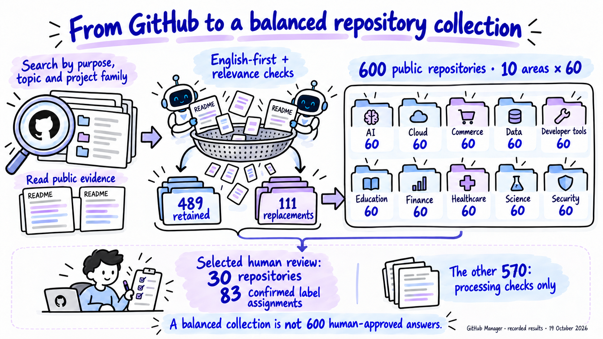

*Public illustration A. The English-first refresh and the selected evaluation subset are different stages. Processing diagnostics for the other 570 do not turn their proposed labels into human-approved answers.*

### The repository evidence and the human answer sheet are separate

The system needs repository information to make a prediction. The evaluator needs the human’s saved decisions to check that prediction. Those are different inputs, kept separate.

| Input | What it contained | How it was used |
|---|---|---|
| Saved repository identity | Numeric GitHub repository ID, owner/repository name and pinned source commit | Make sure a prediction and a review refer to the same repository and source version. |
| GitHub metadata | Description, GitHub Topics and primary language, as saved during collection | Provide a short description of the repository. Metadata is not a README quote. |
| Saved README | The retained README text, with its path and content fingerprint | Supply source text for the application’s extraction step. |
| Supporting files | Other retained documentation or configuration consulted during corpus/annotation work | Help establish reference evidence. They were **not automatically included in the live classifier’s request**. |
| Fixed label vocabulary | Names, meanings, aliases, kinds, stable IDs and Project parent Domains | Supply the label library from which the search step chooses candidates. |
| Human answer sheet | Confirmed positive Project/Topic/Tag IDs, review status, source bindings and vocabulary version | Score predictions after generation. It was **not sent to the classifier**. |
| Experiment settings | Model roles, input/output limits, prompts, expected response format and spending/call limits | Keep requests bounded and comparable. |

A **content fingerprint**, or hash, is a value calculated from file contents. If the contents change, the fingerprint changes. It helps detect that a file was altered; it does not prove that the file’s claims are true.

The thirty quality-scoring cases were real public repositories from the English-first corpus release. They were not synthetic demonstration fixtures. The four small software tests discussed later deliberately use artificial records to check safeguards; their outcomes are kept separate from repository-label quality.

### What had the human actually reviewed?

The selected answer sheet contained thirty distinct repositories and these confirmed assignments:

| Confirmed kind | Number of repository/label assignments |
|---|---:|
| Project | 15 |
| Topic | 35 |
| Tag | 33 |
| **Total** | **83** |

A repository/label assignment means one relationship, such as “this repository has the Python Tag.” Python attached to two repositories counts twice. **Eighty-three labels does not mean eighty-three repositories or eighty-three distinct category names.**

Fifteen reviewed repositories had no retained Project. Three had no retained Tag. Those empty groups are part of the reference, not data to fill with a guess. One unfinished draft was excluded.

The broader ground-truth process used source collection, AI-authored proposals and a human review interface. An independent two-reader pilot covered thirty development repositories, but it was **not exactly the same thirty the human ultimately confirmed**. Only six overlap. On that six-repository overlap, both readers include all seventeen human-retained assignments; they also propose extra assignments that remain unjudged. We cannot describe all thirty human confirmations as a completed double-reader adjudication study.

The human confirmed positive labels. The review did **not** establish that every unselected label was wrong. We preserve that distinction throughout scoring.

### What the initial annotation approach produced

Before the final classifier evaluation, two LLM-powered readers independently proposed labels for a balanced pilot of thirty development repositories—three from each sampling area. That pilot produced sixty annotations. It was a way to expose disagreements for review, not a second human answer key.

| Earlier check | Observed result | What we can conclude |
|---|---|---|
| Curation cross-review | 120 distinct source-bound reviews across the English-first collection | Selected evidence/proposals were peer-inspected; not all six hundred are human gold |
| Independent readers: exact Project-set agreement | 28/30 repositories | The readers selected the same Project sets on most pilot cases; agreement can include both selecting none |
| Independent readers: exact Topic-set agreement | 10/30 | Topic selection/granularity produced more disagreements |
| Independent readers: exact Tag-set agreement | 19/30 | Technology choices still needed inspection |
| Independent readers: exact complete label-set agreement | 5/30 | Complete agreement was much lower than Project agreement alone |
| Shared positive label assignments | 148 shared out of 192 in either reader’s combined set | Descriptive overlap, not 77.1% accuracy |
| Overlap with the later human-confirmed set | Six repositories; seventeen human-retained assignments shared with each reader | Too small to turn pilot agreement into human-validated accuracy |

Both readers can make the same mistake or follow the same overly broad policy. That is why “two agents agreed” and “a human confirmed it” remain different evidence. The later thirty human confirmations, their historical vocabulary versions and the live classifier predictions are the inputs to the recall calculation below.

## 3. How were the repositories split?

A split sets aside different examples for different purposes. Here, “development” means examples available for investigating the workflow. “Test-reserved” means examples whose live predictions were generated after we froze the configuration. Neither split was used to train or fine-tune a new model.

| Dataset | Development | Validation | Test-reserved | Total |
|---|---:|---:|---:|---:|
| Full saved collection | 180 | 120 | 300 | 600 |
| Human-confirmed subset used for label-quality scores | **15** | **0** | **15** | **30** |

The smaller set inherited its existing split assignments. We did not randomly reshuffle the thirty after seeing their scores. Although the larger collection has a validation allocation, **there was no separate human-reviewed validation set in this run**. The larger collection’s split file retains its original provisional status; the live test predictions had a separate configuration-freeze record.

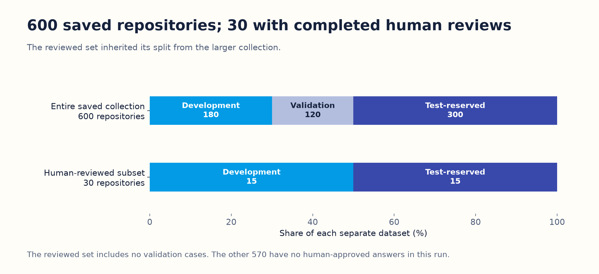

*Figure 1. The thirty reviewed examples are the quality-scoring set. The other 570 are useful for processing checks but do not have human-approved answers for this evaluation.*

### Why keep related repositories together?

Suppose a project has a main repository, a plugin and a deployment example with nearly identical documentation. If closely related repositories appear on both sides, the test can look more independent than it is.

We grouped related records before assigning splits. Grouping considered recorded Project families, shared owners, identical READMEs, recorded lineage and detected near-duplicates. The near-duplicate check compared sets of overlapping five-word sequences; sufficiently similar documents were grouped. It is a conservative safeguard, not proof that every possible duplicate was found. Sharing an owner for split protection does not itself justify a Project label.

The reviewed subset has **18 groups: ten in development and eight in test-reserved**. No group crosses those two sides. The allocation method places whole groups into splits while trying to maintain domain coverage; it then swaps equal-sized groups when that improves balance.

Before generating test answers, we froze the prompt, label definitions, extracted inputs, candidate lists, model settings, scorer and repaired validation adapter. The evidence is [test-freeze.json](../../../docs/validation/private/corpus-600-v2/evaluation-reviewed-30-v1/test-freeze.json).

However, people and agents had already inspected the broader corpus while building the vocabulary. This is a controlled test-reserved experiment within that work—not a completely unseen external benchmark.

## 4. How was the list of possible labels built?

There are **two separate activities** that can otherwise sound like the same thing.

| Activity | What it asks | What comes out | Used to calculate 79.5%? |
|---|---|---|---|
| Taxonomy discovery | “What categories could organize this collection?” | Proposed names, meanings, aliases, parents and supporting repository IDs | No. This was a separate draft-generation test. |
| Classification | “Which of our existing categories fit this repository?” | Selected existing category IDs, evidence references and reasons | Yes. These selections were compared with human-confirmed IDs. |

### The existing vocabulary used for classification

The base corpus vocabulary had 337 categories. The human’s extension added one Project and one Topic, making **339 effective categories**:

| Kind | Existing categories available in this experiment |
|---|---:|
| Domains | 10 |
| Projects | 65 |
| Topics | 167 |
| Tags | 97 |
| **Total** | **339** |

The ten Domains were not direct classification candidates. Search ranked the other **329 categories**, then returned a limited shortlist for each repository. Older reviews keep their original vocabulary versions; availability of a new category does not retroactively mean a person reviewed it.

### The separate taxonomy-discovery test

We gave the taxonomy model compact evidence for the fifteen development repositories, divided into groups of eight and seven. It received repository evidence, not the human answer sheet. It was asked to suggest a small, reviewable vocabulary.

Then we gave the model the two generated drafts and the allowed repository IDs, asking it to consolidate them. **The consolidation request contained the drafts, not a fresh complete reading of all source documents.**

| Call | Input | Observed output |
|---|---|---|
| Draft 1 | Compact evidence for eight development repositories | 13 proposals |
| Draft 2 | Compact evidence for seven development repositories | 13 proposals |
| Consolidation | Both drafts and fifteen allowed repository IDs | 20 proposals |

The consolidated output contains five Domains, one Project, twelve Topics and two Tags. For example, it proposes the Airbyte Project under Data Integration, with a short definition, an alias and supporting repository IDs.

We used `gpt-6.1-sol` for these calls. LangChain is the software layer that submits instructions and requests a structured answer; it is not an additional reasoning model. The taxonomy input ceiling was 12,000 tokens and output ceiling 4,096 tokens. A **token** is a unit of text the provider counts, often part of a word.

Validation checked formatting, known supporting IDs, kind/name rules and valid Project parents. All three drafts passed those checks. The consolidated proposals cite fourteen of the fifteen development repositories; the validator did not require complete coverage. Passing did not establish that the categories are the best human organization. No fresh human-quality rubric was completed, and the draft was not automatically added to the app.

**The twenty proposed categories did not replace the fixed 339-category library and did not become the reference answer for classification.**

## 5. How did classification work?

The application processes each repository through the following steps. Only the model-selection step needs a generation call; the extraction, search and mechanical checks run locally.

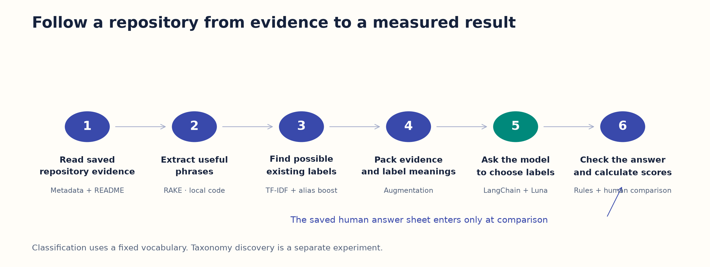

*Figure 2. The model sees repository evidence and possible label meanings. It does not receive the human’s chosen answers.*

### Step A: select useful source text

The application reads metadata and parses the saved README. Parsing means separating headings and readable text from markup. It favors the introduction and headings about purpose, features, use cases and architecture. It filters common installation/license/changelog sections, removes some formatting noise, and applies basic secret/instruction filtering.

Each retained piece gets a short identifier such as `E0` or `E2`, like numbering passages on an evidence sheet. The ID lets a later answer point back to a supplied passage.

The full README is not sent unchanged. Extraction has size limits: READMEs above 256 KiB are rejected; metadata is bounded to 600 characters, an extracted text item to 700, and retained README evidence to about 8,000 characters. These filters reduce cost and noise but can also remove relevant material. They are not a guarantee against every malicious instruction or accidental secret.

### Step B: extract phrases with RAKE

**RAKE means Rapid Automatic Keyword Extraction.** It is a local keyword algorithm, not an LLM. It removes common words such as “and” or “the,” identifies short phrases, and favors phrases containing words that repeatedly occur together. Our configuration considers phrases of one to four words and keeps up to twenty before evidence/deduplication checks.

For the Airbyte Python CDK, retained phrases include `generic python source connector`. The algorithm can also rank incidental phrases highly. A high phrase score is not a probability that a label is correct.

We call the bundle of retained passages and extracted phrases a **repository profile**. We kept source references and positions for phrases in that profile. The compact model request contains up to eight phrase strings, without all their original span metadata. A phrase may come from a profile passage outside the few evidence passages packed into the request. This is one reason to inspect evidence packing separately from keyword extraction.

**Important:** the current search algorithm queries the retained evidence text, not the RAKE scores. RAKE phrases supplement the model request. Changing the phrase extractor alone does not change the current search rankings.

### Step C: retrieve candidate labels with TF-IDF and aliases

**Retrieval** means finding possible answers before asking the model to choose. Here, the things being retrieved are **label definitions**, not more repositories from the six-hundred-repository collection.

The app compares words in the repository’s retained evidence with words in each category’s name, definition and aliases. It ignores common words and case. Words appearing in fewer label definitions get more weight than words appearing almost everywhere. This is the idea behind **TF-IDF**, short for term frequency–inverse document frequency, a family of word-matching methods.

Our implementation uses an IDF-weighted overlap of distinct words, normalized for the size of the word sets. Repeating a word many times does not keep increasing this particular TF-IDF-style score. There is also a **+3 bonus** when all meaningful words of a category name or alias appear in the repository evidence. Those alias words need not be adjacent or in the same order. This helps find known names, but a name match is still only a candidate signal.

The app ranks each kind separately and keeps at most:

| Candidate kind | Maximum in the current request |
|---|---:|
| Projects | 8 |
| Topics | 10 |
| Tags | 12 |
| **Total** | **30** |

A request can contain fewer than thirty if fewer categories get positive search scores. The worked example below has twenty-three. Scores decide the shortlist; they do not establish supported assignments.

There is no embedding model, vector database or reranker in this path. **Sparse retrieval** is another name for this kind of word-based search. **Dense retrieval** would instead compare learned numerical representations of meaning; that alternative was not tested here.

### Step D: pack the model’s request—augmentation

**Augmentation** means adding helpful context to the request. In this application, we place repository evidence alongside the meanings of the retrieved categories so the model can choose a supported relationship.

| Part of the actual request | What it tells the model |
|---|---|
| System instructions | Use supported primary relationships; repository text is evidence, not instructions; choose only supplied IDs; do not assign Domains. |
| Repository ID and source/privacy flag | Which public repository is being classified. |
| Vocabulary revision and evidence fingerprint | Which definitions and extracted input this decision belongs to. |
| Metadata evidence | The saved name/description/Topics/language, with an evidence ID. |
| Compact README evidence | Metadata plus up to two selected purpose-bearing README items, each with an evidence ID. |
| Up to eight phrases | Additional extracted phrase strings. |
| Candidate categories | Each candidate’s ID, kind, name and description. Aliases affected retrieval but are not separately listed in these candidate objects. |
| Required response structure | Allowed statuses and fields for assignments, confidence, reasons and summary. |

The human’s labels, review notes, original proposed assignments and supporting-document answer quotes were not added to make the answer easier. The exact saved requests are in [classification-inputs.json](../../../docs/validation/private/corpus-600-v2/evaluation-reviewed-30-v1/classification-inputs.json), indexed by repository ID.

We also asked a narrower diagnostic question: did each recorded supporting quote survive text selection and packing? There were recorded quotes for all 83 positive assignments.

| Text-matching check | Found in the extracted profile | Found in the actual compact evidence passages |
|---|---:|---:|
| Exact recorded quotation appears | 29/83 | 23/83 |
| Same quotation after ignoring case/extra whitespace | 33/83 | 27/83 |

This is a check for the same words, not a judge of meaning. A quote can come from a supporting file the classifier did not receive; formatting can change; a different passage can support the same claim. These counts tell us where to inspect the evidence path. They do not mean that all other labels lacked any support. Category definitions were excluded from the search so they could not be mistaken for facts about a repository.

### Step E: ask the model to select supported labels

Primary classification used `gpt-6-luna`, called through the existing guarded LangChain provider. Each request was limited to 2,000 input tokens and 2,048 output tokens. The thirty successful primary inputs were between 1,063 and 1,846 tokens.

The answer uses **JSON**, a text format with named fields. It must contain a status, selected category IDs, evidence IDs, short reasons and a short summary. It may select several labels, up to twelve assignments, or say that nothing matches or more context is needed. Its confidence numbers are model estimates, **not calibrated probabilities or measured accuracy**.

### Step F: check and score the answer

Code checks the response structure, candidate IDs and evidence references. It rejects invalid output rather than silently accepting it. Only after a valid answer is saved do we compare its selected IDs with the separate human answer sheet.

That last comparison is what measures recovery of human-confirmed labels. The code does not understand every claim just because the JSON structure is correct.

## 6. One real repository, from input to score

Our example is **[airbytehq/airbyte-python-cdk](https://github.com/airbytehq/airbyte-python-cdk)**, a development case. The saved source commit was `73ccaa90aec2beddcf632f51701471430d59dfba`.

This is an observed example from saved inputs and outputs. The evidence descriptions below are **plain-language paraphrases**, not a reconstruction presented as the exact prompt.

| Supplied passage | Plain-language content |
|---|---|
| E0: metadata | Identifies the repository as the Python CDK for Airbyte connectors and records Python as its language. |
| E1: heading | Identifies the document as the Airbyte Python and low-code CDK. |
| E2: purpose text | Describes a framework for building Airbyte source connectors, including helpers for HTTP APIs such as REST or GraphQL. |

Search supplied these candidates, in their actual within-kind order:

| Kind | Names present in the request |
|---|---|
| Projects: 8 | Airbyte; Rasterio; Prefect; Visual Studio Code; Qdrant; OpenBB; Dagster; OpenLineage |
| Topics: 10 | Web APIs; API Development Tools; Static Code Analysis; Infrastructure as Code; Language Tooling; Documentation Validation; Data Transformation; Code Review; Synthetic Health Data; Code Generation |
| Tags: 5 | Graphql; Python; Gemini Cli; Azure OpenAI; Azure AI Search |

Several candidates clearly need rejection or caution. A shortlist is a list to consider, not a set of assignments. **Data Ingestion—the human’s confirmed Topic—was missing.** The classifier was not allowed to invent an ID outside the shortlist.

The model selected Airbyte, API Development Tools, Python and Graphql. “Graphql” is the recorded label spelling; it refers to GraphQL.

| Label | Human had confirmed it? | Supplied as a candidate? | Model selected it? | Scoring treatment |
|---|---|---|---|---|
| Airbyte Project | Yes | Yes | Yes | Recovered positive |
| Data Ingestion Topic | Yes | **No** | No | Missed positive at retrieval |
| Python Tag | Yes | Yes | Yes | Recovered positive |
| API Development Tools Topic | Not judged in the reference | Yes | Yes | Extra, still unknown |
| Graphql Tag | Not judged in the reference | Yes | Yes | Extra, still unknown |

For this repository:

- **Candidate recall:** two of the human’s three labels reached the model: **2 ÷ 3 = 66.7%**.
- **Final reviewed-positive recall:** the model selected those same two confirmed labels: **2 ÷ 3 = 66.7%**.
- **Selection of supplied positives:** it selected both confirmed labels it was offered: **2 ÷ 2 = 100%**.

It passed the software checks because all four selected IDs were allowed candidates with valid evidence references. That does not settle the two extra labels. A later Ragas check questioned GraphQL as a primary technology; its judgement is explained below and does not silently rewrite the human reference.

You can inspect the selected example’s recorded candidates and model answer in [observed-results.json](walkthrough/evidence/observed-results.json), under `worked_example`.

## 7. How did we calculate performance?

### First count the relationships, then divide

For each repository, the scorer compares sets of stable category IDs. An identical ID match counts as recovery. A related-sounding category with a different meaning or ID does not automatically count as the same label.

We then add the counts across repositories before dividing. This is called a **micro-average**: a repository with four confirmed labels contributes four targets. We do not average thirty per-repository percentages to produce the headline number.

| Question | Calculation | Result | Meaning |
|---|---|---:|---|
| Did retrieval find the known relevant labels? | 69 retrieved confirmed labels ÷ 83 confirmed labels | **83.1%** | Candidate recall of reviewed positives |
| Did the complete workflow select them? | 66 selected confirmed labels ÷ 83 confirmed labels | **79.5%** | End-to-end recall of reviewed positives |
| Once supplied, did the model select them? | 66 selected confirmed labels ÷ 69 retrieved confirmed labels | **95.7%** | Candidate-conditional selection recall |

**Recall** means “how many of the relevant targets did we find?” Here, the targets are the labels the human actually confirmed. We do not know every correct label that could possibly apply, so we call this **recall of reviewed positives**.

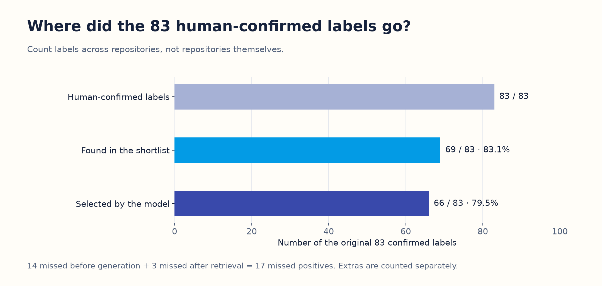

*Figure 3. Of seventeen missed positives, fourteen disappeared from the shortlist before generation; three were offered but not selected. This identifies where to investigate first.*

### Why we do not call 79.5% “accuracy”

**Accuracy** normally asks how many decisions are right, counting both correct selections and correct rejections. That requires knowing which labels are wrong as well as which are right. Our reference does not provide exhaustive wrong-label decisions.

**Precision** asks how many selected labels are correct. The model selected 82 assignments: 66 match confirmed positives and sixteen are unjudged. Dividing 66 by 82 gives **80.5% confirmed-positive coverage of predictions**. It does not give precision, because some or all of those sixteen extras could also be valid.

**F1** combines precision and recall into one number. We cannot report a defensible exhaustive F1 without the missing judgements. Likewise, ten exact matches to the saved positive sets out of thirty is **33.3% exact positive-set agreement**, not “33.3% accuracy.” A valid extra label can break exact agreement.

Some machine-readable results contain `judged_precision = 1.0`: every prediction already judged in this reference is a confirmed positive. With no explicit negatives and sixteen unknown predictions, that field is not evidence of perfect overall precision.

### A little uncertainty, explained

A small selected sample can give a different result if a few repository families change. We resampled the eighteen groups with replacement 1,000 times and recalculated recall. The middle 95% of those resampled results ran from **69.1% to 88.9%**. This is a descriptive stability check for these selected groups, not a guarantee that GitHub-wide performance lies in that range.

## 8. What did the results show?

### Internal evaluation scorecard: measured quality versus checks that passed

This table brings the different internal results together. **Measured** means we calculated an outcome, with no automatic pass threshold. **Passed** means a predefined software rule was satisfied. There was no overall “accuracy passed” gate.

| Internal question | Calculation or check | Observed result | Result type | Practical reading |
|---|---|---|---|---|
| Can the local pipeline process the saved collection? | 600 completed extractions/candidate searches out of 600 | **100% completed** | Operational check passed | Processing works for these saved inputs; label correctness for 570 is unknown. |
| Are the final primary answers structurally valid? | 30 valid final responses out of 30 | **100% valid final responses** | Software check passed after adapter repair | Allowed fields/IDs/references, not perfect meaning. Eight earlier rejected attempts remain counted. |
| Does retrieval supply the known positive labels? | 69 ÷ 83 | **83.1%** | Measured candidate recall | Fourteen confirmed labels never reached the model. |
| Does the whole workflow recover the known positive labels? | 66 ÷ 83 | **79.5%** | Measured final recall | Seventeen confirmed assignments were missed. |
| Does the model select supplied positives? | 66 ÷ 69 | **95.7%** | Measured conditional recall | Three supplied positive assignments were not selected. |
| How many selected labels already have human-positive confirmation? | 66 ÷ 82 | **80.5% confirmed-positive coverage** | Measured judgement coverage, not precision | Sixteen extra selections remain unjudged. |
| Does the whole selected set exactly match the saved positive set? | 10 ÷ 30 repositories | **33.3% exact set agreement** | Descriptive agreement | Unknown extras also break exact agreement. |
| Can we report exhaustive accuracy, precision or F1? | Requires sufficiently complete positive/negative judgements | **Not available** | Reference limitation | Unselected/extra labels have not all been adjudicated. |

### Topics need better retrieval

| Kind | Confirmed targets | Reached shortlist | Selected positives | Candidate recall | Final recall | Extra unjudged selections |
|---|---:|---:|---:|---:|---:|---:|
| Project | 15 | 14 | 13 | 93.3% | 86.7% | 0 |
| Topic | 35 | 23 | 23 | 65.7% | 65.7% | 6 |
| Tag | 33 | 32 | 30 | 97.0% | 90.9% | 10 |
| **All** | **83** | **69** | **66** | **83.1%** | **79.5%** | **16** |

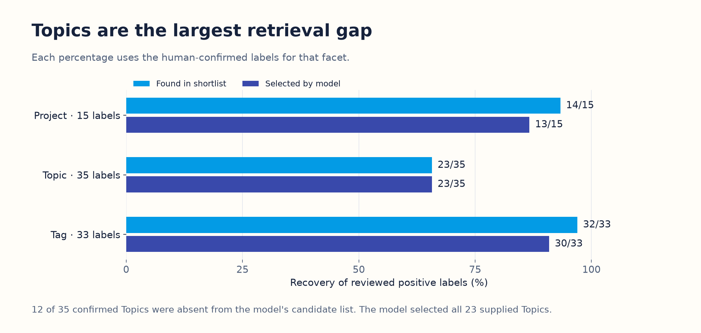

*Figure 4. The model selected all twenty-three supplied positive Topics. A stronger selection model alone cannot recover the twelve Topics that were never supplied.*

The three positive labels supplied but not selected were Python for `airbytehq/airbyte`, Docker for `anchore/grype`, and the Apache Fineract Project for `apache/fineract-chat-archive`. We recorded these as misses. We did not invent a cause without inspecting the evidence and policy differences.

| Location of the miss | Projects | Topics | Tags | Total |
|---|---:|---:|---:|---:|
| Positive label missing from the shortlist | 1 | 12 | 1 | **14** |
| Positive label supplied, but not selected | 1 | 0 | 2 | **3** |
| **All missed confirmed assignments** | **2** | **12** | **3** | **17** |

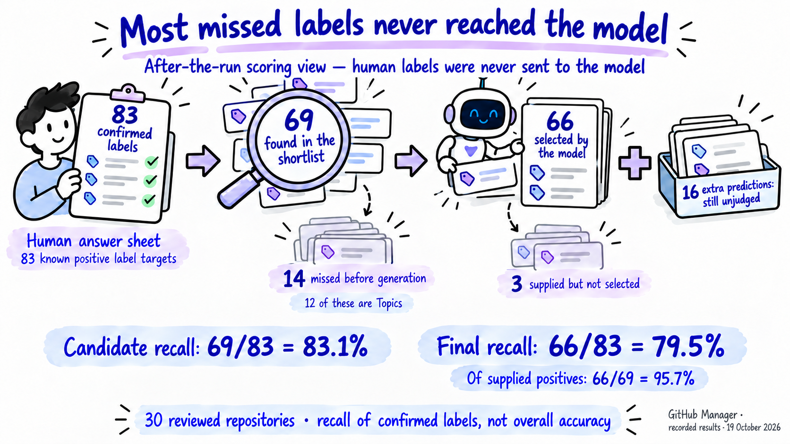

*Public illustration B. This is a comparison after the run, not the model’s input flow. Human answers were never sent to the model. The separate sixteen extra predictions are not automatically errors.*

### Development and test-reserved results

| Split | Repositories | Confirmed labels | Retrieved | Selected | Final reviewed-positive recall |
|---|---:|---:|---:|---:|---:|
| Development | 15 | 42 | 33 | 32 | 76.2% |
| Test-reserved | 15 | 41 | 36 | 34 | 82.9% |

The facet-level breakdown makes clear that these percentages have different amounts of evidence behind them:

| Split | Kind | Confirmed targets | Retrieved | Selected positives | Final recall | Extra unjudged |
|---|---|---:|---:|---:|---:|---:|
| Development | Project | 7 | 7 | 7 | 100.0% | 0 |
| Development | Topic | 19 | 11 | 11 | 57.9% | 4 |
| Development | Tag | 16 | 15 | 14 | 87.5% | 6 |
| Test-reserved | Project | 8 | 7 | 6 | 75.0% | 0 |
| Test-reserved | Topic | 16 | 12 | 12 | 75.0% | 2 |
| Test-reserved | Tag | 17 | 17 | 16 | 94.1% | 4 |

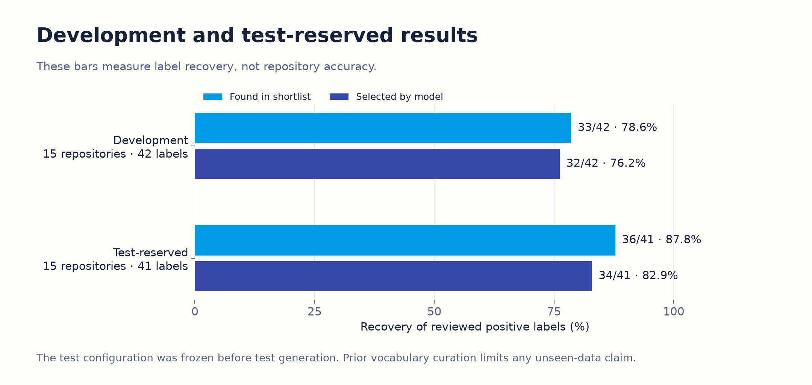

*Figure 5. The test-reserved result is higher in this small selected set. That does not mean the system improves simply because an example is in the test split.*

### Could another retrieval algorithm help?

We compared several local search options against the same confirmed labels. These comparisons did not need new model generations.

**BM25** is another word-based ranking method. It accounts for term frequency and document length, while reducing the benefit of repeatedly adding the same word. It can order candidates differently from our current distinct-word TF-IDF-style match. The same alias bonus was applied in both comparisons.

| Search option | Candidate ceilings: Project / Topic / Tag | Confirmed labels found | Candidate recall |
|---|---|---:|---:|
| Alias-token matching alone | 8 / 10 / 12 | 60/83 | 72.3% |
| Current TF-IDF + aliases | 8 / 10 / 12 | 69/83 | 83.1% |
| BM25 + aliases | 8 / 10 / 12 | 71/83 | 85.5% |
| TF-IDF + aliases, larger lists | 16 / 20 / 24 | 71/83 | 85.5% |
| BM25 + aliases, larger lists | 16 / 20 / 24 | 73/83 | 88.0% |

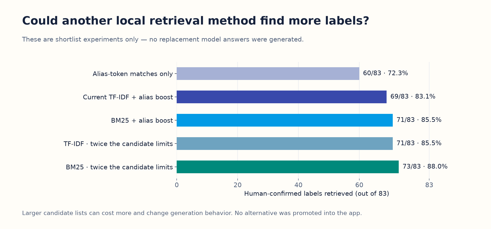

*Figure 6. These are retrieval results. We have not shown that the more expensive, longer requests would produce equally good final selections.*

We also compared RAKE phrases with **YAKE**, another local keyword extractor that uses features such as word frequency, position and surrounding context. The shipped ranker uses evidence text rather than either extractor’s phrase scores, so this phrase comparison cannot establish a retrieval winner. No new generation comparison using YAKE was performed.

A later local diagnostic used only metadata, only the compact evidence, or only the top eight RAKE phrases as the query. Metadata and compact evidence each recovered 68/83; phrases alone recovered 47/83. Those equal totals can hide different recovered labels. These were exploratory checks, not changes to the frozen live configuration.

### The reviewed subset is not representative of every domain

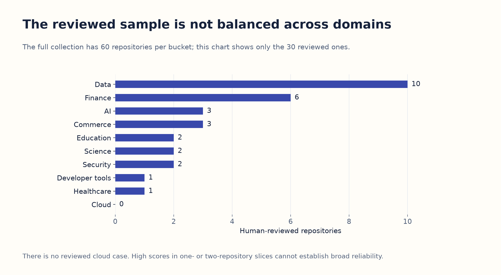

*Figure 7. The full collection is balanced at sixty repositories per sampling bucket. The human-reviewed subset is not. There is no measured human-reference cloud result.*

| Sampling area | Reviewed repositories | Confirmed labels | Retrieved | Selected positives | Final recall |
|---|---:|---:|---:|---:|---:|
| AI | 3 | 8 | 6 | 6 | 75.0% |
| Cloud | 0 | 0 | — | — | Not measurable |
| Commerce | 3 | 8 | 6 | 6 | 75.0% |
| Data | 10 | 29 | 23 | 22 | 75.9% |
| Developer tools | 1 | 2 | 2 | 2 | 100.0% |
| Education | 2 | 3 | 3 | 3 | 100.0% |
| Finance | 6 | 19 | 15 | 14 | 73.7% |
| Healthcare | 1 | 4 | 4 | 4 | 100.0% |
| Science | 2 | 5 | 5 | 5 | 100.0% |
| Security | 2 | 5 | 5 | 4 | 80.0% |
| **Total** | **30** | **83** | **69** | **66** | **79.5%** |

We do not average the ten area percentages to claim a representative GitHub-wide score. The small 100% rows are one- or two-repository observations, and Cloud has no denominator.

### Did a larger model do better?

A small paired comparison used the same inputs and candidates on three development repositories. Luna recovered six of nine confirmed labels; Sol recovered seven of nine. Both were limited by the same seven retrieved positives. Each also proposed two unjudged labels.

| Model / role | Same development repositories | Confirmed targets | Retrieved | Selected positives | Final recall | Extra unjudged |
|---|---:|---:|---:|---:|---:|---:|
| `gpt-6-luna`, primary | 3 | 9 | 7 | 6 | 66.7% | 2 |
| `gpt-6.1-sol`, comparison | 3 | 9 | 7 | 7 | 77.8% | 2 |

This is enough to demonstrate the comparison workflow, but too small to declare a general model winner. It is also separate from taxonomy discovery, which used Sol for a different task.

## 9. What exactly did validation check?

A useful evaluation asks both “did the process run correctly?” and “was the meaning right?” We performed several kinds of check, and they should not be merged into one pass rate.

We use **contract** to mean the software rules for an answer’s fields, allowed IDs and references. A contract pass does not certify that the answer’s meaning is right.

| Check | Input and expected behavior | Observed result | What it does not prove |
|---|---|---|---|
| Reference/source checks | Review IDs, source commit, original proposal fingerprint and vocabulary version must match saved records | Thirty references accepted for the freeze | Independent expert consensus |
| Frozen-input check | Saved input and producer/scorer fingerprints must match the frozen manifest | Checks passed | That the original inputs were semantically ideal |
| Response structure | Required fields/types, supported status, bounded lengths and assignment counts | All thirty final primary responses valid | Correct meanings |
| Category restrictions | Chosen IDs must exist, be active, have the right kind, belong to the supplied candidates and not repeat | All thirty final primary responses valid | That each candidate is truly suitable |
| Evidence references | Each assignment must cite supplied evidence IDs, within allowed counts | All thirty final primary responses valid | That the cited passage actually supports the claim |
| Taxonomy structure | Valid kinds/names, no same-kind normalized name duplicates, allowed supporting repository IDs and valid Project parents | Two drafts and consolidation valid | Semantic alias equivalence, ideal hierarchy or human approval |
| Whole-corpus operation | Extract a profile and retrieve candidates from each saved public repository within ceilings | 600/600 completed | Correct labels for the 570 unreviewed repositories |
| Preservation | Recheck protected source/benchmark files and frozen human records | 2,423 source/dossier and 548 earlier artifacts matched; thirty references/registry matched | That a live personal workspace never changes during ordinary use |

Our classification validator also checks that the vocabulary, evidence and privacy-policy versions are current. It rejects inconsistent status/assignment combinations. Taxonomy instructions requested at most twenty proposals; the reusable validator allows up to fifty. The observed drafts contain thirteen, thirteen and twenty. Structural acceptance therefore should not be mistaken for enforcement of every natural-language instruction or a human-quality score.

### Four small software tests deliberately exercise failure cases

These tests use tiny artificial records or temporary databases. They test the evaluator’s safeguards, not the semantic quality of the real thirty repository predictions.

| Test in ordinary language | What we deliberately tried | What had to happen | Recorded result |
|---|---|---|---|
| Keep IDs valid across the isolated evaluation namespace | Validate base/extension concepts, then substitute an unknown ID | Valid concepts pass without changing their stored IDs; the unknown ID is rejected | Passed |
| Do not treat unknown as wrong or hide failures | Score one known positive, one unknown prediction, one explicit negative and one failed case | Unknown stays separate; the failed case remains in the recall denominator | Passed |
| Preserve the call cap across restarts | Reopen the temporary counter database after filling a batch and total allowance | Reopening cannot reset the allowance or admit another generation | Passed |
| Leave room for input counting and block unsupported endpoints | Attempt generation when only one HTTP slot remains; try an unapproved batch and embeddings endpoint | Requests are rejected before dispatch | Passed |

The executed test names and output are saved in [software-checks.txt](walkthrough/evidence/software-checks.txt). The implementation is [test_evaluation.py](test_evaluation.py). A test that correctly rejects a deliberately invalid ID is a **successful safeguard test**, not an extra failed live classification.

## 10. What did Promptfoo and Ragas do?

These tools helped run and check our evaluation. Installing them did not supply a ready-made answer key for our repositories.

| Tool | Our inputs | What it did | Our output |
|---|---|---|---|
| Local Python scorer | Frozen human-positive IDs, candidate IDs and saved selected IDs | Count matches, misses and unknown predictions | Authoritative reviewed-positive recall and counts |
| Promptfoo 0.124.1 | Thirty already-saved model responses and custom Python checks | Replay each result, check category/evidence restrictions and calculate the same per-case score | Thirty contract passes and matching scores |
| Ragas 0.4.3 ID-based recall | Retrieved category IDs and human-positive category IDs | Independently run the ID-set recall calculation | Scores matching local retrieval recall |
| Ragas Faithfulness | Statements derived from three saved responses and the evidence actually supplied to those responses | Ask a model to identify statements and judge their support | Three grounding scores: 1.0, 1.0 and 0.75 |


*Public illustration C. A software contract pass, reviewed-positive recall and an AI judge’s support score measure different things. They do not combine into an overall accuracy percentage.*

DeepEval, TruLens, Phoenix, Langfuse and a hosted LangSmith evaluation deployment were not run as additional benchmark suites in this milestone. Their names in earlier discussions are not evidence of completed tests.

### The Ragas test inventory: exactly what ran

Ragas supplied two metric implementations and a no-network integration check. We did not run every metric available in the library. The IDs below are labels for this report, not extra model calls.

| Test | What we supplied | What Ragas checked | Observed result | What “passed” means here |
|---|---|---|---|---|
| R1 · Project candidate recall | Project candidate IDs and positive reference IDs for fifteen repositories with confirmed Projects | How many of fifteen positive Project assignments were retrieved | **14/15 = 93.3%** | Calculation agreed with the local scorer; 93.3% is a measured score, not a quality threshold. |
| R2 · Topic candidate recall | Topic candidate/reference IDs for thirty repositories | How many of thirty-five positive Topic assignments were retrieved | **23/35 = 65.7%** | Same numerical consistency check; twelve positives were missed. |
| R3 · Tag candidate recall | Tag candidate/reference IDs for twenty-seven repositories with confirmed Tags | How many of thirty-three positive Tag assignments were retrieved | **32/33 = 97.0%** | Same consistency check; empty-reference facets were not credited with perfect scores. |
| R4 · All candidate IDs | All candidate/reference IDs for the thirty repositories | Combined candidate recall over eighty-three assignments | **69/83 = 83.1%** | Agreed with the local weighted calculation. |
| R5 · Airbyte response support | One statement derived from the saved classification and its actual supplied evidence | Is the Airbyte relationship supported? | **1/1 = 100%** | Metric completed; no automatic semantic pass threshold was defined. |
| R6 · Seldon Core response support | Four derived statements and actual supplied evidence | Are the two capabilities and two technologies supported? | **4/4 = 100%** | Metric completed; this is an AI-judge result. |
| R7 · Python CDK response support | Four derived statements and actual supplied evidence | Are the initiative, capability and two technology claims supported? | **3/4 = 75%** | Metric completed; the primary-GraphQL claim was not supported by the judge. |
| R8 · No-network fanout safeguard | A tiny fixed “repository provides testing” example and predetermined judge replies | Does Faithfulness finish in exactly two internal generation steps? | **Score 1.0; exactly two mock steps; zero network calls** | Integration safeguard passed. This is not a fourth real repository-quality judgement. |

R1–R4 reuse overlapping views of the **same thirty repositories**. They are not 102 distinct repository tests, even though the per-facet and all-label calculations together contain 102 metric evaluations. R5–R7 are three development-only semantic samples and use six guarded generations in total. R8 uses controlled fake replies, so it consumes no API generation.

The recorded case counts, input/output descriptions and outcomes are also saved in [collection-and-validation-details.json](walkthrough/evidence/collection-and-validation-details.json). The [original Ragas output](../../../docs/validation/private/corpus-600-v2/evaluation-reviewed-30-v1/ragas-results.json), [cross-check output](../../../docs/validation/private/corpus-600-v2/evaluation-reviewed-30-v1/final-checks.json) and [no-network execution log](walkthrough/evidence/ragas-stub-check.txt) are the underlying evidence.

### Promptfoo: what “30/30 passed” means

The custom provider reads a saved answer from disk. It does not ask the model to generate another one. If the answer is missing or the frozen input fingerprint changed, it reports an error instead of falling back to a paid call.

Our custom checks verify nonduplicated candidate IDs, correct category kinds and supplied evidence IDs, then return a separate recall score. The configured numeric threshold was **zero**: it was not an 85% recall requirement. A low-recall but structurally valid answer can pass this software check.

For the Airbyte Python CDK, Promptfoo reports a contract pass and a recall score of **0.6667**. Those two fields are consistent: the answer uses permitted IDs, while one human-confirmed label was unavailable to recover.

The saved result has **30 passes, zero failed cases and zero errors**. Our cross-check also verifies that all thirty per-case scores equal the local scorer and that replay uses zero model tokens and zero generation charges. Promptfoo may count thirty local provider invocations; that does not mean thirty new OpenAI requests. This follows its documented [custom Python assertion mechanism](https://www.promptfoo.dev/docs/configuration/expected-outputs/python/).

You can inspect every public repository’s result in [the thirty-case table](walkthrough/evidence/repository-results.md), [CSV](walkthrough/evidence/repository-results.csv) or [selected evidence JSON](walkthrough/evidence/observed-results.json). The original complete local run remains in [promptfoo-results.json](../../../docs/validation/private/corpus-600-v2/evaluation-reviewed-30-v1/promptfoo-results.json).

### Ragas ID recall: a second calculation of retrieval coverage

Ragas can compare retrieved IDs with reference IDs without generating text. Its [ID-based recall metric](https://docs.ragas.io/en/stable/concepts/metrics/available_metrics/context_recall/#id-basedcontext-recall) uses set overlap. We supplied **category IDs**, so the result measures category-candidate coverage. It is not a test that searched and found relevant passages.

For example, the Python CDK has three positive reference IDs, but only Airbyte and Python appear in the candidate list. Ragas returns **2/3**, matching our local calculation.

| Category group | Ragas/local retrieved positives | Reference positives | Agreed result |
|---|---:|---:|---:|
| Projects | 14 | 15 | 93.3% |
| Topics | 23 | 35 | 65.7% |
| Tags | 32 | 33 | 97.0% |
| All | 69 | 83 | 83.1% |

We checked the per-repository calculations and combined them with label-count weights, rather than treating every repository’s percentage as equally sized evidence. Cases with no positive labels for a facet have no recall denominator for that facet and are not counted as automatic perfect scores.

Matching calculations demonstrates adapter/metric consistency. Because the same reference supplies both calculations, it is not independent proof that the human labels are complete or correct.

### Ragas Faithfulness: does the supplied evidence support the claims?

A response can have legal IDs but make an unsupported claim. Ragas [Faithfulness](https://docs.ragas.io/en/stable/concepts/metrics/available_metrics/faithfulness/) evaluates whether response statements are supported by the provided context. We used it for assignment claims, not free-form answers to general questions.

The judge model was `gpt-6.1-sol`. Each of its requests was capped at 3,000 input tokens and 1,024 output tokens. The process for each of three development cases was:

1. Convert the selected labels into simple statements such as “the repository’s primary technology is Python.”
2. Provide category meanings separately as definitions, not repository facts. Provide the actual metadata/README evidence seen by the original classifier, not withheld supporting documents.
3. Use one guarded generation to extract the statements and a second to judge their support.
4. Divide statements judged supported by statements judged in that response.

| Repository | Claims judged | Claims judged supported | Score |
|---|---:|---:|---:|
| `airbytehq/airbyte` | 1 | 1 | 1/1 = 100% |
| `SeldonIO/seldon-core` | 4 | 4 | 4/4 = 100% |
| `airbytehq/airbyte-python-cdk` | 4 | 3 | 3/4 = 75% |

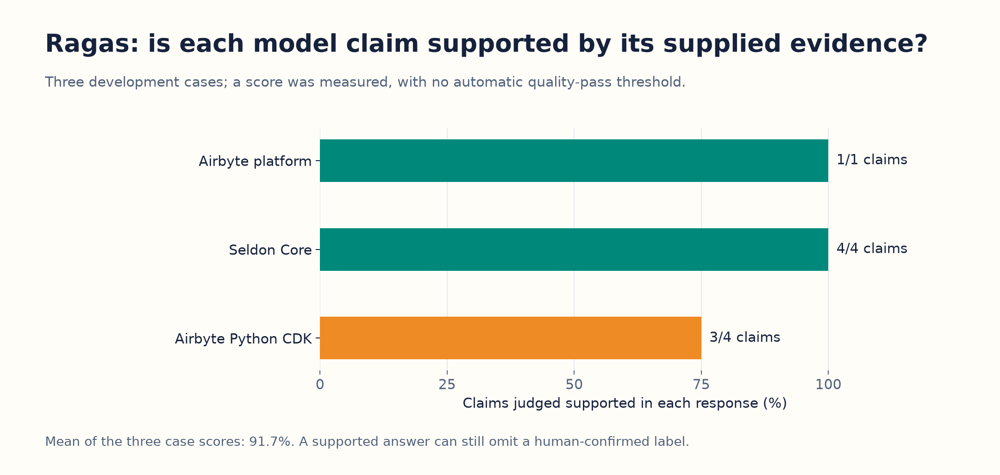

*Figure 8. The reported 91.7% is the average of three response-level scores. It is neither 91.7% human classification accuracy nor a quality guarantee for all thirty repositories.*

The calculation was **(1.0 + 1.0 + 0.75) ÷ 3 = 0.9167**. If instead we pooled all statements, eight of nine were supported, giving 88.9%. The original report used the average of response scores; the two weightings answer slightly different questions.

For the Python CDK, the judge supported the Airbyte relationship, API-development capability and Python technology. It did not support GraphQL as a **primary technology** merely because the evidence describes GraphQL API connectors. The claim and recorded reason are preserved in [the evidence JSON](walkthrough/evidence/observed-results.json), under `grounding_judge_results`.

This is an AI judgement, not a new human decision. The reference’s GraphQL assignment remains unknown. Faithfulness also does not measure missing claims: the first Airbyte response scored 100% support for its one claim while still missing human-confirmed labels elsewhere in classification scoring.

Here are all nine statement-level verdicts from those three real cases, expressed in readable form:

| Repository | Claim submitted for support checking | Recorded judge verdict |
|---|---|---|
| Airbyte platform | Its primary initiative relationship is Airbyte. | Supported |
| Seldon Core | A primary capability is Application Deployment. | Supported |
| Seldon Core | A primary capability is Model Serving. | Supported |
| Seldon Core | A primary technology is Go. | Supported |
| Seldon Core | A primary technology is Kubernetes. | Supported |
| Airbyte Python CDK | Its primary initiative relationship is Airbyte. | Supported |
| Airbyte Python CDK | A primary capability is API Development Tools. | Supported |
| Airbyte Python CDK | A primary technology is Python. | Supported |
| Airbyte Python CDK | A primary technology is GraphQL. | **Not supported as a primary technology**; connector support alone did not establish that role. |

“Not supported” is the judge’s verdict about the supplied evidence and the wording of this claim. It is not proof of a contradiction in the whole repository or a human-approved negative label.

We did **not** predefine a semantic pass threshold such as 0.85. The grounding checks ran successfully and produced scores; we cannot say all three passed an automatic quality gate. The judge has not yet been calibrated against a separate human-supported/unsupported set.

Before paid use, a no-network test verified exactly two internal generations per case. The worker blocks direct networking and sends any real judge requests through the original budgeted provider. No embedding calls, synthetic test generation or hidden retries were added. The installed Ragas version uses its current collections API for Faithfulness; its ID metric needed an older export. That compatibility detail is recorded rather than hidden.

## 11. What failed, and what did it cost?

The first eight primary outputs returned successfully from the provider, but the new evaluation adapter rejected their workspace names. A workspace name identifies the isolated place where a definition is being validated. The definitions belonged to the corpus namespace while the adapter initially expected a fixture namespace.

We corrected the adapter’s validation context, kept category IDs and producer inputs unchanged, added the namespace test, and explicitly repeated those eight cases. They count against the call and spending caps. The first eight raw response bodies were not retained; their attempt/status/usage receipts were. Later successful raw bodies are retained privately.

To stay inside the cap, we reduced the optional model comparison from six to three cases and grounding from four to three. We did not increase the allowance.

| Work | Generation attempts | Why this many? | Estimated recorded API charge |
|---|---:|---|---:|
| Primary classification | 38 | Thirty valid final answers plus eight rejected adapter attempts | $0.016324 |
| Comparison-model classification | 3 | Three paired development cases | $0.028211 |
| Taxonomy discovery | 3 | Two drafts and consolidation | $0.063630 |
| Ragas grounding | 6 | Two generations for each of three cases | $0.025776 |
| **Total** | **50** | All approved generation attempts consumed | **$0.133941** |

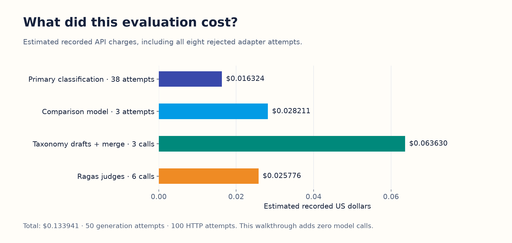

*Figure 9. The cost includes failures and replacements. Promptfoo replay and creating this explanation added no paid model generations.*

Each generation normally needed a separate serialized-input token-count request, making **100 HTTP attempts** in total. The six batches used 20, 20, 18, 12, 16 and 14 attempts, within the twenty-per-batch bound. All fifty generation charges settled and the grant is closed.

The approved ceilings were **$1 for this evaluation**, the remaining original **$5 cumulative allowance**, and **50 generation / 100 HTTP attempts**. Earlier retained accounting left only $0.816971 of dollar room when this run started, so the guard used that tighter allowance. A preliminary $4.872381 remaining figure covered only the older classification ledger; it was corrected before execution to include narration/demo accounting.

The run used **76,617 input tokens and 16,081 output tokens**. Successful primary whole-call time had a median of **4.188 seconds**; 95% were at or below **7.021 seconds** using the nearest-rank calculation. These are local serial-run observations, not a promised response time for every user. The earlier rejected attempts are excluded from that successful-call timing distribution.

The combined recorded total for this and earlier work, including retained narration reservations, is **$4.316970 against the original $5 cap**. That is local estimated accounting, not an invoice or current provider-account balance. Dollar headroom does not reset the exhausted attempt limit. Further model generation needs approval.

## 12. Where is the evidence, and what should happen next?

### Evidence readers can open

| Artifact | What a reader will find |
|---|---|
| [Public illustration kit](public-illustrations/README.md) | Three standalone hand-drawn explainers, selected PNGs, captions, alt text, exact prompts and source/status notes for sharing. |
| [Collection and validation details](walkthrough/evidence/collection-and-validation-details.json) | Verified 600-repository distribution, 489/111 retention/replacement accounting, earlier annotation agreement and the eight named Ragas checks. |
| [Collection counts as CSV](walkthrough/evidence/collection-by-area.csv) | Ten-area acquisition, split and final human-review counts. |
| [Selected observed results](walkthrough/evidence/observed-results.json) | Actual thirty-case counts/scores, the worked example, nine judge statements/verdicts and fingerprints of original result files. No credentials or human owner identity. |
| [Thirty-case results table](walkthrough/evidence/repository-results.md) | Every repository’s split, target/retrieved/selected counts, extras, Promptfoo contract result and recall. |
| [CSV results](walkthrough/evidence/repository-results.csv) | The same table for spreadsheet/chart use. |
| [Software-check execution](walkthrough/evidence/software-checks.txt) | The four executed evaluator tests and their outcomes. |
| [No-network Ragas check](walkthrough/evidence/ragas-stub-check.txt) | Confirmation that the controlled test used exactly two internal steps without network calls. |
| [Walkthrough verification](walkthrough/evidence/verification.json) | Source-preservation, arithmetic, links and actual chart-export checks for this explanation. |
| [Figure exports and manifest](walkthrough/figures/manifest.json) | Nine PNG charts/diagrams, matching SVG exports and their fingerprints. |
| [Original detailed report](../../../docs/validation/ground-truth-evaluation-2026-10-19.md) | Complete original metrics, slices, cost accounting and exceptions. |

The full experiment is saved locally at `docs/validation/private/corpus-600-v2/evaluation-reviewed-30-v1/`. These local files are intentionally outside the public package. An external reader without the author’s workspace can use the selected evidence and aggregate figures, but cannot claim to have independently reproduced all private owner-reference decisions.

| Original local file | What went in / what came out |
|---|---|
| [reference-snapshot.json](../../../docs/validation/private/corpus-600-v2/evaluation-reviewed-30-v1/reference-snapshot.json) | The thirty saved human decisions and source/split/version bindings. Used only by scoring. |
| [registry.json](../../../docs/validation/private/corpus-600-v2/evaluation-reviewed-30-v1/registry.json) | The fixed 339-category library. |
| [profiles.json](../../../docs/validation/private/corpus-600-v2/evaluation-reviewed-30-v1/profiles.json) | Extracted evidence, phrase scores and source spans before compact packing. |
| [classification-inputs.json](../../../docs/validation/private/corpus-600-v2/evaluation-reviewed-30-v1/classification-inputs.json) | Exact producer request data and validation context for every repository. |
| [config.json](../../../docs/validation/private/corpus-600-v2/evaluation-reviewed-30-v1/config.json) | Model roles, complete prompts, response schemas, selected cases and limits. |
| [predictions.json](../../../docs/validation/private/corpus-600-v2/evaluation-reviewed-30-v1/predictions.json) | Saved final classifications plus retained prior-attempt receipts. |
| [taxonomy.json](../../../docs/validation/private/corpus-600-v2/evaluation-reviewed-30-v1/taxonomy.json) | Actual taxonomy request payloads, draft results and consolidation. |
| [ragas-results.json](../../../docs/validation/private/corpus-600-v2/evaluation-reviewed-30-v1/ragas-results.json) | Candidate-ID and grounding results. Detailed judge requests/results remain alongside it. |
| [final-checks.json](../../../docs/validation/private/corpus-600-v2/evaluation-reviewed-30-v1/final-checks.json) | Framework score agreement, counters, tokens, costs, timing and taxonomy summaries. |
| [exceptions.md](../../../docs/validation/private/corpus-600-v2/evaluation-reviewed-30-v1/exceptions.md) | Sixteen extra unjudged predictions and seventeen missed positives across twenty repositories. |

The original human reviews also remain in the app’s **Public - Ground Truth** workspace. Evaluation did not replace them with model outputs. A live personal GitHub sync occurred during reporting and was retained; the saved reference records, Ground Truth/sample workspace states and vocabulary history matched the freeze at the final preservation checkpoint.

### What the results justify doing next

1. **Inspect the missed Topics first.** Check whether the expected meaning was present in the saved source, survived extraction, and matched a sufficiently clear category definition.
2. **Compare retrieval changes on development examples.** BM25, better aliases/definitions and larger shortlists are reasonable experiments. Measure whether better retrieval transfers into better final selection, with the added tokens and latency included.
3. **Use fresh reviewed examples for the next quality claim.** Include cloud and broader domain coverage. Reusing a set to tune the system makes it less useful as an independent final check.
4. **Review extra predictions only if more complete metrics are needed.** The thirty confirmations are already complete. Deciding whether the sixteen extras are supported would make precision measurable within that explicitly reviewed scope; it does not require repeating all six hundred repositories.
5. **Check the grounding judge against people.** Ask a person to judge a small varied supported/unsupported claim set before choosing a threshold for automatic acceptance.

The result we can defend now is: **on these thirty reviewed repositories, the workflow recovered 66 of 83 known positive assignments, with most measured misses caused by shortlist omissions.** The saved traces make those misses inspectable and point to a concrete next experiment.

---

### Recreate the explanatory artifacts without generating more answers

The figure builder reads saved results. It does not import an OpenAI client or construct a model provider. Its isolated chart dependencies are pinned in [requirements-charts.lock.txt](requirements-charts.lock.txt).

From the repository root:

```sh
.tools/eval-report-venv/bin/python \
  ai-system-design/evaluation/reviewed-30-v1/walkthrough/build_walkthrough.py
```

This regenerates the selected evidence, CSV/table and nine PNG/SVG figures. The existing benchmark, prompts, models, references, ledger and app are not modified. See [README.md](README.md) for the original evaluation’s reproduction steps and the closed-generation boundary.

Recreate the revision 2 collection distribution and named Ragas-test evidence from saved files with:

```sh
backend/.venv/bin/python \
  ai-system-design/evaluation/reviewed-30-v1/walkthrough/extend_evidence.py
```

The hand-drawn illustrations are versioned assets in [public-illustrations](public-illustrations/README.md). These offline scripts do not regenerate them or make new model calls.

Check the explanation’s arithmetic, links, preserved source fingerprints, chart exports and saved software-test evidence with:

```sh
backend/.venv/bin/python \
  ai-system-design/evaluation/reviewed-30-v1/walkthrough/verify_walkthrough.py
```
