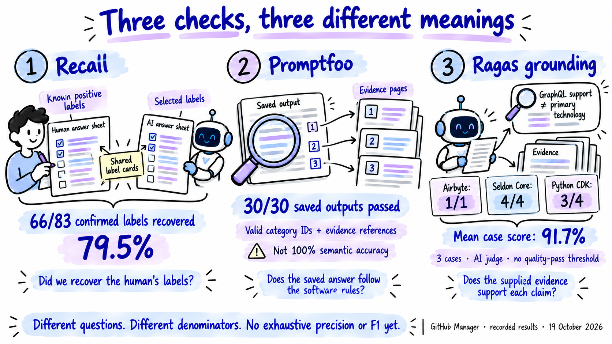

# GitHub Manager evaluation — public illustration kit

**Recorded results: October 19, 2026.** Three standalone illustrations explain the collection, the main evaluation result and the different validation questions. Use the selected PNG files below with their captions. The nine original quantitative charts and the previous guide remain preserved.

These illustrations use the project's [illustrated-explainers skill](../../../../skills/illustrated-explainers/SKILL.md): white paper, dark ink, semantic objects, and blue/indigo with restrained purple marker accents. The built-in image-generation tool created three first versions and one targeted correction. No application classification or judge API call was added; the closed fifty-attempt evaluation remains unchanged. This local kit has not itself been uploaded or published by this update.

## 1. How we built the collection

**Suggested caption:** We assembled an English-first collection of 600 public repositories, with sixty in each of ten sampling areas. The refresh retained 489 and added 111 replacements. Thirty selected human-confirmed repositories supplied the 83 positive assignments used for classifier-quality scoring; the other 570 supplied processing diagnostics for this evaluation.

**Keep this qualification:** Balanced acquisition is not a representative random GitHub sample or six hundred human-approved answers. Some repositories outside the final reviewed thirty also have source curation or independent annotation proposals; “processing checks only” refers to their role in this classifier-quality result.

## 2. Where known labels were missed

**Suggested caption:** On thirty human-reviewed repositories, retrieval supplied 69 of 83 known positive labels and the model selected 66. Fourteen positive assignments were missing before generation, versus three supplied-but-not-selected. This points first to Topic candidate retrieval as the measured bottleneck.

**Keep this qualification:** This is recall of reviewed positive assignments, not exhaustive accuracy. Sixteen extra predictions remain unjudged. The diagram is an after-the-run scoring view: the human answer sheet was not a model input.

**Selected version:** Use the `-v2.png` file. The original is retained as a superseded draft. The correction adds the explicit scoring-only subtitle and replaces the misleading arrow into extra predictions with a plus sign. All numbers remain unchanged.

## 3. Three checks measure different things

**Suggested caption:** The workflow recovered 79.5% of the confirmed label assignments. Promptfoo replay passed the software rules for all thirty saved outputs. Ragas support judgements on three development cases averaged 91.7%. These numbers answer different questions and cannot be substituted for one another.

**Keep this qualification:** A valid evidence reference is not proof of support. Ragas is an AI judge, there was no automatic semantic pass threshold, and three cases do not calibrate its reliability. Exhaustive precision/F1 remain unavailable because extra/unselected labels are not fully adjudicated.

## Sources, prompts and reuse

- [Plain-language explanation and complete tables](../ground-truth-evaluation-explained.md)
- [Collection and named validation-test evidence](../walkthrough/evidence/collection-and-validation-details.json)
- [Recorded case-level results and judge statements](../walkthrough/evidence/observed-results.json)
- [Original generation prompts](prompts.json), [targeted correction prompt](correction-prompt.txt), and [asset/content manifest](manifest.json)
- [Preserved previous guide and all nine chart pairs](../history/plain-language-evaluation-v1-2026-10-19.zip)

The manifest records the actual pixel dimensions and fingerprints. These are the original generated PNG exports; no larger native resolution is claimed. The images include aggregate results and one public-repository example, without credentials, reviewer identity or copied complete READMEs. When sharing one image independently, preserve its scope/denominator notes and use the accompanying caption.
