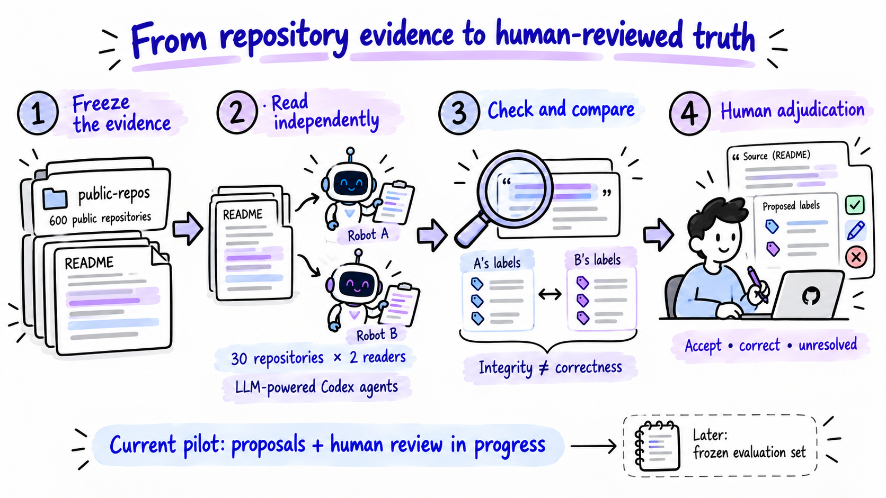
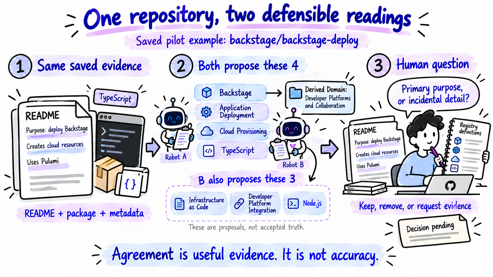

# Before We Can Evaluate AI, We Need an Answer We Can Trust

> **October 19 checkpoint: evaluations complete.** Read the [new results chapter](evaluation-results-2026-10-19.md) after this preserved October 18 narrative and its diagrams. Thirty real human confirmations now support local, Promptfoo and Ragas measurements: retrieval supplies **69/83 positives**, classification selects **66/83**, and three grounding scores average **0.9167**. Sixteen extra predictions remain unjudged; exhaustive precision/F1 are unavailable. See the [detailed report](../../docs/validation/ground-truth-evaluation-2026-10-19.md) and [aggregate statistics](evaluation-statistics-2026-10-19.json). Future-tense evaluation statements below describe the dated October 18 state.

*How GitHub Manager is building an evidence-backed repository reference set with independent AI readers, deterministic checks and human adjudication.*

**Living publication draft · October 18, 2026 · Revision 2 · Human review in progress.** The corpus and independent annotation pilot are implemented. A completed human-approved benchmark and its evaluation results are future work. Statistics below are a dated snapshot; [the evidence file](statistics.json) separates frozen experiment results from changing review progress. The [validation evidence and protocol](validation-evidence.md) retains the detailed checks, their limits and the next decision gates.

## A correct label is a relationship, not a keyword

Imagine trying to organize a few hundred GitHub repositories. Some are products, some are libraries, some demonstrate another framework, and some are deployment tools for a larger initiative. Their READMEs overlap: Python, APIs, cloud, data, Docker. Those words are useful, but they do not tell you what belongs together.

[GitHub Manager](../../README.md) helps a user discover repositories and organize them by purpose, technology and initiative. To evaluate that organization, we need a reference answer: what does each repository do, which labels are supported, and what evidence justifies the relationship?

Consider a real example from our pilot: `backstage/backstage-deploy`. It is a command-line tool for deploying Backstage and creating cloud resources. Belonging to the Backstage initiative is a different relationship from using TypeScript, and both differ from providing an application-deployment capability. A useful reference set needs to preserve all three distinctions.

That made ground-truth creation a system-design problem of its own. Reading and labeling six hundred repositories manually would require substantial attention. Asking one AI reader to produce an answer key would leave its mistakes difficult to detect. Our approach combines retained source evidence, two independent LLM-powered readers, mechanical validation, explicit comparison and targeted human review.

The aim is to make the human decision easier to inspect and correct. We have not yet measured how much review time this saves or how accurate the resulting reference set is.

*Figure 1. The implemented path reaches independent proposals and a working human-review interface. A frozen evaluation set is the next stage, not an already achieved result.*

## First, decide what the answer is allowed to mean

Before discovery, we created a seed vocabulary: broad Domains, named Project families and initial Topics. Source review later added technology Tags and more narrowly defined Topics. This vocabulary guided collection; it was never automatically an approved answer key.

The current proposed registry has **337 concepts: 10 Domains, 64 Projects, 166 Topics and 97 Tags**. Each concept has a stable ID, a definition and, where appropriate, aliases and a parent Domain. Definitions matter because two reviewers can agree on a word while interpreting its scope differently.

| Facet | The question it answers | What the reviewer must avoid |
|---|---|---|
| **Project** | Is this repository an actual implementation, component, extension or operating tool for a named product or initiative? | Treating a dependency, common owner or passing mention as membership. |
| **Topic** | What are its primary purposes or capabilities? | Promoting every example, planned feature or peripheral module into a primary capability. |
| **Tag** | Which primary technologies or properties characterize it? | Turning a long dependency list into a long list of claimed primary technologies. |
| **Domain** | Which broad areas follow from the supported Projects? | Assigning the collection's sampling bucket as if it were evidence. |

A repository may have multiple Projects, Topics and Tags. Its assigned Domains are the union of the parent Domains of its selected Projects. A repository with no supported known Project can still have useful Topics and Tags, with no derived Domain. Empty does not mean useless.

This is particularly important for independent projects and educational repositories. A book's Python/PyTorch code does not automatically belong to the PyTorch Project family. Likewise, “collected in our AI bucket” is a sampling decision, not proof of an AI Project relationship.

An unlisted label remains **unknown**, rather than a negative assertion. When a needed concept is missing from the registry, the reader records the gap instead of forcing the repository into its nearest familiar family. We will need explicit decisions about reviewed negatives and label completeness before using this set for conventional precision/recall calculations.

## Build a collection worth reading

The first collection gave us six hundred candidates, but the later review exposed a practical problem: some repositories did not provide an adequate English primary narrative, and others did not fit their proposed sampling domain strongly enough. We preserved that first version and created an English-first release with separate eligibility decisions and exclusions.

Two collection agents divided ten sampling domains: AI, cloud, commerce, data, developer tools, education, finance, healthcare, science and security. They screened language, inspected purpose-bearing evidence and replenished missing coverage. The resulting release has **600 distinct public repositories, exactly 60 per sampling domain**. It retains 489 original repositories and adds 111 replacements. Two retained repositories moved to more appropriate sampling buckets.

The 111 removed original active entries do not all represent bad repositories: 77 had substantive non-English primary narratives, 18 had inadequate or off-domain evidence, and 16 were valid English repositories held in reserve to improve balance. A reserve is not a negative label. Names, code, translation links and ordinary Unicode were not treated as language failures.

This balance helps us inspect performance across broad areas later. It does not make this a random sample of GitHub. Discovery choices, available source material and our proposed vocabulary shape the collection. Family membership is also uneven: 308 repositories have at least one supported Project proposal; others have useful evidence without a supported known family.

| Retained corpus evidence | Current release |
|---|---:|
| Distinct repositories | 600 |
| Complete README snapshots | 600 |
| Supporting files | 1,223 |
| Source bytes | 18,436,109 |
| Original curation: complete README semantic reads | 88 |
| Original curation: targeted/partial README reads | 512 |
| Independent curation peer audits | 120 distinct cases |

Retaining a whole README is different from reading it semantically. A language scan or an extracted quotation is not a claim that an agent understood every paragraph. Recording that distinction became one of the most useful controls in this work.

Files are tied to a GitHub numeric repository identity, Git commit, path and SHA-256 hash. Metadata is retained as an acquisition-time snapshot; it is not made commit-immutable merely by placing it beside pinned files. Historical successful snapshots can be reused with their provenance intact. These controls give reviewers a stable object to inspect even if GitHub changes tomorrow.

The collection also contains explicit coverage gaps. Supported proposals cover 63 of the 64 Projects and 160 of the 166 Topics. The missing Trivy acquisition followed pinned-source HTTP 403 responses; that limited event does not prove a general OAuth access failure. Missing positives for six Topics can reflect selection or incomplete annotation, rather than absence of those capabilities everywhere in the corpus. [The release report](../../docs/validation/corpus-600-v2-review-2026-10-17.md) records the details.

## Keep collection checks separate from independent annotation

The 120 curation peer audits checked selected eligibility and annotation claims across the two collection cohorts. They are useful historical quality controls. They are not the later double-annotation pilot, and they are not human review.

For the semantic pilot, we selected **30 development repositories: three from each domain**. A fixed SHA-256 ordering of numeric repository IDs made the selection reproducible. It did not inspect old purpose summaries, expected labels or production predictions. The pilot did not use the provisional validation or held-out repositories.

Each of two new readers received the same source-first material:

| Supplied to each reader | Explicitly withheld |
|---|---|
| Full saved README text and retained supporting files | Original corpus label proposals and purpose summaries |
| Whitelisted saved GitHub metadata | The other reader's annotations |
| The full 337-concept registry and definitions | Production predictions and the production retriever's shortlist |
| Annotation policy and strict output schema | Comparison results before completion of the independent pass |

Across the thirty packets, this meant 30 README channels, 66 supporting-file channels and 30 metadata channels: **126 channels containing 810,821 source bytes**. Saved packets are a retained subset, not the entire live repository. Repository text is evidence, including when it contains instructions; it cannot override the annotation policy.

Giving reference readers the full registry is intentional. If the same retriever supplied both our classifier's candidate labels and our answer key, a missed candidate could disappear from both, making the system appear better than it is. The pilot avoids that particular coupling. Registry definitions were curated with access to corpus sources, without a proven development-only boundary, and earlier exploratory outputs across the original 600-repository v1 collection were already inspected. The reserved v2 partitions are therefore not a pristine external or unseen-registry holdout. A later freeze can protect subsequent model-selection comparisons; it cannot erase earlier exposure.

## Where the LLM is in this workflow

The readers are **LLM-powered Codex agents**. They read source text, interpret purpose and relationships, consult the definitions, and author structured annotations. We are not claiming that a non-LLM program reproduces semantic understanding.

The user chose to use the agents' existing intelligence for this pilot. We therefore made **zero additional external provider API requests**, with **$0 incremental external API spend recorded for this pilot**. This is not zero computational cost: agent allowance and token consumption were unmeasured, and an exact serving-model identifier was unavailable in the producer records. There is no invented token bill, model comparison or separate extra “LLM judge” stage.

For each repository, a reader saves a purpose summary, supported label IDs, label-specific rationale and exact citations. It also records missing concepts, conflicts, caveats and per-file reading intervals. That is how the interpretation becomes reusable: the next reviewer sees a structured knowledge record with its supporting text and limits, rather than an unsupported summary.

These records preserve an inspectable interpretation. They do not preserve every possible fact about a repository, hidden model reasoning or a guarantee of complete understanding. Both readers may use closely related models and share the same vocabulary and policy. Their work is independently produced, but their errors are not necessarily statistically independent.

## Follow one repository through the process

Our saved `backstage/backstage-deploy` packet is pinned to commit `f9f28b08e9c7df14495c84a773081d8a37446d3b`. Its README describes a CLI to deploy Backstage and says it uses Pulumi to create the necessary resources. The packet also includes `package.json`, retained public metadata and a license. This is an observed pilot example, not a synthetic illustration.

One short exact README excerpt is:

> CLI to help deploy Backstage on a specified cloud provider.

The surrounding README provides the provisioning context. The package identifies its role as a Backstage CLI and contains its implementation/dependency configuration. The public snapshot identifies TypeScript as the primary language. These are different evidence channels, not interchangeable README quotations. [Pinned README](https://github.com/backstage/backstage-deploy/blob/f9f28b08e9c7df14495c84a773081d8a37446d3b/README.md) · [Pinned package manifest](https://github.com/backstage/backstage-deploy/blob/f9f28b08e9c7df14495c84a773081d8a37446d3b/package.json).

The transformation is concrete:

| Stage | Input → operation → output | Why it matters |
|---|---|---|
| Read | Same pinned packet + full definitions → interpret the repository's actual role → a purpose summary and proposed relationships | The task is understanding a deployment tool, not counting mentions of Backstage. |
| Annotator A | Source-backed interpretation → four positives | Backstage; Application Deployment; Cloud Provisioning; TypeScript. |
| Annotator B | Independent source-backed interpretation → seven positives | The same four, plus Infrastructure as Code; Developer Platform Integration; Node.js. |
| Validate | IDs, hashes, quotation text and coordinates → deterministic checks → structurally valid proposals | A check can establish that the cited text exists; it cannot decide whether Node.js deserves a primary Tag. |
| Compare | Canonical positive-ID sets → intersection and differences → four agreed and three B-only candidates | Review can focus on the actual semantic boundary. A's omission is not an explicit negative. |
| Human adjudicate | Source + definitions + both proposals → accept, correct or leave unresolved → a version-bound review | No final human decision for this example is implied by this article. |

Both readers found a real Backstage relationship, so the proposed Domain derives from that Project: **Developer platforms and collaboration**. The Topic and Tag candidates are parallel descriptions; they are not children of the Project in a classification hierarchy.

The disagreement is useful. Is programmatic Pulumi provisioning a primary Infrastructure as Code capability? Is Node.js a primary technology here or a runtime detail insufficiently central for this registry's Tag policy? Does Developer Platform Integration add a distinct supported purpose? The reference set improves when a reviewer resolves those questions consistently across cases, rather than automatically preferring the longer list.

*Figure 2. “Defensible readings” means proposals with inspectable rationale, not an endorsement of every proposed label. The source text in the illustration is paraphrased. The exact label sets and source bindings are in [the worked-example record](worked-example.json). Human adjudication remains pending.*

Another pilot case, `rasbt/LLMs-from-scratch`, illustrates why a missing Project can be correct. Both readers proposed four Topics—Learning Content, Model Training, Deep Learning and Natural Language Processing—and three Tags—Python, PyTorch and Jupyter Notebook. Neither asserted a known Project family. Its use of PyTorch did not establish membership in the PyTorch initiative. [The pinned educational repository](https://github.com/rasbt/LLMs-from-scratch/tree/cdbd33e6d57a71e20ea31434841095fac50cecd8) supports the example. These are the recorded agent proposals; this example makes no claim about a final human outcome.

## What software can check—and what it cannot

The coordinator is deterministic. It checks packet/release bindings, known canonical IDs, exact quotation containment, source hashes and inclusive line coordinates. It rejects duplicate or malformed rows, fake evidence, incomplete sample coverage and direct Domain assignments. Its reading-ledger checks reject a declaration of complete coverage when the recorded intervals do not support it.

These checks are essential because a convincing annotation with a fabricated source is costly to review. But they are integrity checks. A quotation can be real and still fail to support a label. A dependency can really exist without defining the repository's primary purpose. A reader can record a valid interval without that proving comprehension.

Once both passes are valid, comparison uses canonical concept IDs. It retains shared positives, A-only positives and B-only positives by facet, with declared scope and reasons for review. The original corpus proposals remain a separate artifact; comparison does not quietly replace them or any human decision.

| Pilot observation | Result | Interpretation |
|---|---:|---|
| Independent annotation records | 60 for 30 repositories | Two completed proposal passes. |
| A / B positive decisions | 153 / 187 | Reader B proposed more labels; more is not automatically better. |
| Shared positive repository/concept pairs | 148 | Agreement on those particular positive decisions. |
| A-only / B-only pairs | 5 / 39 | Specific review candidates, not measured false positives or false negatives. |
| Exact full-set agreement | 5 / 30 repositories | Consistency between readers, not accuracy against human truth. |
| Project / Topic / Tag exact-set agreement | 28 / 30; 10 / 30; 19 / 30 | Of the 28 agreeing Project sets, 12 are both empty and 16 share the same nonempty set. |

We do not report precision, recall, F1 or a calibrated confidence score for this pilot. The human reference needed to calculate them is still being created.

The empty-set distinction is practical. “Both readers found no supported known family” is useful, but it is not a positive family match. Counting those twelve cases as twelve additional correct family assignments would change the meaning of the observation. We retain the sets and denominators so later analyses can ask the right question without rewriting the original evidence.

## Reading coverage changed how we interpret confidence

Annotator B declared reading all 126 supplied channels. Annotator A recorded reading 109: every README, metadata snapshot, supporting prose and configuration/manifest, while leaving seventeen license or trademark-license artifacts unread. Under the pilot's strict whole-packet rule, A therefore declared complete supplied scope for fourteen repositories and partial scope for sixteen.

The coordinator assigned **2 Green, 12 Amber and 16 Red** review bands. Green requires agreement, valid evidence, complete declared scope and no noted conflict or missing concept. Amber flags disagreement or uncertainty. Red flags incomplete supplied reading in this run.

Those names are routing signals. They are not probabilities, and Red does not mean sixteen labels were proved wrong. In fact, the educational example above has complete label-set agreement but is Red because A did not read its retained license. The reason must travel with the color.

This exposed a useful improvement for the next run: define which retained files are required semantic evidence for which decisions. A license may be essential for a licensing claim while contributing little to a primary-purpose decision. We should preserve whole-packet reading scope and separately state required-purpose evidence coverage. That policy must be declared before rerunning or changing bands; silently regrading this run would erase the lesson.

## Make human review a decision, not a second data-entry job

The app's **Public - Ground Truth** workspace puts the queue, grouped label editor and evidence beside one another. A reviewer can compare the independent annotations, stage one as a starting point, correct the purpose or labels, and inspect saved source text. Staging is an explicit editing action; it does not save a final decision or manufacture human approval.

The interface now makes the coverage boundary visible. **Agent A & B inputs** appears near the top of a pilot repository, with a separate purpose summary and label suggestions from each reader. **Compare independent annotations** opens their rationale, evidence, differences and reading scope. The other **570 repositories have original corpus proposals, but no independent A/B annotation**. An original recommendation is not two-agent agreement.

The searchable **Repository review scope** control separates **All repositories · 600**, **Initial human review · 20**, and **Agent A/B pilot · 30**. Opening a pilot card selects the corresponding scope, and **Confirm & next** remains in it. This corrected an earlier navigation problem where a reviewer could advance out of the pilot and reasonably wonder where the two agents' inputs had gone. Selection is applied before pagination; unavailable pilot integrity fails visibly instead of silently broadening the queue. [Implementation and isolated verification](../../docs/validation/ground-truth-agent-inputs-2026-10-18.md).

The initial queue has twenty cases: **10 risk-selected, 2 random Green agreement cases and 8 deterministic random fill cases**. Only two cases met the strict Green rule. The fill cases remain separately identified; they are not relabeled as Green to make the sampling plan look cleaner. All thirty pilot repositories are available.

Risk selection helps find ambiguity. Random audits matter because two readers can agree on the same mistake. Results from those groups must be reported separately: a targeted queue is designed to contain difficult cases, so its correction rate is not a population error estimate. A small random audit will also have wide uncertainty.

*Figure 3. The queue is a review policy, not a quality score. The paper cards are illustrative, not an actual queue screenshot. Drafts never count as confirmed references.*

The practical review sequence is short:

1. Choose **Public - Ground Truth → Repository review scope → Initial human review · 20**, then open a repository. Understand its purpose from the retained README and relevant supporting evidence.
2. Compare A and B against the registry definitions. Check Projects, Topics and Tags directly; inspect the Domains derived from supported Projects.
3. Stage a starting proposal if useful, then remove unsupported positives or add known missing labels. New positives require an exact saved-source quotation. Record missing concepts and uncertainty rather than forcing an answer.
4. Deliberately acknowledge the three reviewed groups. **Confirm & next** saves a confirmation before advancing. **Save draft** preserves unfinished work. **Needs evidence** records an explicit unresolved decision.

Purpose edits invalidate the relevant review acknowledgements; so do affected label/evidence edits. Concurrent edits are revision-checked, and unsaved navigation is guarded. A failed fetch of the next repository can be retried without repeating the successful save. These are workflow controls that protect the provenance of a decision, not guarantees that the decision itself is correct.

Review records are separate from source snapshots and agent proposals. A record binds the dataset release, manifest, repository, commit, original proposal, revision and actor; pilot-staged records also bind the pilot sidecar. Revision history is retained. Export contains the signed-in reviewer's final decisions; incomplete drafts are separate.

Confirmation has a specific meaning in the current app: a human saved a purpose, a positive-label set and the three group-review acknowledgements. It does **not** record an explicit negative/unknown judgment for every other registry concept, a formal completeness declaration or independent expert consensus. Those additional reference semantics need a later protocol and adapter before an exhaustive classifier score is defensible.

## Where we stand today

The October 18, 2026 read-only application snapshot, captured at 22:09 America/New_York, contains **five human-confirmed corpus records and zero incomplete drafts**. Four confirmations are outside the thirty-repository double-annotation pilot, and one is inside it. Therefore, **1 of 30 pilot cases and 1 of the initial 20 queue cases are human-confirmed in this snapshot**. None of those five records carries a pilot-annotation binding. That last field records a staged annotation context; its absence does not establish whether a reviewer consulted A or B. The earlier three- and four-record snapshots are preserved in the package history.

This distinction matters. The frozen pilot summary records zero human confirmations at pilot creation. It should remain a historical result; it is not a live counter. The application is the source for changing human-review progress, and the immutable comparison files are the source for the independent-reader experiment.

| Layer | Completed | Still required |
|---|---|---|
| Corpus | English-first 600-repository release, retained sources, eligibility and provenance | Continued review of ambiguities and coverage gaps. |
| Proposed taxonomy | 337 defined concepts and proposed relationships | Human resolution of definitions/gaps and a later frozen version. |
| Semantic pilot | 30 development repositories, 60 independent annotation records | Human adjudication and audit analysis. |
| Review interface | Compare, stage, edit, evidence, drafts, confirmation, revisions and export | Actual review decisions and review-effort measurement. |
| Benchmark | Provisional grouped partitions | Frozen references, evaluation protocol and measured results. |

The redesign changed how review happens, not what the frozen readers said. Source corpus, pilot annotations and previous benchmark/readiness artifacts were preserved. Functional QA uses disposable test identities and databases; its scripted confirmations do not enter the real human-review count.

## Validation has several jobs, and each needs its own evidence

For our Backstage example, a valid source hash answers “is this the saved README?” A real quotation answers “does this passage exist?” Neither answers “should Node.js be a primary Tag?” That last question needs a policy-aware reading and, for this reference set, human adjudication. A working save button answers another question again: “was the review recorded safely?”

We therefore keep the layers separate:

| Validation layer | Completed evidence | What it establishes | What remains |
|---|---|---|---|
| Corpus/source integrity | Versioned manifest; source hashes; 1,746 curation evidence items checked against recorded read intervals; 120 curation peer audits | Evidence bindings and inspected source/eligibility claims are traceable. | Exhaustive semantic understanding and human-approved labels. |
| Independent annotation | 60 schema/evidence-validated records; 126 source channels; two source-first passes | Both readers produced inspectable proposals against the same registry and sources. | Human resolution of interpretation and completeness gaps. |
| Comparison and review routing | 5/30 full-set agreement; 2 Green/12 Amber/16 Red; twenty-case queue with separate sampling reasons | Disagreements and declared evidence limits are exposed. | Calibrated acceptance bands or an accuracy claim. |
| Review software | Latest dated run: 57 backend checks and 12 isolated Ground Truth suite checks; static checks and production build passed | Isolation, provenance, editing, persistence, scope and recovery behave as tested. | Whether a human's saved semantic decision is correct. |
| Preservation | Latest dated check: 548 protected artifact hashes unchanged; legitimate new user review retained by exact read-only reconstruction | UI work did not replace corpus/pilot evidence or roll back user progress. | A future frozen reference release and quality estimate. |
| Human reference quality | Five corpus confirmations, including one in the pilot and initial queue | Review is possible and real decisions are being saved. | The remaining nineteen initial-queue confirmations or explicit unresolved outcomes, audit analysis and policy decisions. |

The twelve-check Ground Truth suite includes a deterministic palette assertion as well as browser journeys; it is not twelve independent accuracy experiments. Historical run sizes also differ: the pilot handoff reported a 190-test backend run, while the later 57-check run targeted corpus, annotation, draft, scope and fixture boundaries. We retain dates and scopes rather than adding those overlapping counts together. The [validation appendix](validation-evidence.md) maps each completed run to its report and distinguishes package QA from application QA.

Operational reliability is relevant to reference quality because a reviewer must know whether a decision saved. Session warnings now allow a still-valid session to be extended, saved drafts are separate from confirmations, expiry returns the app to sign-in, and uncertain mutations are not silently replayed. A fixture-port incident during earlier QA briefly exposed a test account at the normal localhost URL; the real app was restored and future tests isolated to separate ports/builds, with guards on fixture entrypoints. This incident and its preservation checks are [documented](../../docs/validation/session-sync-recovery-2026-10-18.md), rather than omitted from the evidence trail.

The retained evidence and proposed releases live in ignored local files under `docs/validation/private/corpus-600-v2/`, with references to unchanged v1 source snapshots where reused. Human decisions and drafts persist in owner-scoped SQLite application state. Public methodology is in versionable Markdown and code. This package publishes aggregate facts and small public-repository examples, not private account details or the entire retained corpus.

## The next result should come from review, then evaluation

The immediate task is to complete review of the initial twenty pilot cases and record corrections with their reasons. One is confirmed at this snapshot; nineteen remain without a confirmation. We should distinguish wrong family membership, incidental capabilities, technology granularity, missing concepts and insufficient evidence. Those categories explain which part of the system needs work; a single aggregate disagreement number does not.

After that, the planned sequence is:

1. **Adjudicate policy, not just cases.** Resolve recurring interpretation differences and version any registry or annotation-policy changes. Retain old decisions and bindings rather than overwriting history.
2. **Examine the audits separately.** Report targeted-risk, random-Green and random-fill outcomes with their denominators. Use observed outcomes to decide further review effort; do not invent a confidence threshold from agreement alone.
3. **Extend a bounded development batch after the initial review checkpoint.** Preserve independent passes and random audits. Measure reviewer corrections, unresolved rates, evidence sufficiency and time/interaction effort. Decide from the initial twenty cases whether to review the remaining ten or gather more development cases; there is no new sixty-case prerequisite and no automatic promotion of the other 570.
4. **Freeze a reference release.** Settle reviewed-positive/negative/unknown semantics and completeness scope; freeze source, taxonomy and decisions. Preserve related families, owners, lineage and detected near-duplicate groups across partitions. Current provisional partitions are 180 development, 120 validation and 300 reserved repositories, or 18/12/30 per sampling domain. “Reserved” protects later use under a declared protocol; it does not establish that those sources and earlier exploratory results were never seen.
5. **Evaluate the actual application in stages.** First ask whether candidate retrieval includes reviewed supported labels. Then ask whether classification selects supported labels from those candidates. Separately measure evidence support, schema validity, abstention/unknown handling, and application behavior. Report facet/domain/family results alongside overall results, with uncertainty and sample sizes.

These future evaluations can distinguish a retrieval failure from a generation mistake. If a correct Project never reaches the classifier's candidate list, changing the generation prompt may not fix it. If the evidence is present but a dependency becomes membership, the problem lies in interpretation or policy. If the human reference is itself incomplete, a missed label may be an answer-key problem. Ground-truth provenance makes those diagnoses possible.

The first human analysis should remain understandable: how many cases were reviewed in each queue stratum, how many needed changes, what changed by facet, and how many could not be resolved? For example, removing a proposed Node.js Tag because it is incidental is a different correction from discovering a missing Project family. Record the reason and the source, not only a changed-label count. Compare A and B separately against adjudicated decisions; do not treat the human's staged starting choice as proof that the chosen reader was right.

Small samples need restraint. Two Green agreement cases cannot establish a dependable future auto-acceptance rate. A targeted queue is enriched for risk, and related repository families can share the same error. Report counts and denominators before percentages, separate the sampling groups, and use uncertainty estimates appropriate to the eventual random/clustered design. Review effort and time remain proposed measurements; no labor-saving estimate is available yet.

Before scoring classification, supplement the app's positive decisions with explicit judgments for the claims being evaluated and a declared completeness scope. Predicted labels outside the reviewed positives need adjudication, not automatic false-positive status. An unselected concept stays unknown unless reviewed as unsupported. Evaluate retrieval at fixed candidate budgets using the reviewed supported IDs; evaluate selection/generation against the judged candidates; evaluate evidence support separately. Only a reference protocol with sufficient positive and negative decisions supports the corresponding precision/recall/F1 interpretation.

The budget policy follows the same principle of explicit scope. The English-first cleanup used 902 upstream HTTP attempts, including nine searches, under separate ceilings of 6,000 attempts, 120 searches and 512 MiB of newly retained content. These are collection limits, not desired spending targets. The independent annotation pilot added no provider API requests, while agent allowance/token cost is unmeasured. Future paid judge/model comparisons need their own approved call/token/cost limits; the earlier readiness experiment's allowance is not an automatic budget for this corpus. None is required to begin the already available human-review queue.

No Jev decision model, separate automated judge or completed RAG-evaluation framework is part of this pilot. We should choose any future tooling around these actual artifacts and decision boundaries. Existing synthetic safety fixtures still matter for controlled failure cases; a public-repository corpus complements them rather than replacing every test.

The useful outcome is an answer key whose decisions can be traced, questioned and improved. Two readers give us disagreements worth examining. Deterministic checks keep the evidence inspectable. Human adjudication turns supported proposals into explicit reference decisions. Evaluation becomes credible when we preserve those boundaries all the way through.

## Evidence and update notes

This draft describes local implementation and retained observations, not an independent scientific validation or a claim of novel annotation theory. The process has not yet been measured against an expert-labeled comparison set, and no engagement, labor-saving or accuracy gain is claimed.

- [Corpus release and reading-scope report](../../docs/validation/corpus-600-v2-review-2026-10-17.md)
- [Independent pilot results and live review handoff](../../docs/validation/agent-annotation-pilot-2026-10-17.md)
- [Annotation methodology and output contract](../evaluation/annotation-pilot/README.md)
- [Bounded review API and draft contracts](../../docs/planning/corpus-review-workflow-api.md)
- [Live redesign verification](../../docs/validation/live-workspace-redesign-2026-10-17.md)
- [A/B visibility, 600/30/20 scoping and latest validation](../../docs/validation/ground-truth-agent-inputs-2026-10-18.md)
- [Session recovery, test-isolation incident and preservation](../../docs/validation/session-sync-recovery-2026-10-18.md)
- [Detailed completed validation and next protocol](validation-evidence.md)
- [Machine-readable statistics and provenance](statistics.json), [worked example](worked-example.json), and [update instructions](README.md)

The snapshot's calendar date follows America/New_York. Machine evidence records its actual capture timestamp separately. Future updates should retain a dated history and keep frozen experiment observations separate from live review counts.
