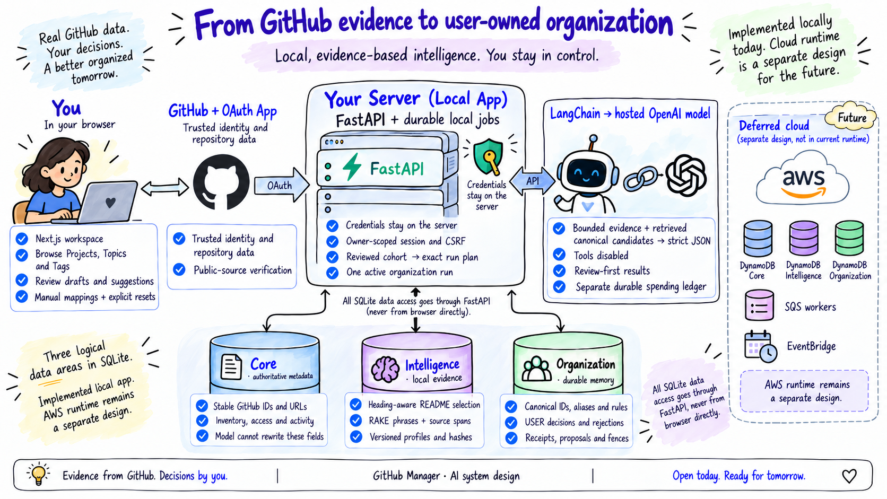
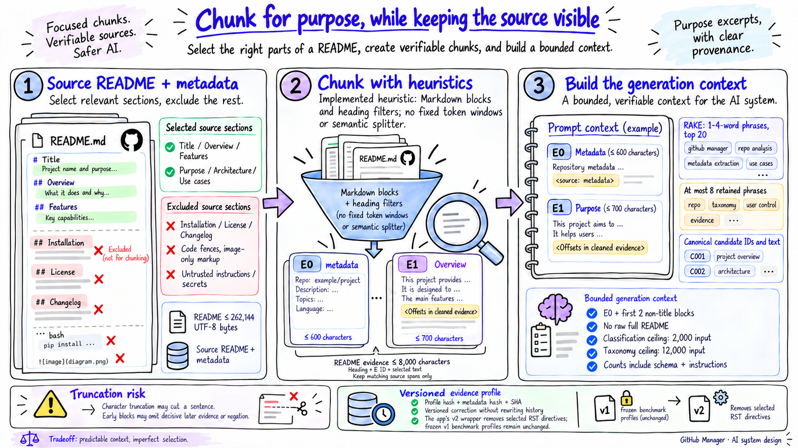
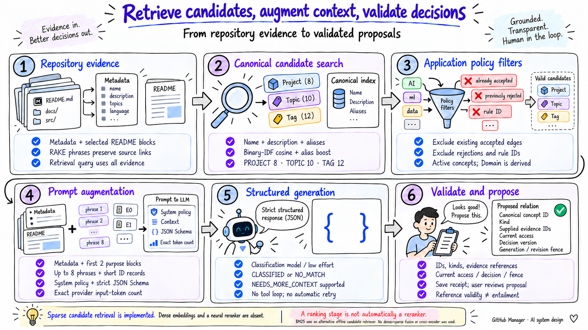
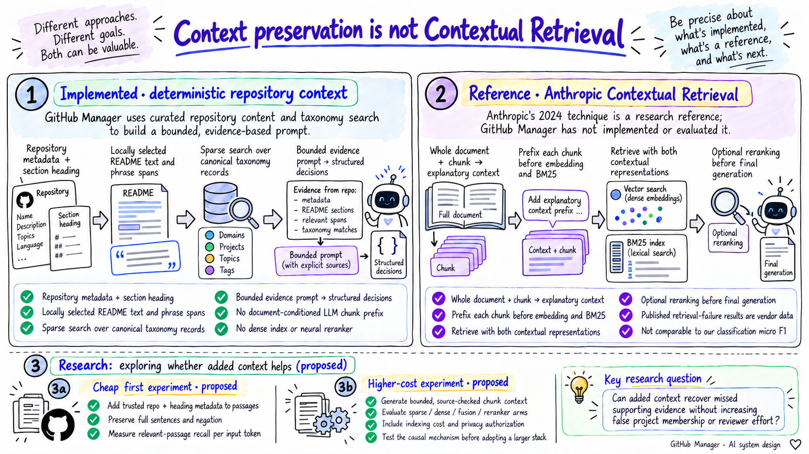
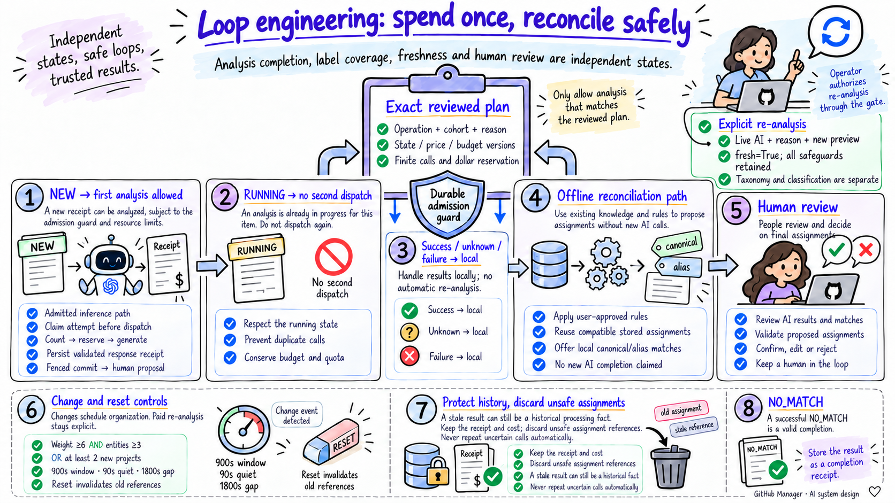
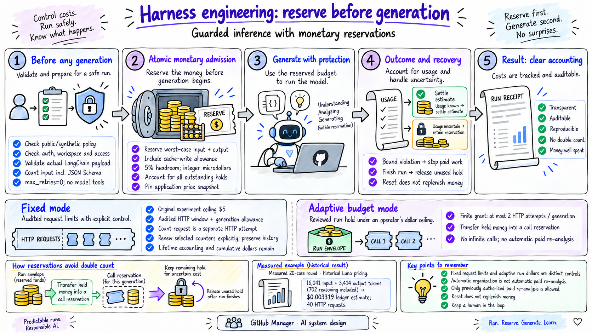
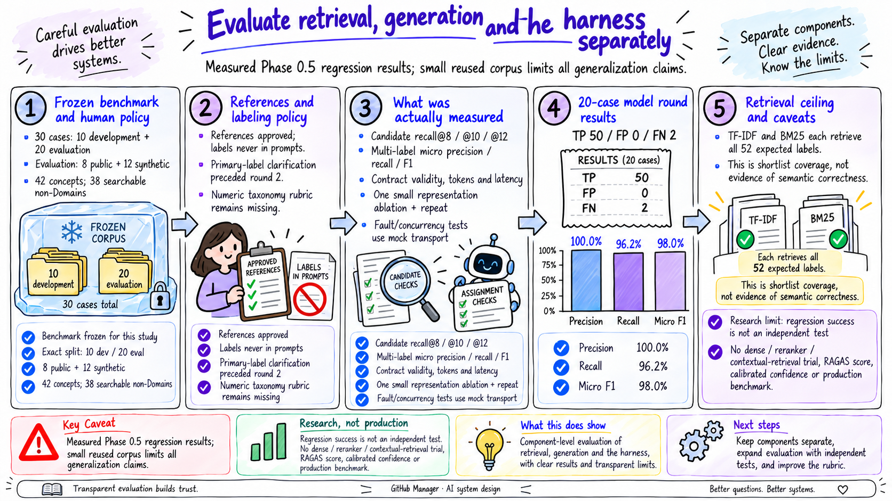
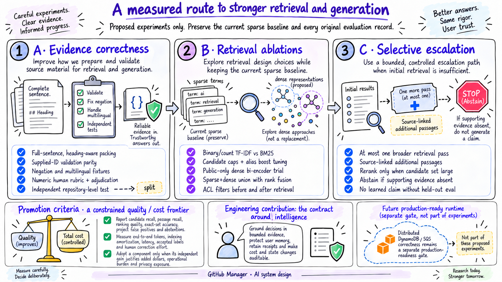

# Engineering a Repository Organizer Around Bounded Evidence

## Context, retrieval, controlled loops and auditable inference in GitHub Manager

**Illustrated edition.** The same audited case study, with explanatory illustrations matching the project’s original hand-drawn diagrams. The [academic edition](../github-manager-ai-system-design.md) and its exact-label block diagrams remain unchanged. Illustrations clarify the concepts; the source-linked text and measurements define the technical claims.

**Article type:** reproducible engineering case study and research agenda  
**Audit date:** October 14, 2026  
**Implementation baseline:** `3ffac3f1ed6618b80045c3ffafc050f50d102d10`  
**Evidence:** source inspection, frozen public/synthetic experiments and dated validation reports. No new repository-classification or taxonomy inference was performed for this article. Illustrations were created separately with the built-in Image Generation tool.

### Abstract

Organizing a personal GitHub collection requires more than predicting technology labels. A repository can participate in several initiatives, share a framework with unrelated projects, retain useful topic labels without belonging to a project, or have insufficient evidence for any assignment. The organizer must also preserve user decisions, respect source-access policy and avoid paying repeatedly for the same analysis. This case study examines GitHub Manager's implemented local system: heading-aware README selection, source-linked RAKE phrases, sparse retrieval of canonical taxonomy candidates, bounded LangChain prompts, provider-native structured output and transactional application validation. The system is best described as retrieval-augmented structured classification with durable application memory and a deterministic controller. It does not deploy embeddings, a vector database, a neural reranker, autonomous retrieval agents or Anthropic Contextual Retrieval.

On a frozen 20-case regression partition containing eight public and twelve synthetic repositories, the latest real API round produced 50 true-positive assignments, no false positives and two false negatives: micro precision 100%, recall 96.2% and F1 98.0%. It consumed 16,041 input and 3,414 output tokens and recorded an estimated \$0.003319 under its historical pricing method. These observations establish bounded feasibility, not independent generalization: the corpus was small, reused and partly involved in clarifying the labeling policy. The principal engineering contribution is the integration of evidence provenance, canonical identity, explicit re-analysis, durable processing receipts, generation fences and conservative spending admission. We distinguish those implemented mechanisms from proposed retrieval improvements and outline experiments needed before broader automation.

**Keywords:** repository classification; context engineering; sparse retrieval; RAKE; BM25; canonical taxonomy; structured generation; human review; inference budgeting; evaluation leakage.

---

## 1. Problem statement: useful organization without invented relationships

A personal GitHub collection mixes owned repositories, collaborations, favorites, experiments and reusable libraries. Names, languages and native GitHub topics help discovery, but do not establish organizational meaning. Two FastAPI services might belong to unrelated products. A compliance component might support both a clinical platform and an audit initiative. A public framework may deserve a topic and technology label while having no relationship to any personal project.

The application therefore answers a constrained question:

> Given an accessible repository, bounded source evidence, a user-owned canonical taxonomy and existing user decisions, which supported associations should be proposed—and which should be left unassigned?

This differs from open-domain question answering. The desired output is a small set of typed canonical IDs, source references and short reasons. The model must not rewrite GitHub metadata, invent a project, assume membership from a common technology, reverse a rejection or turn an uncertain response into accepted state.

### 1.1 Four types with different semantics

| Type | Meaning | Repository relationship | Example |
|---|---|---|---|
| Domain | Broad business or technical area | Derived through the repository's Projects | Healthcare |
| Project | A logical product, initiative or related solution | Many-to-many; each Project has one primary Domain | Orion Clinical Platform, an authored fixture |
| Topic | Cross-cutting capability or subject | Independent many-to-many association | Web APIs, Audit Logging |
| Tag | Technology or descriptive label | Independent many-to-many association | Python, React |

GitHub-native `topics[]` remain trusted source metadata. They are evidence for local classification, not automatically canonical local Topics or Tags. The classifier returns Project, Topic and Tag IDs; direct Domain assignments are rejected. A repository's Domains are the union of its active Projects' Domains. This prevents contradictory direct and derived memberships. [I05, I19, D01](../evidence-index.md)

### 1.2 The user-facing problem that changed the controller

An earlier interface called repositories without Projects “unclassified.” That conflated four independent conditions:

1. **Coverage:** accepted labels and Project membership.
2. **Processing:** whether actual AI analysis has already occurred.
3. **Freshness:** whether the recorded inputs and taxonomy still match current state.
4. **Review:** whether proposals await a decision.

A repository can be analyzed successfully, have accepted Topics and Tags, and still have no Project. `NO_MATCH` can also be a correct model outcome. Treating either condition as unfinished AI work creates repeated inference with little prospect of new information. The later implementation persists analysis receipts separately from memberships and shows these conditions separately. This is an optimization rooted in product semantics, rather than prompt shortening alone. [E05, D04](../evidence-index.md)

## 2. Scope, evidence and architecture

The implemented Phase 0.9 app runs locally with Next.js, FastAPI and a single-process durable SQLite job runner. SQLite holds owner/collection-scoped Core, Intelligence and Organization aggregates. GitHub OAuth App credentials remain in server memory; durable organization state survives a restart, while the user must authenticate again. A separate SQLite ledger retains inference accounting and replay records. The bounded adapter supports up to 500 concepts and thirty repositories per organization run. These are implementation bounds, not measured scaling limits. [I22, D02](../evidence-index.md)



*Figure 1. Actual local architecture. The approved production design uses three DynamoDB tables, SQS workers and EventBridge. Those cloud components must not be inferred to be the deployed application runtime from the earlier architecture illustration.*

The distinction matters because successful AWS resource pre-tests do not establish production distributed-worker correctness. Cloud IAM, queue leases, conditional DynamoDB writes, throughput and operational recovery remain separate implementation and evaluation work.

### 2.1 Evidence classes used throughout the article

| Class | What it can establish | What it cannot establish |
|---|---|---|
| Source inspection | Current algorithm, branches, bounds and data contracts | Real-world quality or live-provider behavior by itself |
| Frozen public/synthetic API records | The observed results, tokens and latency for those requests | Broad accuracy, current account access or future model behavior |
| Mock transport and local tests | Behavior under the tested failures and interleavings | Live-provider quality or distributed-cloud guarantees |
| Human reference approval | Agreed labels and semantics for the benchmark | Multi-rater agreement or a numeric taxonomy-quality score |
| Design and historical discussion | Intent, alternatives and reasons for constraints | Proof that a proposed mechanism shipped |

The [evidence index](../evidence-index.md) maps claims to source entry points and reports. [Aggregate measurements](../measurements.json) are recomputed from existing public/synthetic records; [source hashes](../source-manifest.json) identify the inspected artifacts. Raw READMEs, private account inventory, credentials and model responses are not included in this publication package.

## 3. What type of RAG is this?

The original RAG work combines retrieved non-parametric information with a generative model. GitHub Manager shares the retrieval-augmentation pattern, but does not reproduce that paper's trained retriever/generator architecture. Its external knowledge is a canonical taxonomy and locally extracted repository evidence, and its output is structured classification. [Lewis et al., 2020](https://arxiv.org/abs/2005.11401)

| Description | Applicability to the implemented app | Qualification |
|---|---|---|
| Simple retrieval-augmented generation | **Yes, in the broad workflow sense** | Retrieve candidates → assemble evidence → generate structured assignments → validate. It is not a conversational document-QA system. |
| Adaptive RAG | **No, as a demonstrated research implementation** | Deterministic routing adapts work admission and spending. The app does not learn query complexity or automatically choose a researched multi-step retrieval strategy. |
| Agentic RAG | **No** | The model cannot call tools, browse, select a retriever or iterate an autonomous search plan. |
| RAG with memory | **Qualified yes: application state** | Canonical concepts, user decisions, rejections, rules, profiles and receipts persist. There is no LangChain conversation-memory component or semantic episodic-memory index. |
| Hybrid dense/sparse RAG | **No** | Sparse retrieval plus an LLM is not dense/sparse fusion. There is no embedding query or vector search. |
| GraphRAG | **No** | Domain–Project relationships are application structure; there is no graph-community summarization or graph retrieval engine. |
| Anthropic Contextual Retrieval | **No** | There is no document-conditioned, model-generated chunk prefix indexed with embeddings and BM25. |
| Fine-tuning | **No** | The project configures hosted models; it does not train a custom classifier, retriever or model adapter. |

Adaptive-RAG routes questions among retrieval strategies according to complexity; ReAct interleaves reasoning with actions. They are useful reference points, but neither pattern describes a model constrained to one schema-producing call without tools. The broader pretest runner contains a one-time candidate-expansion branch for `NEEDS_MORE_CONTEXT`; the executed twenty-case round disabled expansions, and the local product does not execute that branch automatically. Available code is not evidence of a measured adaptive-retrieval benefit. [Adaptive-RAG](https://aclanthology.org/2024.naacl-long.389/), [ReAct](https://arxiv.org/abs/2210.03629), [I16, I24](../evidence-index.md)

## 4. Context engineering: an explicit contract for what the model sees

Here, context engineering means selecting, structuring, versioning and authorizing the information supplied for a decision. It is broader than wording a system prompt. The implementation separates four information classes:

| Context class | Examples | Treatment |
|---|---|---|
| Trusted source facts | GitHub ID, URL, visibility, metadata | Fetched by the connector; AI cannot replace them |
| Untrusted repository text | README prose and native topics | Locally selected and cleaned; treated as data |
| User-owned organization | Canonical IDs, descriptions, aliases, accepted edges, rejections | Active candidate retrieval and application-side constraints |
| Execution identity | Workspace, revision, evidence hash, privacy policy, run fence | Cache binding, authorization and commit checks |

The classification prompt explains that common frameworks do not establish Project membership; multiple Projects are allowed; negation matters; incidental capabilities should be omitted; and a library's own name should not become its dependency-technology Tag. Those instructions directly address observed mistakes rather than asking for generically “better reasoning.” [I04](../evidence-index.md)

The application does not simply send every stored item in this table to the model. For example, rejection and manual-decision IDs are used to remove candidates before prompting; the classification payload does not serialize a rich feedback history or correction examples. Aliases improve retrieval, but candidate records sent to the model contain ID, kind, name and description, not the aliases themselves. The architecture allows richer few-shot feedback later, but it is not currently implemented.

### 4.1 No separate LLM summarization pass

Purpose evidence is selected from source text locally. The classifier receives bounded excerpts and phrases, not an LLM-generated README summary created by an additional request. This saves a model stage and preserves a direct source path, while accepting that heuristic extraction can omit important evidence. There is no measured comparison proving that this choice is always superior to summarization.

### 4.2 Privacy is enforced before token counting

The application permits model input only when the repository is explicitly public, available, from `PUBLIC_GITHUB` or `SYNTHETIC`, and policy-verified. Unknown visibility fails closed. Private README text and phrases derived from it are excluded. The corpus loader also uses an explicit public allowlist and records repository identity, README SHA and license metadata. Private metadata can support approved local rules; that does not authorize its transmission to the hosted classifier. [I01, I11, I16](../evidence-index.md)

The parser removes a narrow set of instruction-like lines and redacts a narrow secret-assignment pattern. These are hygiene measures, not a complete prompt-injection defense or secret scanner. Stronger boundaries come from restricted input provenance, no model tools, an allowlisted provider endpoint, bounded output and application validation. A syntactically plausible secret or indirect malicious instruction can evade the regexes; human review and better scanning remain relevant.

### 4.3 Development context is separate from runtime model context

The engineering workflow also used an explicit context hierarchy. Repository instructions place the latest user decision above the approved system design, then the approved implementation plan, then historical discussion. This prevents an early conversational suggestion—such as PostgreSQL, KeyBERT or a larger token allowance—from being mistaken for a current implemented decision. Historical conversation remains useful for explaining why an alternative was rejected. It is not automatically part of any repository-classification prompt. [Repository instructions](../../AGENTS.md), [execution guide](../../docs/system-design-execution.md)

Phased readiness isolated different uncertainties: Phase 0 tested local sign-in/source access and AWS capabilities; Phase 0.5 tested local extraction, reference semantics, provider access and bounded inference; Phase 0.9 delivered the local product while cloud runtime remained deferred. Reports, lockfiles, corpus fingerprints and separate app adapters carried verified context forward. Preservation checks compare protected source/report hashes and historical ledger rows rather than rewriting old runs to match new behavior. This is practical context management for development and evaluation; it is not evidence of a proprietary context-selection algorithm or persistent conversational memory inside the product. [E01, E07, D02](../evidence-index.md)

## 5. Ingestion, chunking and evidence provenance

### 5.1 What is actually chunked

The system does not build a vector store of fixed-size token windows. `markdown-it-py` parses CommonMark, and the extractor retains enabled inline blocks with their section heading. An H1 enables selection; lower headings enable it when their text includes purpose-related terms and excludes low-signal terms. Selection follows document order rather than a learned relevance rank. [I01](../evidence-index.md)

| Stage | Implemented bound or rule | Unit / consequence |
|---|---|---|
| README admission | At most 262,144 UTF-8 bytes | Whole-source extraction ceiling |
| Metadata evidence `E0` | At most 600 characters; first twelve native topics | Bounded metadata string |
| Heading policy | Overview, About, Purpose, Features, Use Cases, Architecture, What Is, Intro; H1 enabled | Substring heuristics, predominantly English |
| Excluded lower headings | Install, License, Changelog, Quickstart, Usage, Benchmark, Sponsor, Contributing | Can remove useful operational-purpose evidence as well as noise |
| Selected inline block | At least twelve characters; truncated to 700 characters | Not a token limit or sentence-boundary guarantee |
| Combined README evidence | At most 8,000 characters | Earlier retained blocks have priority |
| Model compaction | `E0` plus first two non-title README blocks; fallback to first two blocks | No automatic passage relevance scoring |
| Keyword context | Up to eight retained phrases | Separate from the full local profile |



*Figure 2. Chunking is purpose-oriented block selection, not semantic segmentation. Character limits, byte limits and provider token limits serve different stages and must not be reported interchangeably.*

Code fences and image-only content are generally absent from the retained inline text, because the extractor selects text children from inline tokens. This is not a complete format-aware noise policy. The frozen Markdown parser retained some reStructuredText directives in pytest's README. The application's separately versioned `demo-rake-tfidf-v2` wrapper removes selected RST directives, without regenerating the original benchmark. That correction is implemented; a broad extraction-quality gain from it has not been measured. [I11, E01, E07](../evidence-index.md)

### 5.2 Source references and hashes

Evidence items receive local IDs such as `E0` and `E1`, a section name and selected text. A retained phrase must match an actual evidence string; the profile stores matched evidence IDs and start/end offsets. These offsets refer to the **cleaned, selected evidence text**, not a byte range in the original README. The profile also records source SHA, metadata hash, extractor version, evidence/phrase hash and policy version. [I01–I02](../evidence-index.md)

These distinctions support two useful decisions. A README SHA change alone need not change selected evidence: an installation-only edit can leave the profile hash unchanged, as an existing fixture test demonstrates. Conversely, changing a description or selected purpose block should change relevant context. The current freshness projection also includes `readme_sha` in a metadata fingerprint, so the app can still mark a receipt stale after a raw SHA change even when selected evidence is identical. Admission nevertheless prevents an automatic paid repeat. This is a conservative freshness signal, not a fully semantic invalidation policy.

### 5.3 Chunking tradeoffs and missing capabilities

Small source-linked blocks make inspection and bounded prompting straightforward. However, a 700-character cut can split a sentence; the first two blocks can miss later relationship evidence; English heading filters can reject multilingual purpose sections; and headings outside the allowlist can contain decisive explanations. A README with no description and a late “not affiliated with…” statement is a particularly important failure case.

There is no sliding overlap, semantic sentence splitter, parent–child passage index, embedding-based boundary detection or citation-entailment test. A useful next experiment is to retain complete sentences under a token budget, preserve negation-bearing neighbors, and compare heading-first packing against query-dependent passage selection. This should measure relevant-passage recall and classification errors, not just shorter prompts.

## 6. Local algorithms: RAKE, YAKE and corpus statistics

### 6.1 RAKE: compact signals without a model deployment

RAKE creates candidate phrases by splitting around stopwords and punctuation and ranks phrases using word co-occurrence statistics. In the installed `rake-nltk` default, a phrase score sums degree-to-frequency word scores:

$$
\operatorname{score}(p)=\sum_{w\in p}\frac{\operatorname{degree}(w)}{\operatorname{frequency}(w)}.
$$

The package's co-occurrence degree includes its implemented self/co-occurrence counting; reproducing the library matters more than substituting a different textbook convention. The original method is described by [Rose et al., 2010](https://doi.org/10.1002/9780470689646.ch1); the project uses the [RAKE-NLTK implementation](https://github.com/csurfer/rake-nltk).

GitHub Manager supplies a project-authored English stoplist, a regex word tokenizer, a simple sentence split and one-to-four-word phrase bounds. It takes the top twenty phrases, normalizes duplicates and discards phrases that cannot be located in selected evidence. This avoids runtime tokenizer-corpus downloads and additional hosted extraction calls. At most eight phrases enter the normal compact prompt. [I02](../evidence-index.md)

RAKE does not identify project membership, understand negation or establish that a technology is a primary dependency. Its stoplist includes “not” and “no,” which are especially consequential for sparse matching. Retaining purpose prose gives the LLM a chance to recover the relationship that a keyword bag loses, provided the relevant prose survives compaction. Long contiguous phrases may also be excluded by the four-word limit rather than converted into optimal subphrases.

### 6.2 YAKE: an evaluated alternative, not the production extractor

YAKE ranks single-document keywords using local statistical features, including capitalization, position, frequency and contextual distribution. The comparison uses an isolated process with `lan='en'`, maximum n-gram length three and twenty returned phrases, then applies the same source-span retention policy. The algorithm's general multilingual capability does not make this English-configured experiment multilingual. [Campos et al., 2020](https://doi.org/10.1016/j.ins.2019.09.013), [YAKE project](https://github.com/INESCTEC/yake), [I02](../evidence-index.md)

Both extractors produced thirty profiles. Recorded wall times were RAKE 0.249 seconds and YAKE 12.669 seconds. YAKE's measurement includes thirty isolated interpreter startups, so a roughly fifty-fold ratio would be a misleading intrinsic-speed claim. Numeric human phrase-usefulness ratings were not supplied. The user qualitatively accepted the samples; licensing of the installed YAKE 0.7.3 artifact remained a production-adoption concern. RAKE stayed the application baseline. [E01](../evidence-index.md)

### 6.3 What corpus intelligence did—and did not—do

`document_frequency` counts a term once per repository, avoiding repeated mentions in one README being mistaken for support across many repositories. The pretest stores these corpus statistics. Its grouping helper uses explicit synthetic initiative-name prefixes and a `public-outliers` bucket; this is a fixture-oriented grouping heuristic, not an unsupervised clustering result. The executed limited taxonomy call supplied compact evidence for all thirty cases. The app samples by owner/language buckets and supplies compact per-repository collection rows. [I09, I12](../evidence-index.md)

Although the approved design discusses corpus TF-IDF/co-occurrence and representative cluster summaries, the local product does not implement a learned clustering engine, c-TF-IDF topic model or general corpus-wide semantic project detector. Furthermore, the IDF used by candidate retrieval is computed over **canonical concept documents**, not the saved repository document-frequency table. Those are two different corpora with different roles.

## 7. Retrieval strategy: sparse candidates first

### 7.1 What is retrieved?

For classification, the repository is the query and canonical concepts are the searchable documents. Each concept document concatenates its name, description and aliases. Domains are excluded. Query text concatenates **all locally selected evidence**, rather than only the compact text later supplied to the generator. [I03, I16](../evidence-index.md)

This creates an important asymmetry: a concept can be retrieved because of a late evidence block that the generation prompt omits. High candidate recall therefore does not prove that the generator received the passage supporting that candidate. Candidate retrieval and evidence selection need separate evaluation.



*Figure 3. The implemented classification pipeline retrieves taxonomy IDs, not arbitrary external documents. Candidate scoring precedes the model; there is no independent neural reranker.*

### 7.2 The method named “TF-IDF” is binary-IDF cosine

For a searchable registry of $N$ concepts, the code computes:

$$
\operatorname{idf}(t)=\log\frac{1+N}{1+\operatorname{df}(t)}+1.
$$

For query term set $Q$ and concept term set $D$, its lexical score is:

$$
s(Q,D)=\frac{\sum_{t\in Q\cap D}\operatorname{idf}(t)^2}
{\sqrt{\left(\sum_{t\in Q}w_Q(t)^2\right)
\left(\sum_{t\in D}\operatorname{idf}(t)^2\right)}} ,
\quad
w_Q(t)=\begin{cases}\operatorname{idf}(t),&t\text{ in registry vocabulary}\\1,&\text{otherwise.}\end{cases}
$$

Repeated query/document terms do not increase term frequency in this branch: the implementation converts them to sets. It is a binary term-frequency, IDF-weighted cosine variant, not count-based TF-IDF or scikit-learn's default vectorizer. The conventional TF-IDF background is described in the [Stanford IR text](https://nlp.stanford.edu/IR-book/html/htmledition/tf-idf-weighting-1.html); the exact equation above is derived from the inspected project code. [I03](../evidence-index.md)

An alias/name match adds **3** to the lexical score. “Exact” here means all normalized alias tokens occur somewhere in the query term set; it does **not** require contiguous phrase order or a positive assertion. “Not part of Orion” can therefore retrieve Orion strongly. This is candidate recall engineering, not proof of membership. The classifier's purpose/negation instructions and human review carry the semantic decision.

Positive-scoring candidates are sorted within kind by descending score and stable ID, with caps of eight Projects, ten Topics and twelve Tags. The alias-only comparison sets the base lexical score to zero but retains the boost. This deterministic ordering is reproducible and cheap for the bounded registry; it does not provide semantic synonym matching beyond stored aliases and lexical overlap.

### 7.3 BM25: compared offline, not the app's selected retriever

BM25 scores query terms using document frequency, saturated term frequency and document-length normalization. The pretest uses `rank-bm25`'s `BM25Okapi`, with defaults $k_1=1.5$, $b=0.75$, and $\epsilon=0.25$. Its implementation floors negative IDFs using a fraction of average IDF; repeated query tokens contribute repeatedly. It is not numerically interchangeable with every BM25 implementation. The same alias boost and per-kind candidate caps are added by the project. [BM25 background](https://doi.org/10.1561/1500000019), [package source](https://github.com/dorianbrown/rank_bm25/blob/master/rank_bm25.py), [I03](../evidence-index.md)

The development comparison chose the method named TF-IDF, with a stable tie-break favoring that simpler baseline. The application explicitly constructs `Retriever(..., method='tfidf')`. Neither BM25-ranked README passage retrieval nor a BM25+dense ensemble is active in the product. In particular, “B25” in the initial request was interpreted as BM25; it is a retrieval scorer, not the system's keyword extractor.

For clarity, the inspected package scores each query-token occurrence using:

$$
s_{\mathrm{BM25}}(q,d)=\sum_{t\in q}
\operatorname{idf}_{\mathrm{pkg}}(t)
\frac{f(t,d)(k_1+1)}{f(t,d)+k_1(1-b+b|d|/\operatorname{avgdl})}.
$$

Its initial IDF is $\log((N-n_t+0.5)/(n_t+0.5))$; negative values are replaced by $\epsilon$ times average IDF. Unlike the binary-cosine branch, document term frequency and length matter, and repeated query words can add repeated contributions. Long repetitive evidence therefore changes this branch differently. Both branches still receive the project's alias boost. The experiment compared these concrete implementations, not every possible TF-IDF/BM25 variant.

### 7.4 Why sparse rather than dense?

The accepted MVP excluded KeyBERT, local embedding deployment, vector databases and code-wide indexing. Sparse methods meet that constraint, expose inspectable term matches and can exploit user-maintained aliases. The measured shortlist recall on the small benchmark did not reveal a missing-label advantage for BM25 over the simpler baseline, so adding a dense subsystem was not justified by those observations. This is a scope/evidence decision, not proof that sparse retrieval generally outperforms dense retrieval. [D01, H01–H02](../evidence-index.md)

Dense bi-encoders can retrieve paraphrases with little token overlap, but introduce encoder/version choices, indexing cost, semantic false neighbors, access-filtering requirements and drift. [DPR](https://arxiv.org/abs/2004.04906) provides the foundational contrast; its QA results cannot be transferred to repository membership classification. A useful trial would target documented lexical misses, multilingual purpose descriptions and synonym-heavy taxonomy definitions, while retaining exact aliases for rare initiative names.

## 8. Augmentation and generation

### 8.1 Classification context

The augmentation step joins compact repository evidence with retrieved canonical records and execution identity. A typical payload contains source/private flags, repository ID, revision, evidence hash, policy, selected evidence, phrases and candidates. The app includes workspace identity; the pretest uses a fixture context. The system message supplies primary-label and relationship rules. No reference labels enter model prompts. [I04, I16](../evidence-index.md)

The model returns `CLASSIFIED`, `NO_MATCH` or `NEEDS_MORE_CONTEXT`, assignments of `{kind, concept_id, confidence, evidence_ids, reason}`, and a short summary. It cannot create new canonical concepts in this operation. A separate taxonomy workflow drafts Domain, Project, Topic and Tag definitions, aliases, parents and supporting repository IDs. Drafts require explicit user publication before classification can use those concepts.

LangChain's role is narrow and testable: `ChatOpenAI` calls the Responses API, and `with_structured_output(..., method='json_schema', strict=True, include_raw=True)` binds the Pydantic schema. There is no LangGraph agent, conversational memory backend, autonomous planner or model-selected tool. The provider disables SDK retries, remote tracing, tools, streaming, background requests and previous-response/conversation state, and requests `store=False` with the default service tier. `store=False` is a request setting, not an independent assertion about all provider retention policies. [I06](../evidence-index.md)

### 8.2 Generation validation is layered

Provider-native structured output reduces format drift; it does not establish factual correctness. The application separately checks maximum assignments and summary/reason lengths, confidence range, status consistency, duplicate IDs, active concept status, kind, workspace, candidate membership, rejection policy and evidence-reference membership. Runtime dispatch and commit checks also bind current access, repository decision version, profile hash and the generation/revision fence. [Official structured-output documentation](https://developers.openai.com/api/docs/guides/structured-outputs), [I05–I06, I16–I17](../evidence-index.md)

Assignments become reviewable proposals. Accepting them creates USER decisions; rejection creates protected tombstones. A model's confidence is an uncalibrated self-report and is not a validated probability or an auto-accept threshold. A correct ID with an incorrect relationship can pass structural checks—as the initial FastAPI overclassification showed.

### 8.3 Important implementation gaps exposed by the audit

The pretest validator receives evidence IDs from the compact payload. The application currently passes IDs from the **full profile**, although it sends only compact evidence. An ID for an omitted block could therefore pass the app validator. This is a concrete validation-parity gap, not evidence that such an error occurred in the measured round. The remedy is to derive permitted IDs from the exact transmitted payload and retain that input snapshot for review. [I04–I05, I16](../evidence-index.md)

Taxonomy instructions request at most twenty proposals, while the semantic validator accepts up to fifty. The twenty limit is presently a prompt target rather than a hard validator invariant. Additional validation gaps include bounded-but-not-comprehensive alias checking at generation time; publication performs the stronger canonical reservation checks. These discrepancies should be fixed before portraying the harness as a complete semantic enforcement system.

The product recognizes `NEEDS_MORE_CONTEXT`, but does not automatically broaden retrieval or add decisive later passages. A validated ambiguous response leaves an attempt record and ordinarily requires an explicit decision to re-analyze. Thus abstention is supported; automatic evidence escalation is not demonstrated. The distinction avoids an unbounded loop but can leave resolvable cases waiting for human action.

### 8.4 A worked trace: why a valid candidate can still be wrong

FastAPI illustrates the separation of retrieval and generation. The frozen reference expects the Web APIs Topic and Python Tag, without a personal Project. Metadata and selected purpose evidence support the framework's API role. Lexical overlap can also retrieve Data Validation and a `fastapi` technology concept; this is reasonable shortlist behavior because a retriever should not decide primary-purpose policy by itself.

The earlier smoke output selected the two expected labels plus those secondary labels. Canonical ID/type validation passed, but the result was wrong under the later explicit primary-only policy. After prompt clarification, the twenty-case regression output selected only Web APIs and Python. The observed correction concerns the meaning of the task, not syntactic JSON quality or a missing retrieval candidate. A taxonomy alias or a valid evidence ID cannot by itself decide whether a label is primary. [E01–E03](../evidence-index.md)

The synthetic Negated API case exposes a different issue. Its purpose explicitly denies Orion/Helios membership. The sparse stoplist and unordered alias boost can still surface those Projects; retrieval is intentionally recall-oriented. The retained prose lets the classifier reject the relationship while assigning HTTP Clients/Python. That behavior was observed in the limited checks. If compaction had removed the denial, the same candidate shortlist would be less safely interpretable. This motivates evaluating contradiction preservation and supplied evidence—not treating high candidate recall as complete retrieval success.

## 9. Did we use a reranker or Anthropic Contextual Retrieval?

**No independent learned reranker runs before generation.** The first-stage cosine/BM25 score and alias boost rank candidates. Application filters enforce admissibility. The LLM subsequently selects supported IDs. Calling that selection a cross-encoder reranking stage would misdescribe the architecture. No Cohere reranker, cross-encoder, ColBERT index, reciprocal-rank fusion or LLM passage-reranking call was used in the measured application path.

Anthropic's September 2024 engineering article describes generating chunk-specific explanatory context from the document, prefixing chunks before embedding and BM25 indexing, and optionally reranking retrieval results. Its reported reductions in retrieval failure are vendor results on its evaluation, not GitHub Manager measurements. The publication is an engineering study rather than a peer-reviewed paper. [Introducing Contextual Retrieval](https://www.anthropic.com/engineering/contextual-retrieval)



*Figure 4. Both approaches care about context loss, but their mechanisms differ. GitHub Manager’s registry contains all four concept kinds; candidate retrieval uses Projects, Topics and Tags, while Domains derive through Projects. Metadata, headings and source-linked evidence do not constitute an implementation of Anthropic Contextual Retrieval.*

Our design preserves context through trusted metadata, section labels, purpose prose and canonical descriptions. It does not ask a model to contextualize every chunk using the whole document, build contextual embeddings or index contextualized README passages in BM25. These absences are deliberate scope limits. A research extension could first test deterministic repository/heading prefixes, then separately test generated prefixes, sparse/dense fusion and reranking. Relevant metrics would include supporting-passage recall, assignment precision and amortized indexing cost—not a numerical comparison between vendor retrieval failure and our classification F1.

---

## 10. Taxonomy intelligence: discovery is a different task from association

Individual classification assumes the candidate registry already exists. First-run taxonomy discovery instead asks which reusable concepts should exist in a collection. Combining these tasks would let a model invent labels and then receive credit for assigning repositories to its own inventions.

The implemented discovery path supplies a collection of compact repository profiles and requests typed proposals, descriptions, aliases, supporting repository IDs and Domain parents for Projects. A Project needs initiative/purpose evidence; one Project per repository and grouping purely by framework are discouraged. The response is validated for proposal names, lengths, support IDs and hierarchy, then saved as a draft. It does not become canonical state automatically. [I04–I05, I16](../evidence-index.md)

The app's automatic cohort rotates deterministically through `(owner, language)` buckets. This is a useful coverage heuristic under a thirty-repository limit, but not a statistically representative sample of the full account or a semantic clustering algorithm. It can miss a small cross-owner initiative and overrepresent a large bucket through later rounds. Classification cohort ordering instead favors eligible new analysis, then lack of Project membership, recency and stable ID. A reviewed manual selection remains available. [I12](../evidence-index.md)

### 10.1 Collection compaction is a separate optimization

Taxonomy packing operates on copies of compact profiles; it does not mutate source evidence. The application reserves room for schema/system overhead by imposing a byte-oriented collection bound based on `max_input - 5000`, with a minimum of 512 bytes. If needed, it reduces phrases to three, evidence to two items, truncates text by a per-repository byte allocation, then removes phrases or halves long text until the collection fits. Exact provider token counting still decides admission. [I13](../evidence-index.md)

This is deterministic, cheap and independent of an additional LLM summary call. Its costs are loss of relationship details and possible mid-sentence cuts. The byte calculation is a conservative text-packing heuristic, not a substitute for the provider tokenizer or a proof that the full serialized request will fit. An over-limit request is blocked rather than silently sent. No large quality-versus-compaction curve has been measured.

### 10.2 Canonical conflicts are a memory-consistency problem

Publication checks normalized canonical names and aliases within each kind. Normalization applies Unicode NFKC, case folding and punctuation/whitespace handling. Archived concepts can continue to reserve terms even when absent from the active tree. A user who sees no visible duplicate can therefore encounter a real alias or archived-name conflict. Stable identity matters: a rename should not create a second concept with the same meaning. [I18](../evidence-index.md)

The updated review flow identifies the incoming term, conflicting concept, matched field and active/archive status. Explicit remediation can remove an alias, choose a distinct name, reuse an existing concept, exclude a proposal or clean duplicate aliases. Domain reuse/rename also rewrites draft parent references. These are deterministic review operations; there is no embedding-based entity-resolution model or automatic semantic merge. Improvements in conflict explanation and opt-in repair reduce workflow friction, but no measured reviewer-time reduction is available.

## 11. Memory: durable user state, not a growing conversation

The registry is persistent organizational memory. It provides stable concept IDs and descriptions that later retrieval can consult. Additional memory has different authority and invalidation rules:

| Memory | Stored purpose | How it affects future work | Important boundary |
|---|---|---|---|
| Canonical registry and aliases | User vocabulary and stable identity | Builds searchable candidate documents | New AI drafts cannot publish themselves |
| USER memberships | Accepted or manual relationships | Excluded from redundant AI proposals; protected during ordinary organization | Acceptance is a user decision, not a new quality measurement |
| Rejection tombstones | Explicitly unwanted associations | Exclude or suppress those IDs | Deleting run history must not erase the rejection |
| Approved rules | Deterministic reusable decisions | Local matching can add RULE edges | No learned rule induction is automatically activated |
| Evidence profiles | Source-linked local intelligence | Reused for retrieval and local reconciliation | Private profiles cannot enter the model path |
| Provider result cache | Validated response replay | Exact content/configuration match avoids a request | Revalidated; distinct from analysis admission |
| Analysis receipts | Historical per-repository/per-operation processing fact | Prevent repeated inference, including after `NO_MATCH` | A reset can invalidate assignments while retaining the processing fact |
| Detailed run history | Operational explanation and progress | Review and debugging | Optional history is not the only completion record |
| Spending ledger | Attempts, holds, estimates, uncertainty | Admits or blocks future paid requests | Application reset cannot replenish it |

A provider replay key hashes model, task, prompt version and text, schema, full supplied evidence, reasoning effort, token bounds, privacy setting, storage mode and tier. Workspace/revision/profile identities enter through payload data where supplied. This is content-addressed memoization; it does not retrieve semantically similar conversations. A hit is parsed and validated again and labeled `REPLAY`, not relabeled as fresh inference. [I06–I07](../evidence-index.md)

The analysis receipt deliberately solves a different problem. Even if a new taxonomy revision changes the prompt hash, the system should not repeatedly analyze every old repository without authorization. The receipt retains model/provenance, profile and metadata fingerprints, revision/epoch, prompt hash, cache key and the last successful outcome. Ordinary admission blocks prior successes, failures, uncertain attempts and unknown legacy history. Newly ingested repositories have an explicit `NEW` state. Fixture outcomes remain distinguishable from actual model/replay completion. [I14, D04](../evidence-index.md)

This conservatism reduces accidental spending but sacrifices automatic recovery and recall after meaningful changes. Repositories with failed or ambiguous prior attempts need explicit re-analysis; unknown legacy fingerprints cannot be reconstructed reliably. A future “safe to refresh” policy needs measured change semantics, not merely a boolean labeled “already classified.”

## 12. Loop engineering: a controller around decisions and state

Loop engineering here concerns the transitions surrounding inference: when to prepare context, when to skip, when to claim an attempt, what to do after an uncertain failure, and whether a response is still safe to apply. It is not an assertion that the model runs an autonomous thought/action loop.



*Figure 5. The controller distinguishes new analysis from local reconciliation. A stale input does not itself grant permission for another paid request.*

### 12.1 First analysis and deliberate re-analysis

The shared preview and worker check admission before constructing the provider or making its count request. The app transaction claims admitted attempts as `RUNNING` before dispatch. Concurrent Start on the same reviewed plan returns the same job; concurrent attempts cannot independently claim the same repository/operation. [I12, I14, I16, I22](../evidence-index.md)

Explicit refresh remains available for taxonomy and classification independently. The user selects Live AI, enables re-analysis, enters a reason and reviews the exact cohort and bound. The worker passes `fresh=True`, bypassing provider memoization while retaining access, privacy, schema and spending checks. A manual repository selection or legacy route does not silently bypass the receipt guard. This combination addresses both repeated-analysis waste and the legitimate need to revisit changed evidence.

### 12.2 Local reconciliation after prior processing

For previously attempted repositories, ordinary organization remains useful without fresh generation. It applies user-approved rules, can reuse compatible stored assignments, and can offer canonical/alias matches among sparse candidates. Stored-result compatibility requires matching revision, taxonomy epoch, full fence and profile hash. Local matching requires a contiguous normalized name/alias occurrence in the description or extracted phrases; it is stricter than the retriever's unordered token-set alias boost. Local suggestions have `LOCAL_MATCH` provenance and confidence zero rather than pretending to be model confidence. [I16](../evidence-index.md)

Approved rules can write deterministic RULE mappings, subject to rejections. Stored or heuristic assignments become reviewable proposals. USER choices remain authoritative. New local matches do not manufacture AI completion. These distinctions are crucial when presenting a demo: a successful offline update is a product capability, but not evidence of another model call.

### 12.3 Configurable automatic organization

The trigger accumulates eligible events within a window and checks:

$$
\text{trigger}=((\text{weight}\ge6)\land(\text{distinct entities}\ge3))
\lor(\text{new Projects}\ge2),
$$

followed by a ninety-second quiet period and an 1,800-second cooldown. The default lookback is 900 seconds; the alternative Project branch can be disabled with zero. Eligible types are Create, Create Project, Edit, Archive, Merge, Rule and Evidence. The implementation exposes type, count, weight, window and wait settings. Consumed event sequences prevent the same edits scheduling indefinitely. [I15, E05](../evidence-index.md)

These thresholds schedule organization; they do **not** authorize automatic paid re-analysis of previously processed repositories. Automatic jobs use the same saved cohort/budget policy and durable admission guard. Genuinely new eligible repositories may use AI; existing analysis reconciles locally. The app also cannot react to an upstream README change it has not fetched. Evidence extraction refreshes verified public content; cloud webhooks and production polling remain deferred.

### 12.4 Stale output, reset and interrupted requests

The application fence contains generation, taxonomy epoch, AI epoch, cache epoch, taxonomy revision and policy version. A reset or relevant state change can invalidate an in-flight result. The response receipt is saved as historical processing evidence before the fenced association commit; if state changed, unsafe assignment references are discarded. Current repository decision/profile checks provide an additional guard against overwriting a user's concurrent edit. [I14, I16–I17](../evidence-index.md)

Reset uses an owner-scoped, expiring, one-use preview and exact `DELETE` confirmation. It advances fences and performs selected cleanup; the cost ledger and earlier readiness reports remain outside reset scope. Interrupted inference is marked uncertain and is not automatically repeated. This is a conservative response to the inability to know whether a timed-out remote generation was executed or billed. It establishes tested local behavior, not distributed exactly-once execution or forensic data erasure. [D02–D04](../evidence-index.md)

## 13. Harness engineering: the test rig and the application boundary

The experimental harness makes model calls measurable and bounded. The application reuses its proven provider path and adds durable HTTP allowances, exact previews and adaptive run holds. LangChain is the transport/schema abstraction; custom Python code supplies corpus freezing, authorization, cost admission, state transitions, local persistence and reporting.



*Figure 6. Generation is admitted only after counting the actual request and reserving a conservative maximum. Request-count controls and spending controls are separate; both modes retain the original cumulative \$5 ceiling. Uncertain usage retains its call reservation, while unused run-level holds can be released.*

### 13.1 What happens before the network request

The provider inspects the actual serialized LangChain generation payload, rather than estimating from a developer's prompt string. It rejects unexpected destinations/operations, unapproved models, tools, streaming, background execution, stateful conversation fields and non-default tier/storage settings. It checks the output ceiling, then calls the input-token endpoint with the relevant input, instructions, schema/text and reasoning fields. An unavailable count or over-limit input blocks generation. [I06](../evidence-index.md)

The application HTTP hook also verifies the current session/workspace authorization and consumes a durable request slot before dispatch. Token counting therefore consumes an HTTP attempt even when the subsequent generation is blocked. The count request occurs before monetary generation reservation; a successful count is connectivity evidence, not a paid-generation success or a quality result.

Official documentation explains that provider counts include request-structure tokens and that output usage includes non-visible generated tokens. The code relies on those counts instead of assuming four characters equal one token. [OpenAI token-counting documentation](https://developers.openai.com/api/docs/guides/token-counting)

### 13.2 Failures have different accounting consequences

| Outcome | Local treatment | Interpretation |
|---|---|---|
| Successful response with valid usage | Settle estimated token cost; validate and cache only a valid completed result | Format/contract success still does not prove assignment truth |
| Refusal, incomplete or unparsable response | Not a successful replay-cache entry | May still consume generated-token cost |
| Missing usage / timeout / uncertain server error | Keep maximum call reservation | Avoid assuming “no response” means “no charge” |
| Selected 4xx/429 rejections | Mark rejected before generation with zero local charge estimate | A harness policy, not independent invoice reconciliation |
| Actual usage above reservation | Mark `BOUND_VIOLATION`, stop future paid admission | Do not continue on an invalid bound |
| Changed access, user decision or fence | Block dispatch or discard unsafe application result | Historical cost/processing records remain |

SDK `max_retries=0` prevents hidden request multiplication. The settings file also contains a pretest retry field, but that field is not an automatic retry loop in the invoked provider. Sanitized error codes/types are retained; exception messages are avoided because they may echo content or credentials. Remote tracing is disabled. Files and SQLite state use private local permissions; that is not equivalent to encryption at rest. [I06–I07, I21](../evidence-index.md)

### 13.3 Fixed limits versus adaptive dollars

Fixed mode uses an audited HTTP window and a generation allowance. Renewal and selective override require explicit values, actor/reason and an expected control revision. They preserve earlier attempts, cached results, uncertain reservations and spending. Resetting a displayed counter is not a budget reset.

Adaptive mode instead admits a reviewed run under an operator-selected dollar ceiling, initially \$0.25, while preserving the original \$5 cumulative experiment cap. A conservative run hold grants a finite number of generations and at most two HTTP attempts per generation. Per-call reservation transfers money out of the remaining hold instead of counting the same funds twice. Fixed admissions also account for adaptive holds; lifetime accounting includes both. [I20–I21, D03](../evidence-index.md)

The application state database and spending ledger cannot share a cross-database transaction. A plan ID links hold reservation to job enqueue idempotently. Recovery reconciles holds to jobs, expires unqueued holds after five minutes and releases unused terminal-run money. Unknown calls retain their call reservations. A store-path hash prevents an isolated validation database from releasing another app's holds. This is a tested local reconciliation protocol, not an atomic distributed transaction.

## 14. Tokenomics: what was optimized and what was measured

### 14.1 Historical rates and cost equations

The following rates are the source-controlled standard short-context snapshot used by this case study, in USD per million tokens. The app pins new call prices under `openai-standard-short-2026-10-13`; historical Phase 0.5 accounting remains frozen. Official pricing was checked for this article, but the calculations below reproduce the recorded method rather than retroactively changing old bills. [Official pricing](https://developers.openai.com/api/docs/pricing), [I07, I21](../evidence-index.md)

| Model | Uncached input | Cached input | Cache write | Output | Role / evidence |
|---|---:|---:|---:|---:|---|
| `gpt-6-luna` | \$0.10 | \$0.01 | \$0.125 | \$0.50 | Default classification; actual twenty-case API round |
| `gpt-6.1-sol` | \$2.00 | \$0.10 | \$2.50 | \$10.00 | Default taxonomy; actual limited draft and integration calls |
| `gpt-6-astra` | \$10.00 | \$1.00 | \$12.50 | \$50.00 | Comparison candidate; successful comparative quality evaluation deferred |

For input $I$, cached input $I_c$, reported write tokens $I_w$, output $O$ and the corresponding rates $r$, the local settlement method is:

$$
\widehat C=\frac{(I-I_c)r_i+I_cr_c+I_wr_w+Or_o}{10^6}.
$$

The ledger rounds each call upward to an integer microdollar. It conservatively adds reported cache-write charges to its input estimate. This formula documents the harness's accounting convention; it is not a claim of independently reconciled invoice charges or account credit. Reasoning tokens are already part of $O$ and are not added again.

Before generation, the reservation uses exact counted input and maximum allowed output:

$$
R_\mu=\left\lceil1.05\left[I(r_i+r_w)+O_{\max}r_o\right]\right\rceil,
$$

where $R_\mu$ is in microdollars for rates quoted per million tokens. Cached-input discounts are not assumed at admission. This intentionally over-reserves when outputs are short or a cache hit occurs.

The configured classification ceilings are 2,000 input and 2,048 output tokens; taxonomy uses 12,000 input and 4,096 output. With the snapshot above, a worst-bound Luna classification reserves \$0.001548 and a Sol taxonomy call \$0.099708. These are monetary admission bounds, not typical usage predictions. Low reasoning effort is configured for both tasks; a controlled effort-level ablation was not performed. [I06–I07, I12–I13, I21](../evidence-index.md)

### 14.2 Latest twenty-case round: recomputed totals

| Quantity | Observed / derived value | Meaning |
|---|---:|---|
| Model generations | 20 | Fresh real API calls; no replay, retries or expansion |
| Input-count requests | 20 | Separate successful HTTP requests |
| Total provider HTTP requests in this round | 40 | Do not report twenty generations as twenty total HTTP operations |
| Input tokens | 16,041 | Mean 802.05 per repository; includes request/schema overhead |
| Output tokens | 3,414 | Mean 170.7 per repository |
| Reasoning tokens within output | 702 | 20.6% of output; already included in the 3,414 total |
| Cached-input / cache-write tokens | 0 / 0 | No provider cache-discount benefit demonstrated in this round |
| Input + output tokens | 19,455 | Aggregate inference usage |
| Cost before per-call rounding | \$0.0033111 | `16,041 × $0.10/M + 3,414 × $0.50/M` |
| Ledger estimate after per-call rounding | \$0.003319 | Matches the frozen report |
| Mean ledger estimate per repository | \$0.00016595 | Small-corpus historical inference-only mean |
| Input + output per true-positive assignment | 389.1 tokens | 19,455 / 50; aggregate efficiency diagnostic |
| Ledger estimate per true-positive assignment | \$0.00006638 | \$0.003319 / 50; not cost per accepted human decision |

The whole Phase 0.5 experiment stood at \$0.052212 after this round, including earlier access/failed-attempt accounting and the limited taxonomy/model checks. It is a different denominator from the round's \$0.003319. The later app continued using the preserved ledger; dated snapshots are not statements of its current balance. [E01–E02](../evidence-index.md)

### 14.3 The representation ablation challenges an easy optimization story

For one FastAPI smoke case under the earlier prompt:

| Representation | Input tokens | Reference micro F1 | Interpretation |
|---|---:|---:|---|
| Metadata + purpose + RAKE phrases | 988 | 66.7% | Extra secondary labels remained |
| Metadata + purpose baseline, no phrases | 932 | 66.7% | Fewer tokens, same assignments |
| Metadata + purpose + YAKE phrases | 955 | 66.7% | Same assignments |

The baseline saves 56 input tokens versus RAKE, or approximately 5.7%, on this single case. It does not establish that phrases are unnecessary across the corpus. Equally, the evidence does not support claiming that RAKE produced a measured generation-quality improvement or always compressed the prompt more effectively. A keyword list can add tokens already represented by a good purpose sentence. [E01](../evidence-index.md)

The approved broad A/B/C study—phrases alone, added purpose sentences and additional selected passages—was not completed on 100–200 independently reviewed repositories. The executed ablation compared three representations that all retained purpose evidence on one repository. Reporting it as a full three-arm retrieval-augmentation experiment would be inaccurate.

### 14.4 Optimization in different contexts

| Context | Implemented optimization | Tradeoff / missing measurement |
|---|---|---|
| Evidence preparation | Local parser/RAKE; no hosted extraction pass | Heuristic omission, English bias, local compute still costs time |
| Candidate retrieval | Per-kind caps and short concept descriptions | Candidate recall ceiling; broad caps less challenging on a tiny registry |
| Individual inference | Compact source blocks, strict short output, low effort | More aggressive compaction can lose purpose/negation |
| Collection discovery | Owner/language cohort + byte-bounded packing | Smaller sample can miss initiative structure |
| Repeated work | Exact provider replay + separate durable receipts | Conservative guard requires explicit retry/re-analysis |
| Taxonomy changes | Offline rules/stored decisions/local matches | Local semantic quality is not guaranteed; review remains necessary |
| Scheduling | Change thresholds, debounce, cooldown and consumed sequences | Delayed updates and bounded-cohort coverage |
| Spending | Exact counting, worst-case reservation, holds and finite grants | Count latency and reserved funds can reduce throughput |
| Concurrent benchmark | Four isolated clients; shared atomic ledger | Observed wall speed is not app throughput or provider SLA |

The best zero-inference opportunity is often to avoid another decision altogether: preserve accepted state, recognize a prior `NO_MATCH`, or reconcile known facts locally. That is different from provider prompt caching, which still invokes the model. No broad no-LLM rate, cache-hit ratio, accepted-label cost or human correction-time curve was measured.

### 14.5 Keep inference economics separate from media and infrastructure

The later narrated demo used speech generation and alignment in addition to repository intelligence. Its report records fifteen media HTTP requests plus four intelligence HTTP requests, with media conservative accounting of \$1.58 and combined accounting of \$2.213029 under a \$5 cap. Those figures include prior work and uncertain/reserved media accounting; they are not repository-classification unit costs. The real-account recording's 310-repository inventory also does not imply 310 fresh model classifications: its fresh AI segment used two public repositories for a taxonomy call and one single-repository classification. [Demo validation](../../docs/validation/demo-full-v2.md)

Production cost additionally includes API hosting, source fetches, data storage, queues, monitoring, networking, review effort and, if introduced, embedding/index refresh. Tiny token costs do not make an always-running API free. A useful optimization objective is total cost per **correct, accepted, current** association rather than tokens per request alone.

## 15. Evaluation: what the evidence supports

### 15.1 Dataset, ground truth and leakage

The frozen corpus contains thirty cases: ten allowlisted public repositories and twenty authored synthetic cases. Ten cases were designated development and twenty evaluation. The evaluation partition contains eight public libraries and twelve synthetic cases; related initiative examples were grouped in their splits. The registry has 42 concepts: four Domains, ten Projects, fourteen Topics and fourteen Tags, so 38 non-Domain records are searchable. [I23, E01–E03](../evidence-index.md)

Public expected labels were implementer-proposed and user-approved. Synthetic expected outcomes were authored fixture truth. Labels were not sent to the model, and taxonomy drafts did not define classification truth. Public examples are concentrated in the Python ecosystem; the Spanish development fixture exposes a lexical/English extraction limitation. Empty and fork/no-purpose fixtures supply no-match cases; other fixtures cover two initiatives, negation, installation noise, injection-like text and metadata-only evidence.

The term “held-out” describes the original partition, not independence of the final result. Three evaluation cases informed clarification of the primary-label policy before round two. The final twenty-case run is therefore a reused-corpus regression validation. References and extractor outputs were not silently changed; that preserves traceability but does not restore the statistical independence lost through policy tuning.



*Figure 7. The latest model result is strong on this small regression set. It is not a comparison of dense versus sparse retrieval, a production accuracy estimate or a calibrated auto-accept threshold.*

### 15.2 Retrieval evaluation

Candidate recall counts expected IDs found in the shortlist:

$$
\operatorname{candidate\ recall@k}=
\frac{\sum_r|G_r\cap C_{r,k}|}{\sum_r|G_r|}.
$$

| Offline method | Project recall@8 | Topic recall@10 | Tag recall@12 |
|---|---:|---:|---:|
| Alias-only | 10/10 = 100% | 15/19 = 78.9% | 23/23 = 100% |
| “TF-IDF” binary-IDF cosine + alias boost | 10/10 = 100% | 19/19 = 100% | 23/23 = 100% |
| BM25 + alias boost | 10/10 = 100% | 19/19 = 100% | 23/23 = 100% |

These evaluation-partition values show that lexical scoring recovered four Topic labels missing from the alias-only shortlist. They do not show a BM25 advantage over the chosen baseline. The development set gave both lexical methods 5/5 Project, 11/12 Topic and 15/15 Tag coverage; neither was perfect there. [E01, aggregate audit](../measurements.json)

Candidate caps are large relative to this registry: eight of ten Projects, ten of fourteen Topics and twelve of fourteen Tags can be returned, subject to positive score. The task is consequently easier than retrieving a few correct concepts among thousands of near-duplicates. No ranking-quality nDCG/MRR, shortlist precision, relevant-passage recall, ACL leakage rate or retrieval-latency distribution was reported. A correct ID appearing somewhere in a large shortlist is not sufficient evidence for generation quality.

### 15.3 Generation evaluation

For each repository, predicted and gold assignments are sets. Micro true positives, false positives and false negatives are summed over repository–concept pairs:

$$
P=\frac{TP}{TP+FP},\quad R=\frac{TP}{TP+FN},\quad
F_1=\frac{2TP}{2TP+FP+FN}.
$$

Scores are independent of model confidence. Undefined denominators are reported as missing, rather than automatically awarding perfect precision. [I08](../evidence-index.md)

| Type | TP / FP / FN | Positive repositories / expected labels | Precision | Recall | F1 |
|---|---:|---:|---:|---:|---:|
| Project | 10 / 0 / 0 | 8 / 10 | 100.0% | 100.0% | 100.0% |
| Topic | 18 / 0 / 1 | 18 / 19 | 100.0% | 94.7% | 97.3% |
| Tag | 22 / 0 / 1 | 18 / 23 | 100.0% | 95.7% | 97.8% |
| All | 50 / 0 / 2 | 18 / 52 | 100.0% | 96.2% | 98.0% |

| Source slice | Repositories | TP / FP / FN | Micro F1 |
|---|---:|---:|---:|
| Public | 8 | 16 / 0 / 0 | 100.0% |
| Synthetic | 12 | 34 / 0 / 2 | 97.1% |

The two retained misses were Telemetry for the synthetic Helios Dashboard and Python for Helios Audit. Both expected IDs reached the shortlist, so these particular misses occur after candidate inclusion; the available evaluation does not isolate evidence packing from model selection as the causal source. No false-positive Project assignment was observed. The two no-match cases remained unassigned. [E02](../evidence-index.md)

The round's contract checks all passed. Planned preflight quality gates—precision at least 85% and recall at least 75% for each type, micro F1 at least 80%—were met. Those are preflight thresholds, not calibrated production acceptance criteria. Correct expected labels on eight public cases do not establish safety on private enterprise repositories or unseen initiative vocabularies.

### 15.4 The observed prompt improvement

The earlier limited Luna subset of three repositories produced 8 TP, 2 FP and 0 FN: micro F1 88.9%. Both tested models gave FastAPI an extra Data Validation Topic and a `fastapi` Tag. Those were valid canonical IDs but unwanted secondary assignments under the user's subsequent primary-only decision. The prompt was clarified to omit incidental capabilities and a library's own-name dependency Tag. In round two, FastAPI returned only Web APIs and Python. [E01–E03](../evidence-index.md)

This is a documented correction aligned with the task definition. It is not a controlled effect-size estimate: the earlier three-case subset and later twenty-case run have different sample sizes, repeated cases and policy exposure. Nor is 98.0% versus 88.9% evidence that a different retrieval algorithm caused the improvement—the chosen retrieval baseline and reference labels were retained.

### 15.5 Taxonomy, stability, latency and supplementary checks

The actual Sol taxonomy draft passed support-ID, type and hierarchy validation. The user qualitatively accepted the drafts and phrase samples with “looks ok.” No numeric five-dimension rubric was recorded for relevance, support, hierarchy/type, alias/distinctness and logical grouping. A structural pass plus qualitative acceptance should not be converted into an invented taxonomy-quality score.

One fresh Luna repeat agreed on its assignment set. That is one pair, not a measured long-run stability rate; confidence, summary equality and cross-model stability remain unestablished. The original full paired Sol/Astra study was deferred to limit calls. Luna and Sol are task defaults supported by feasibility evidence, not statistically selected winners over every candidate. [E01](../evidence-index.md)

The twenty-case round used four isolated clients and took 17.078 seconds wall time. Per-request time, including count/client work, had nearest-rank p50 2.974 seconds and p95 4.749 seconds. The earlier serial three-case subset is not directly comparable. Nearest-rank percentiles on twenty observations do not establish production service levels or tail behavior. [I08, I10, E02](../evidence-index.md)

During the earlier API-credit outage, user-authorized Codex subscription checks provided supplementary feasibility evidence with different batching, client instructions, model routing and billing. Their reported 96.3% F1 cannot substitute for API access, per-repository cost/latency or an independent model comparison. The article's headline numbers use real LangChain/API records instead. One supplementary report retains a historically stale note saying the clarified prompt had not been rerun; the later dated round-two report records the subsequent run. Neither original report is rewritten here. [E04, E02](../evidence-index.md)

### 15.6 Did we perform RAG evaluations?

**Yes for candidate retrieval and downstream structured classification; no for a complete document-QA RAG suite.** The harness measures canonical candidate recall, assignment precision/recall/F1, contract validity, token use and limited timing/stability. It tests source-span presence and rejects invented IDs. It does not measure whether each cited excerpt entails its assignment, nor use RAGAS, ARES, an LLM judge or a passage-level relevance benchmark.

RAGAS separates retrieval relevance, evidence-faithful use and generated-answer quality; it is a useful conceptual reference. Its generic QA metrics would need adaptation to typed memberships and primary-label policy. A model-based judge could assist review, but should be calibrated against independent human annotations and should not replace them with the generator's own opinions. [RAGAS](https://aclanthology.org/2024.eacl-demo.16/)

### 15.7 Harness and application evaluations

Existing tests cover concurrent monetary admission, durable request limits, unknown-usage holds, refusal/incomplete-output handling, frozen-label drift, private/unknown-source denial, prompt/secret fixture filtering, manual precedence and stale state. Later analysis-policy tests cover zero provider construction on repeats, explicit fresh re-analysis, partial-run receipts, atomic claims, uncertain restart recovery, reset invalidation, decision changes and automatic scheduling. The dated refinement report records 157 backend tests and twelve product browser tests passing. These totals are historical validation observations, not tests rerun for this article. [E01, E05](../evidence-index.md)

A separate real-provider adaptive canary used an isolated authenticated fixture session and a public FastAPI snapshot. It made one generation plus one count request, used 745 input and 201 output tokens, and estimated \$0.000175. It continued under an adaptive grant while the fixed HTTP window remained exhausted. That establishes integration/admission behavior, not a new quality benchmark or a real OAuth test. [E06](../evidence-index.md)

## 16. Use cases and failure cases accounted for

| Use case / problem | Mechanism | Evidence and residual risk |
|---|---|---|
| Unrelated repositories share Python/FastAPI | Separate initiative Projects from capability Topics/technology Tags; explicit prompt rule | Synthetic distractors and public library labels; no guarantee against unseen ambiguous prose |
| One repository serves two initiatives | Multi-label Project assignments and derived Domain union | Orion/Helios audit fixtures; small positive Project support |
| README explicitly denies a project relationship | Retain purpose prose; negation instruction; review-first | Negated API fixture; stopword/compaction loss still possible |
| Empty README or metadata-only repository | `E0` fallback; no-match/uncertainty allowed | Authored cases and metadata fallback tests; sparse evidence limits recall |
| Long installation examples mention unrelated names | Heading exclusion and selected-evidence hashes | Installation-noise fixture; headings/format can still evade policy |
| Malicious instruction or secret-like text | Narrow cleaning + source policy + no tools + restricted output | One authored injection fixture; not a comprehensive adversarial benchmark |
| Canonical duplicate hidden by an alias/archive | Normalized reservation and explicit conflict explanation | Taxonomy-review tests; no learned semantic deduplication |
| Completed AI analysis but no Project | Durable receipt separate from label coverage | Status/admission tests; outcome can still be semantically wrong |
| Taxonomy changes after classification | Stale indicator + offline reconciliation + explicit refresh | Source and policy tests; no automatic upstream evidence omniscience |
| User rejects or removes an AI assignment | Protected tombstone, candidate filtering and decision checks | Manual precedence/race tests; accepted state is user authority |
| User edits during generation | Decision version/profile/fence checks | Delayed-result tests; remote cost can still be incurred |
| Backend interruption after dispatch | Uncertain receipt, conservative held cost, no silent retry | Local recovery tests; actual remote completion may remain unknowable |
| Fixed request window exhausted | Explicit selective renewal or finite adaptive dollar grant | Allowance tests + one real adaptive canary; cumulative cap unchanged |
| Reset while old output is in flight | Epoch/generation fence and reference invalidation | Reset-race tests; production distributed equivalents deferred |
| Account includes private repositories | Exclude hosted AI input; allow approved local rules/manual organization | Privacy tests; listing access does not imply model-processing consent |

## 17. What improved during development—and what remains a hypothesis

| Change | Motivation | Established result | Unestablished claim to avoid |
|---|---|---|---|
| Primary-only classification instructions | Valid IDs still produced unwanted secondary labels | Corrected FastAPI behavior in later regression round | Causal corpus-wide gain of a fixed magnitude |
| App-only v2 README cleanup | RST directive/badge noise observed in frozen extraction | Versioned correction without rewriting v1 evidence | Quantified general extraction-quality improvement |
| Canonical conflict explanation and opt-in repair | Users could not identify hidden alias/archive conflicts | Deterministic tested review operations | Measured reduction in human review time |
| Analysis receipts separate from memberships/history | Already analyzed/no-Project repositories were being treated as unfinished work | Tested zero repeat provider construction and preserved `NO_MATCH` success | Global cost-saving percentage |
| Explicit fresh re-analysis | A permanent skip flag could prevent useful updates | Reasoned, reviewed, bounded bypass with `fresh=True` | Automatic accurate change-impact detection |
| Offline stored/local reconciliation | New organization should not always require a new model call | Tested provenance and USER/rejection precedence | Equivalent semantic quality to fresh model inference |
| Adaptive run holds | Fixed count exhaustion blocked useful testing despite remaining dollars | Atomic local tests and one real-provider canary | Learned Adaptive-RAG or unlimited autonomous work |
| Preservation audits | New app features could corrupt earlier readiness evidence | Original protected file hashes and historical ledger/cache rows retained | Every later data store is byte-identical after additive changes |

These are engineering contributions in integration and controllability. RAKE, sparse cosine, BM25, schema-constrained generation and caching are established techniques. The case study does not claim a new retrieval algorithm or a state-of-the-art research result. Its useful contribution is showing how those techniques interact with user authority, provenance, repeated processing, uncertain remote outcomes and spending controls in a concrete application.

## 18. Research agenda: improving retrieval and generation without obscuring cost



*Figure 8. Future work should be a controlled sequence of experiments. Adding an embedding index or agent loop is not itself evidence of an improvement.*

### 18.1 First fix the evidence contract

Before a more elaborate retrieval stack, align app evidence-ID validation with the actual transmitted compact payload, resolve twenty-versus-fifty taxonomy bounds, preserve complete sentences, and persist the exact input evidence needed to explain a proposal. Add RST/Markdown/HTML format fixtures, negation after long introductions, false secret patterns, multilingual headings and sparse-description cases. Compare ordinary packing with a candidate-conditioned selection of supporting excerpts.

The hypothesis is specific: supplying the passage that justified a candidate can improve decisions more reliably than simply adding more keywords. Evaluate passage-support recall, contradiction preservation, false Project membership and downstream precision under equal input-token ceilings. Both selected and omitted evidence should be inspectable by reviewers.

### 18.2 Establish independent evaluation before tuning

Build the planned 100–200 repository benchmark with permissioned data, unseen initiatives and hard near-neighbor concepts. Group related repositories/forks and freeze taxonomy versions, source snapshots, primary-label rules and scoring before model comparison. Maintain a new untouched final partition after any feedback-driven prompt or algorithm tuning.

Obtain independent annotations for Project identity, primary Topics/Tags and source support; record disagreements and adjudication. Include sufficient positive and negative examples per type and language. Report exact-set accuracy, macro and micro scores, false Project association rate, no-match/abstention accuracy, coverage and human correction effort. Use repository/initiative-level bootstrap intervals for paired comparisons rather than treating correlated labels as independent trials. No confidence intervals are fabricated from the current tiny reused set.

### 18.3 Sparse retrieval ablations

Compare the existing binary-IDF method with count/sublinear TF-IDF, BM25, field-weighted scoring and phrase-aware aliases under matched candidate budgets. Sweep the alias boost instead of assuming `+3` is optimal; evaluate unordered token matching versus contiguous aliases and negation-aware evidence handling. Report recall and shortlist size together. Test caps substantially smaller than registry size, and include confusing same-language concepts.

Keep repository-frequency summaries separate from concept-document IDF. If corpus grouping is introduced, compare simple name/cross-reference rules to lexical clustering on representative evidence, with explicit outliers. Do not interpret a technology cluster as a product/initiative cluster without relationship labels.

### 18.4 A standard embedding strategy, if lexical errors justify it

Start with a **public-only, versioned bi-encoder experiment**, not an immediate vector-database migration. Encode concept definitions and repository purpose profiles separately. For a small registry, exact cosine or dot-product scoring over a local matrix is sufficient to test the semantic hypothesis before adding an approximate nearest-neighbor service. Record embedding model/version, dimensionality, input normalization, similarity metric and any required query/document prefixes.

Embedding units should match use cases:

| Use case | Proposed encoded unit | Why / risk |
|---|---|---|
| Canonical concept retrieval | Kind + name + description + aliases | Short stable records; kind must remain a hard constraint |
| Repository classification query | Trusted metadata + supported purpose text | Avoid embedding long install noise or unrelated dependencies |
| Supporting passage retrieval | Complete paragraph/sentences + repository/heading metadata | Preserve source identity and local context; avoid cross-repo evidence leakage |
| Duplicate-concept suggestions | Comparable same-kind definitions | Suggest review candidates; semantic similarity must not auto-merge distinct initiatives |
| Conversational repository assistant, if later approved | Permission-filtered passage units with source citations | Different task; needs answer faithfulness and access-leakage evaluation |

Cache embeddings by selected-text hash, encoder version and preprocessing version; update only changed units. Keep workspace, stable repository ID, visibility/authorization, source SHA, evidence ID and concept kind outside the vector as filterable metadata. Enforce access both before retrieval and before prompt assembly. Private embeddings are themselves derived content and require a separate approved processing/retention policy. Unknown access must fail closed.

Measure indexing time, update churn and semantic false neighbors. Dense similarity may recover “specimen lifecycle” versus “sample tracking,” but can also conflate separate initiatives with similar descriptions. Rare exact names and abbreviations still benefit from sparse/alias retrieval. No provider or embedding model is selected by this article; that choice needs its own current quality, cost, privacy and licensing evaluation.

### 18.5 Hybrid retrieval and reranking

If dense retrieval recovers real lexical misses, compare a union of sparse and dense candidates with hard policy filters. Reciprocal-rank fusion provides a score-scale-independent baseline:

$$
\operatorname{RRF}(d)=\sum_j\frac{1}{k+\operatorname{rank}_j(d)}.
$$

The constant and cutoffs require development-set tuning; fusion does not guarantee better precision. This is a proposed experiment, not an implemented algorithm. [Cormack, Clarke and Büttcher, 2009](https://cormack.uwaterloo.ca/cormacksigir09-rrf.pdf)

A cross-encoder reranker is most plausible when a larger registry makes the first-stage candidate set noisy or supporting passages numerous. It can score repository-purpose/concept pairs jointly, but adds latency, inference cost and another versioned model. Test it against simpler field/phrase scoring and against giving the generator better evidence. Reranking cannot recover a concept omitted from the first-stage union. Nor can it compensate for missing authorization or convert a suggestive description into proven membership.

### 18.6 Bounded adaptive retrieval instead of an open-ended agent

A modest controller can allow one extra retrieval/evidence pass after `NEEDS_MORE_CONTEXT`: expand candidates, select additional source-linked passages and retry once under a reviewed budget. Its stopping rule should require meaningful new evidence, not merely a model requesting more tokens. Log the reason, added context, incremental cost and result; abstain when support is still absent. Compare to the current single-pass baseline with equal total spending.

Self-RAG and Corrective RAG offer research examples of retrieval/generation control, but their training and correction mechanisms are not present in this project. A small deterministic escalation experiment should precede claims of adopting those methods. Autonomous agentic search would require additional tool permissions, query/step limits, observation provenance, cancellation and trajectory evaluations. [Self-RAG](https://arxiv.org/abs/2310.11511), [Corrective RAG](https://arxiv.org/abs/2401.15884)

### 18.7 Memory and generation experiments

User-approved correction examples could become compact few-shot context, selected by concept type and error category rather than replaying an entire history. Compare that with deterministic rules and clearer concept descriptions. Protect archived/rejected terms and exclude incompatible old taxonomy revisions. Do not train on raw acceptance events as if every accepted label were independently verified truth.

Evaluate model size and reasoning effort on the same frozen cases, with repeated independent requests where budget allows. Calibrate assignment confidence against held-out outcomes before using it operationally. Consider abstention thresholds and stronger review for Project assignments, where a false relationship can be more damaging than a missing technology Tag. A larger model is useful only if its additional correct accepted decisions justify its cost and review burden.

### 18.8 Measure a constrained quality–cost frontier

An appropriate objective combines retrieval, generation and operating cost:

$$
C_{\text{total}}=C_{\text{source fetch}}+C_{\text{local processing}}+
C_{\text{index updates}}+C_{\text{count/generate}}+
C_{\text{storage/runtime}}+C_{\text{human review}}.
$$

Indexing should be amortized over actual reuse, not assumed free. Report dollars and latency per repository, per correct expected label and per human-accepted current association. Add the no-new-inference rate, stale-reference rejection rate, completion coverage and correction time. For long-running jobs, compare a batch/offline service option only after checking whether its turnaround and retention semantics fit the workflow; none is active here.

The promotion criterion is a Pareto improvement or an explicit justified tradeoff: better relevant-evidence/assignment quality at acceptable cost, latency, privacy exposure and operational complexity. Production DynamoDB/SQS migration needs its own concurrency, access-control and recovery evaluation regardless of which retrieval method wins.

## 19. Threats to validity and publication boundaries

**Construct validity.** Primary labels are a product policy. A model can make a semantically defensible secondary association that the benchmark intentionally rejects. Reference approval resolves the project's policy, not a universal definition of the repository. Evidence-ID validity is weaker than entailment; self-reported confidence is not calibrated.

**Internal validity.** The final partition was reused after policy feedback; model, prompt and representation comparisons were not a full randomized factorial experiment. Synthetic fixtures share authored vocabulary with the registry. One-source and one-repeat ablations cannot isolate causality. Concurrent and serial latency measurements have different conditions.

**External validity.** Public examples are few and ecosystem-concentrated. Project-positive examples are synthetic; eight positive repositories supply only ten Project labels in the latest round. A small registry with generous shortlist caps understates retrieval difficulty. Private enterprise taxonomies, multilingual READMEs, very large inventories and production distributed workloads were not evaluated by this benchmark.

**Measurement validity.** Dollar amounts are ledger estimates with conservative cache-write assumptions and per-call rounding, not invoices. Reported latency includes counting/client work. YAKE startup overhead confounds extractor timing. Historical app/media counts use different scopes and must not be pooled as one model-quality experiment.

**Reproducibility.** Source versions, schema/prompt/corpus hashes, package locks and aggregate recomputation are preserved. Full provider response records and fetched README snapshots remain ignored local artifacts. External readers can inspect the method and reported arithmetic, but cannot fully reproduce the historical calls from this sanitized article package alone. Model aliases may also change; returned IDs in the round are recorded as `gpt-6-luna`, without claiming an immutable provider weight snapshot.

These limits support a conditional conclusion: the system demonstrates a working review-first local organizer and a bounded inference harness. It does not yet justify broad auto-acceptance, a claim of novel RAG performance, exhaustive GitHub-access completeness or production-readiness certification.

## 20. Reproduction, artifact guide and research references

### 20.1 Local verification without new model calls

The article's audit script reads only the two named frozen public/synthetic experiment files, recomputes headline arithmetic and emits aggregates and an implementation index. It does not read `.env`, create providers, contact services, initialize ledgers or mutate old reports. The diagram scripts rebuild the academic edition’s deterministic SVG/PNG figures; they do not overwrite this edition’s illustrations. Use the existing repository environment:

```bash
backend/.venv/bin/python ai-system-design/scripts/audit_evidence.py
backend/.venv/bin/python ai-system-design/scripts/draw_figures.py
PLAYWRIGHT_BROWSERS_PATH="$PWD/.tools/playwright" \
  .tools/node/bin/node ai-system-design/scripts/render_figures.cjs
backend/.venv/bin/python ai-system-design/scripts/verify_package.py
```

The audit requires the original ignored experiment files locally. Diagram rendering requires the existing Playwright Chromium installation; no package download is part of this procedure. The academic SVGs are editable and their PNGs render at 3600×2160. This edition uses separately generated illustrated PNGs at their native resolution, with the earlier architecture figures as style references. The full prompt set, content checklist and review record are retained alongside the illustrations. Regenerating the illustrations requires the built-in Image Generation tool; the offline scripts reproduce the academic diagrams only. Implemented, measured and proposed components remain distinguished in both editions.

### 20.2 Algorithm and mechanism inventory

| Algorithm / mechanism | Actual role | Status |
|---|---|---|
| CommonMark token parsing + heading substring policy | Select purpose-related README blocks | Implemented |
| Regex cleaning/redaction | Narrow instruction/secret hygiene | Implemented; incomplete security classifier |
| RAKE degree/frequency phrase ranking | Local model-free phrase extraction | Implemented application baseline |
| YAKE local-feature ranking | Extractor comparison | Evaluated offline; not product baseline |
| Distinct-document frequency | Repository corpus term support | Computed pretest artifact; not product semantic clustering |
| Binary-IDF cosine | Canonical candidate retrieval | Selected app baseline, named `tfidf` in code |
| BM25Okapi | Alternative canonical candidate retrieval | Compared offline |
| Alias token-set subset + additive boost | Candidate recall for names/aliases | Implemented; not semantic relationship validation |
| Per-kind top-k and stable-ID tie-break | Bound candidate context | Implemented |
| Owner/language round-robin | Bounded taxonomy cohort | Implemented deterministic coverage heuristic |
| New-analysis / Project / recency ordering | Classification cohort | Implemented; not a learned ranking model |
| Byte-bounded collection packing | Fit taxonomy evidence before exact counting | Implemented; no measured broad compaction curve |
| Native JSON Schema + Pydantic/application checks | Constrain and validate generation | Implemented with documented parity gaps |
| SHA-256 content/configuration hashing | Freeze inputs, bind replay and provenance | Implemented |
| Unicode normalization and term reservation | Canonical/alias conflict detection | Implemented deterministic deduplication |
| Approved contains/equality-style rules | Local metadata organization | Implemented; no automatic rule learning |
| Stored-analysis/local alias reconciliation | Useful updates without repeat inference | Implemented review-first proposals |
| Durable state machine + transactional claims | Avoid repeated/concurrent/uncertain inference | Implemented local controller |
| Weighted events + debounce/cooldown | Automatic organization scheduling | Implemented; not learned Adaptive-RAG |
| Generation/epoch/revision fencing | Reject stale background writes | Implemented locally; cloud equivalent deferred |
| Integer-microdollar reservation/settlement + run holds | Bound cumulative and per-run spending | Implemented conservative accounting |
| Micro set metrics, recall@k and nearest-rank percentiles | Evaluate observed retrieval/classification/timing | Implemented and measured on limited corpus |
| Dense embeddings, ANN, RRF, cross-encoder reranking | Possible stronger retrieval | Proposed only |
| Contextual embeddings/BM25, Self-RAG, CRAG, agent tool loops | Research comparison / possible extension | Not implemented |

### 20.3 Selected primary references

1. Lewis et al. (2020). [Retrieval-Augmented Generation for Knowledge-Intensive NLP Tasks](https://arxiv.org/abs/2005.11401). Background; not the project's trained architecture.
2. Rose et al. (2010). [Automatic Keyword Extraction from Individual Documents](https://doi.org/10.1002/9780470689646.ch1). RAKE; see also the [implemented library](https://github.com/csurfer/rake-nltk).
3. Campos et al. (2020). [YAKE! Keyword extraction from single documents using multiple local features](https://doi.org/10.1016/j.ins.2019.09.013) and [author-maintained project](https://github.com/INESCTEC/yake).
4. Robertson and Zaragoza (2009). [The Probabilistic Relevance Framework: BM25 and Beyond](https://doi.org/10.1561/1500000019). The experiment uses [rank-bm25](https://github.com/dorianbrown/rank_bm25), whose exact variant is documented above.
5. Manning, Raghavan and Schütze (2008). [TF-IDF weighting](https://nlp.stanford.edu/IR-book/html/htmledition/tf-idf-weighting-1.html), *Introduction to Information Retrieval*. Conventional background, distinct from the audited binary-frequency variant.
6. Karpukhin et al. (2020). [Dense Passage Retrieval for Open-Domain Question Answering](https://arxiv.org/abs/2004.04906). Dense-retrieval comparison, not an implemented component.
7. Cormack, Clarke and Büttcher (2009). [Reciprocal Rank Fusion outperforms Condorcet and individual Rank Learning Methods](https://cormack.uwaterloo.ca/cormacksigir09-rrf.pdf). Proposed fusion baseline only.
8. Jeong et al. (2024). [Adaptive-RAG: Learning to Adapt Retrieval-Augmented Large Language Models through Question Complexity](https://aclanthology.org/2024.naacl-long.389/). Distinguishes adaptive retrieval research from adaptive spending controls.
9. Yao et al. (ICLR 2023). [ReAct: Synergizing Reasoning and Acting in Language Models](https://arxiv.org/abs/2210.03629). Agentic reference; no ReAct tool loop is deployed here.
10. Asai et al. (2023 preprint; ICLR 2024). [Self-RAG: Learning to Retrieve, Generate, and Critique through Self-Reflection](https://arxiv.org/abs/2310.11511). Future research comparison.
11. Yan et al. (2024). [Corrective Retrieval Augmented Generation](https://arxiv.org/abs/2401.15884). Future research comparison.
12. Es et al. (EACL 2024). [RAGAs: Automated Evaluation of Retrieval Augmented Generation](https://aclanthology.org/2024.eacl-demo.16/). Evaluation perspective; not a reported project score.
13. Anthropic (September 19, 2024). [Introducing Contextual Retrieval](https://www.anthropic.com/engineering/contextual-retrieval). Vendor engineering study; not implemented or benchmarked by this project.
14. OpenAI. [Structured model outputs](https://developers.openai.com/api/docs/guides/structured-outputs), [token counting](https://developers.openai.com/api/docs/guides/token-counting), [reasoning](https://developers.openai.com/api/docs/guides/reasoning), [pricing](https://developers.openai.com/api/docs/pricing). Official API references checked October 14, 2026; historical experiment snapshots remain the basis of the cost tables.
15. LangChain. [OpenAI chat integration](https://docs.langchain.com/oss/python/integrations/chat/openai). Library abstraction; inspect the pinned project code for the exact invocation and safeguards.

The frozen extraction experiment records `langchain-core` 1.6.9, `langchain-openai` 1.7.0, `openai` 3.29.0, `rake-nltk` 1.0.6, `rank-bm25` 0.2.2 and `markdown-it-py` 4.2.0. Exact dependency resolution is preserved in [the lockfile](../../backend/uv.lock). [Evidence index](../evidence-index.md), [aggregate measurements](../measurements.json) and [source manifest](../source-manifest.json) provide the implementation trace and numeric audit.
