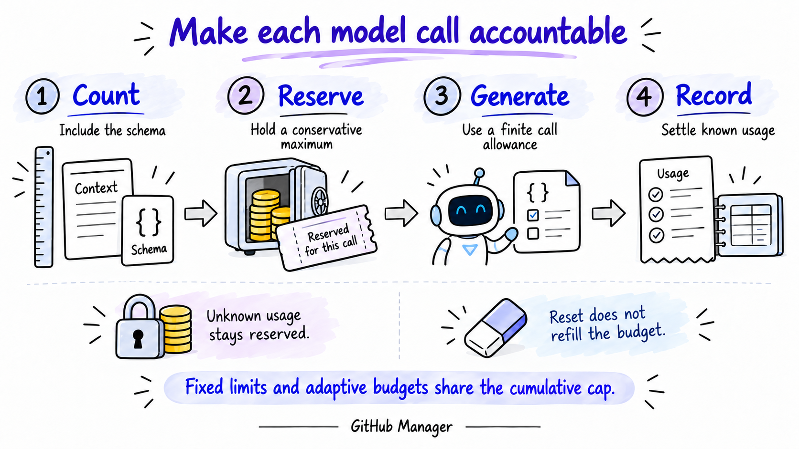

# What Building a GitHub Organizer Taught Us About Reliable AI

*Lessons in context engineering, retrieval, useful memory and making every model call accountable.*

A repository can have useful Topics and Tags, a completed AI analysis, and no assigned Project.

That sounds like a small product detail. In GitHub Manager, it exposed a much bigger design problem.

Our interface had treated “no Project” too much like “not classified.” But those repositories were not necessarily waiting for another model call. Some already had useful labels. Some had a valid no-match result. Some simply did not belong to an initiative in the current taxonomy.

We needed to distinguish four things: **what is assigned, what has been analyzed, whether that analysis is current, and what still needs human review.**

That distinction became one of the most useful lessons from building the app. Reliable AI depended on the context, state and controls surrounding each decision.

*GitHub Manager turns source evidence into reviewable organization. GitHub owns the repository facts; the user owns the accepted relationships.*

## Give the model a problem with clear semantics

GitHub Manager helps people explore repositories and organize them into a vocabulary they control:

- **Projects** represent actual products or initiatives.
- **Domains** group those Projects into broader areas.
- **Topics** describe capabilities or subjects.
- **Tags** describe technologies or other useful labels.

A repository can support several Projects. A Topic or Tag can be useful even when no Project applies. Domains derive through Project membership.

These distinctions matter because shared technology is weak evidence of a shared initiative. Two repositories can both use Python and FastAPI while serving completely different purposes.

We encountered a related issue when classifying FastAPI itself. An early result selected its expected Web APIs Topic and Python Tag, but also added Data Validation and a `fastapi` Tag. Those were real concepts in the registry. They were still unwanted secondary labels under our eventual primary-purpose policy.

We clarified the instructions: select primary-purpose Topics and primary implementation or dependency Tags; omit incidental capabilities and a library's own name as its dependency technology.

FastAPI returned the intended labels in the later regression round. That was a useful correction to the task definition. It did not establish a causal performance gain across an independent dataset.

**A well-formed answer can still solve the wrong interpretation of the problem.** Define what a good decision means before trying to improve its score.

## Context engineering starts with preserving meaning

We did not send complete READMEs to the classifier.

The local pipeline selects purpose-related Markdown blocks, keeps their headings, extracts RAKE keyphrases and records references back to the selected text. A typical classification context includes metadata, up to two selected README blocks, up to eight phrases and a shortlist of canonical concepts.

The purpose text matters. Consider an authored test fixture whose description explicitly says it is **not part of Orion or Helios**. A bag of keywords can preserve both initiative names while losing the relationship that matters most: the denial of membership.

Source prose gives the model a chance to interpret that relationship. Keywords provide compact signals for matching; they do not replace the sentence explaining what the repository does.

Our extraction uses heading filters and bounded text blocks, rather than semantic chunking or a separate summarizing model call. It is predictable and inspectable. It also has limitations: character truncation can split a sentence, and early paragraphs can crowd out decisive evidence later in the README.

One correction came from real format noise. The Markdown parser retained some reStructuredText directives. We added a separately versioned cleanup wrapper for the app and kept the original benchmark profiles unchanged.

That preservation was important: improving the current extractor should not quietly rewrite the evidence behind an earlier result.

## Retrieve candidates before asking for a decision

For classification, the repository acts as the query and the canonical taxonomy supplies the candidate records.

We compared alias matching, an IDF-weighted lexical cosine method and BM25. The method named “TF-IDF” in the code actually uses binary term presence with IDF weighting. It became the app's baseline, with an alias boost and separate limits for Projects, Topics and Tags.

On the small evaluation partition, both lexical methods retrieved every expected label into their shortlists. Alias-only matching missed four expected Topic labels. The development comparison did not demonstrate a BM25 advantage over the simpler baseline.

This gave us a useful starting point within an MVP that deliberately excluded embeddings and a vector database. It did not prove that sparse retrieval would win on a larger or more varied collection.

The important separation was between two questions:

**Retrieval:** Which concepts deserve consideration?

**Classification:** Which of those concepts are actually supported?

High candidate recall cannot answer the second question. A concept might be retrieved from a paragraph that the compact prompt omits. That gap is a reason to evaluate evidence selection as well as shortlist coverage.

The resulting pattern is retrieval-augmented structured classification. LangChain handles the hosted model integration and schema binding. The application controls retrieval, privacy, execution and persistence. There is no autonomous retrieval agent, neural reranker or Anthropic-style Contextual Retrieval implementation in this version.

## Let AI propose; keep authority in the application

Taxonomy discovery and repository classification are separate operations.

Discovery proposes concepts for a collection. The user reviews, edits and publishes them. Classification then selects from existing canonical IDs; it cannot invent a new Project in the middle of assigning a repository.

Provider-native structured output and Pydantic keep the response shape constrained. Application checks go further: does the ID exist, does its kind match, is it active, does it belong to the workspace, and is its evidence reference allowed?

Before applying the result, the app also checks whether the repository, user decisions or taxonomy changed while the request was in flight.

Accepted and manual relationships remain user decisions. Rejected relationships leave protected records so ordinary AI organization does not recreate them.

These controls improve consistency, but they do not prove semantic truth. A valid evidence ID does not establish that the text supports the assignment. Human review remains part of the workflow, and the audit identified evidence-validation details that still need tightening.

## Give the workflow a memory of completed work

The most useful memory in this system is durable application state: canonical concepts, user decisions, rejections, approved rules, evidence profiles and analysis receipts.

An analysis receipt records that a repository went through an operation and preserves its outcome and provenance. It lives independently of accepted labels, optional run history and the provider replay cache.

That independence changes the workflow:

- A successful `NO_MATCH` counts as completed analysis.
- Removing a Project assignment does not automatically make the repository eligible for another paid call.
- A taxonomy revision can mark an old result stale while ordinary organization reconciles locally.
- Failed, uncertain or unknown prior attempts require deliberate review before fresh inference.
- Explicit re-analysis remains available, with a reason and a reviewed budget.

*Processing history and label coverage answer different questions. A change can justify review without automatically authorizing another paid request.*

Local reconciliation can apply approved rules, reuse compatible stored assignments or offer canonical/alias matches for review. Its provenance is visible; a local match does not pretend to be a fresh AI analysis.

This is where loop engineering became concrete: decide when to run, when to skip, when to require authorization and when a response is too stale to apply.

## Make model calls accountable before they happen

Our harness inspects the actual serialized LangChain request and counts its input tokens, including schema overhead, before admitting generation.

It reserves a conservative maximum cost, then settles the estimate when valid usage arrives. Unknown usage keeps its reservation. Automatic SDK retries are disabled, and application resets do not replenish the spending ledger.

We added two ways to control work: fixed request allowances and finite adaptive dollar budgets. Both retain the same cumulative cap. “Adaptive” here describes spending admission; it does not mean an unbounded agent or a researched Adaptive-RAG implementation.

*The cost of a request is part of its execution contract. Unknown outcomes remain visible rather than being treated as free retries.*

Privacy belongs in that contract too. Hosted AI input is restricted to verified public repositories and labeled synthetic fixtures. Access to a private repository does not, by itself, authorize sending its README or derived phrases to a model.

The working product currently uses Next.js, FastAPI and local SQLite persistence. The AWS production architecture remains separate work. Local integration success should not be mistaken for distributed-production readiness.

## What the measurements actually showed

The latest frozen API round evaluated twenty repositories: eight public and twelve synthetic. References were approved, and the model never received the reference labels.

| Measure | Observed result |
|---|---:|
| Correct / unexpected / missed assignments | 50 / 0 / 2 |
| Micro precision | 100.0% |
| Micro recall | 96.2% |
| Micro F1 | 98.0% |
| Input / output tokens | 16,041 / 3,414 |
| Round inference ledger estimate | \$0.003319 |

**This was a small, reused regression set.** Some examples had already informed the primary-label clarification. Public samples were concentrated in the Python ecosystem, and Project-positive examples were synthetic. An independent, broader evaluation is still needed before generalizing these results.

The dollar figure is a dated token-based ledger estimate for that round. It excludes hosting, storage, source fetching and human review, and it is not an independently reconciled invoice. Twenty generations also involved twenty separate input-count requests: forty HTTP operations in total.

One small representation check was particularly useful. For a single FastAPI case, metadata plus purpose evidence used 932 input tokens; adding RAKE phrases used 988. Both produced the same assignments under that earlier prompt.

One example cannot settle the value of keyword extraction. It does show why we should measure the assembled context: a useful extraction component can still add redundant tokens to a particular prompt.

## What we would improve next

Our next experiments have specific questions to answer:

1. **Better evidence packing:** preserve complete sentences and negation, and supply the passages that justified retrieved candidates.
2. **Stronger validation:** allow citations only to the exact evidence transmitted in that request; align prompt limits with validator limits.
3. **Independent evaluation:** build the planned 100–200 reviewed-repository benchmark with unseen initiatives, harder near-neighbors and broader language coverage.
4. **Targeted retrieval experiments:** test dense or hybrid retrieval where lexical misses are demonstrated, then assess whether reranking adds enough value to justify its cost.
5. **Useful operating metrics:** measure human corrections, accepted current associations, abstentions and the share of work completed without fresh inference.

The engineering we would repeat is the discipline around each decision: define the task, preserve meaningful context, retrieve bounded candidates, protect user authority, remember completed work and account for uncertain outcomes.

Those choices make model outputs easier to inspect and incorporate deliberately into a product. They also give us a clearer basis for deciding which more sophisticated techniques deserve to come next.

---

[Explore the demo and walkthrough](https://nkaul.github.io/github-manager-demo/) · [Watch the architecture deep dive](https://nkaul.github.io/github-manager-demo/deep-dive/)

*Method note: this case study draws on the implemented local application, source inspection and saved public/synthetic preflight records. The benchmark was not rerun for this article. Illustrations are AI-assisted and were reviewed against the documented behavior.*
