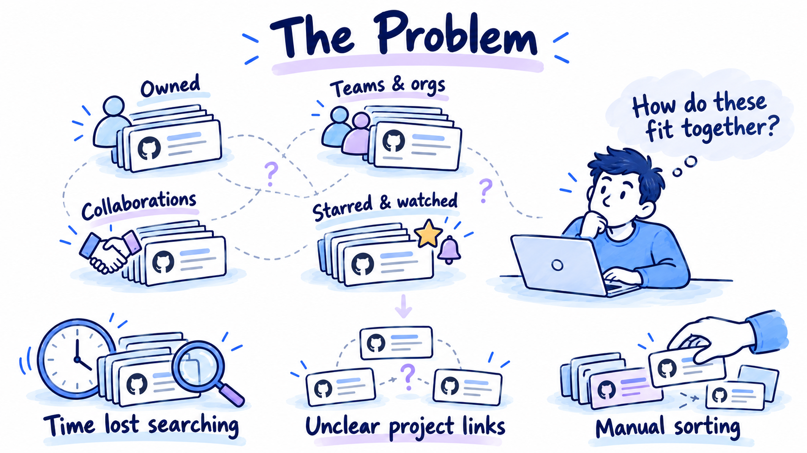

# Repository discovery problem — README illustration

Created on 2026-10-20 from the root README section **Why — The problem we are solving**. This is a selective illustration of the central discovery and organization problem, not an architecture diagram or an assertion that all intended features are implemented.

## Asset and suggested use

- Current asset, v2: [repository-discovery-problem-v2.png](repository-discovery-problem-v2.png), **1672 × 941 px**. It adds the prominent “The Problem” title and three illustrated consequences in response to review feedback.
- Preserved original, v1: [repository-discovery-problem.png](repository-discovery-problem.png), **2020 × 778 px**, 1,551,431 bytes. This PNG and its original prompt/verification are unchanged.
- Suggested placement: after the opening explanation in the README's problem section.
- Suggested alt text: “The Problem: repositories scattered across ownership, teams, collaboration, stars, and watches leave a developer facing time lost searching, unclear project links, and manual sorting.”
- Suggested caption: “Repositories accumulate across GitHub. Finding the right work, remembering project relationships, and maintaining the organization become manual work.”

The repository stacks represent overlapping sources of relevant work. They are not exclusive categories or a diagram of GitHub permissions.

## Provenance and generation

Used the locally preserved `illustrated-explainers` skill and the `imagegen` skill. One original raster was created with the built-in image generation tool. No application API key, classification harness, evaluation budget, or paid application model call was used. The exact submitted prompt is preserved in [prompt.txt](prompt.txt); source hashes, dimensions, and review notes are in [verification.json](verification.json).

V2 uses one built-in image edit of the original v1 PNG, after inspecting that image again. The exact edit prompt is in [prompt-v2.txt](prompt-v2.txt); its source/output hashes and review notes are in [verification-v2.json](verification-v2.json). No separate application model calls were made for the revision.

Two inspected style references were supplied to generation as style references only:

- Local skill asset: `skills/illustrated-explainers/assets/style-overview.png`.
- Existing [README demo illustration](../readme-illustrations/demo-overview.png).

The first reference remains intentionally ignored with the local skill files. Neither skill folder was edited. Previous illustration assets were preserved.

## Current v2 review

- Inspected the full **1672 × 941 px** export and an **850 px-wide** preview. The main “The Problem” title is prominent; the developer's question is subordinate.
- All nine text elements are accurate and readable. No clipped content or tiny prose was found.
- The upper scene retains four overlapping sources of repository discovery and the thoughtful developer, with a limited number of dotted relationships.
- The lower row adds three distinct semantic drawings: a clock and magnifier for **Time lost searching**, uncertain repository links for **Unclear project links**, and a hand arranging cards for **Manual sorting**.
- A subtle downward cue connects the scattered-repository scene to the consequences. The lower vignettes are consequences, not numbered process steps.
- White margins, separated vignettes, dark indigo lettering, and soft marker accents maintain the established style without dense panels or a solution diagram.

These consequences map to the README's fragmented discovery/cognitive overhead, lack of a unified personal project structure, and manual upkeep/inconsistent labels. This remains selective rather than an illustration of every bullet.

## Preserved v1 review

- Inspected the full exported image and a temporary **850 px-wide** preview, representative of README display size.
- All five requested text elements render accurately and remain readable at the preview size.
- Repository stacks, a thoughtful developer, and an unfinished notebook map communicate one problem rather than a collection of unrelated mechanisms.
- Generous white space, dark indigo labels, soft blue/lavender accents, and small semantic objects match the established illustrated style.
- No clipped content, tiny prose, architecture components, statistics, invented repository names, or solution claims were found.
- Dashed connections express uncertain relationships. They are not API calls or an implemented retrieval flow.

Limitations: this deliberately omits other detailed pain points in the prose, including recent-activity semantics and alias upkeep. Small generated GitHub marks function as illustrative integration symbols; they are not canonical supplied logo artwork. This is not an exact application screenshot. Visual QA does not establish measured user comprehension.

The illustration was saved for review. This asset task did not change the root README, commit, push, or publish anything.
