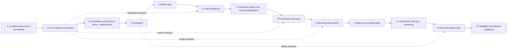

# GitHub Manager phased implementation plan

Updated: October 12, 2026 — Phase 0.9 approved and implemented; local validation and runbook recorded.

Date: October 11, 2026. Status: Phase 0 approved; named private/org and required AWS tests passed, conditional exit review open. Phase 0.5 is implemented; API access and primary-label preflight targets pass; CONDITIONAL GO recommended with explicit comparison/production limits. The user confirmed Phase 0.9 as a complete working local demo with cloud and video planning deferred; its detailed implementation/storage/call-renewal plan is approved and the local app is implemented. Phases 1–10 remain proposed.

Baseline: [system design](../system-design.md), especially §16–18, with the user's requested Phase 0 and Phase 0.5 additions. Repository findings are in [architecture review](architecture-review.md); choices D01–D20 are in [open decisions](open-decisions.md). The [Phase 0 plan](phase-0-pretesting.md) covers localhost/GitHub/AWS feasibility. Phase 0 supplies the existing frontend/backend scaffold, manifests, scratch stack and Markdown reports. Live checks verified named private access, fixed a 78-repository organization discovery gap and passed all eight required AWS target canaries; the user requested retaining those resources. The new [Phase 0.5 plan](phase-0-5-ai-readiness.md) tests extraction/retrieval, LangChain/OpenAI contracts, taxonomy and classification before production AI work. Its [results record](../validation/phase-0-5-results.md) contains offline measurements, provider failures and separately labeled supplementary Codex checks. Later-phase files remain proposals. See [ADR 0001](../adr/0001-oauth-app-and-local-pretesting.md), [setup](../development/phase-0-localhost.md) and [actual Phase 0 results](../validation/phase-0-results.md).

## Execution boundaries

Implement one approved phase at a time. Phases 0 and 0.5 have recorded results; the [Phase 0.9 complete working local demo](phase-0-9-functional-demo.md) is approved and implemented; see its [results](../validation/phase-0-9-results.md). At each exit, show the demo, changed files, actual validation, unresolved risks and next-phase scope, then request approval. Plan approval alone does not authorize production changes, AWS provisioning, GitHub writes or unreviewed destructive operations. Proceed within recorded GitHub/AWS authorizations without repeatedly requesting the same tests. The public/synthetic AI boundary and cumulative $5 allowance persist; the approved Phase 0.9 renewal is 20 additional total HTTP requests, with at most ten new generations and the unchanged $5 ledger.

Start with a real, minimal localhost slice in Phase 0: GitHub authorization → server-side identity/repository fetch → basic Next.js repo page, plus independent named-resource AWS probes. Reuse that scaffold in Phase 1. Build the first durable product slice across Phases 1–2: secured persistent session → relevant GitHub repo discovery → persisted Core metadata → My Repos/Favorites UI. AI must never delay repo visibility. Fixture, live preflight and production-readiness evidence remain distinct.

In the original production sequence the reset UI is Phase 9, with safety foundations beginning in Phase 1. Proposed Phase 0.9 brings those user workflows and equivalent local transactional safeguards forward into a complete local app. The SQLite/local-runner exception is approved for Phase 0.9; production DynamoDB/SQS correctness and cloud work remain in Phases 1–10. Reconcile and reuse completed demo features at that handoff rather than rebuilding them.

## Dependency order and complexity



| Phase | Complexity | Main uncertainty / exit demonstration |
|---|---|---|
| 0 Pre-testing | M–L | OAuth App scopes/SSO/team/watch coverage and local AWS operation permissions; real localhost login/repo demo and access report |
| 0.5 AI readiness pre-testing | M–L | OpenAI access, extraction/retrieval, task-specific quality/cost and privacy; local taxonomy/classification experiments with Markdown reports |
| 0.9 Complete local demo | L | Integrate all core user workflows with durable local state and safe reset; cloud and video planning deferred; temporary adapter/call renewal approved; validation recorded |
| 1 Foundation | M | Local integration tooling and contract refinements; secured workspace shell |
| 2 GitHub integration | L | Harden/revalidate Phase 0 permission findings and durable sync; useful persisted repo explorer |
| 3 Intelligence | M | Extraction quality and privacy boundaries; reusable evidence/group inspection |
| 4 Registry/manual organization | L | Concurrent uniqueness and merge recovery; user-managed multi-project organization |
| 5 AI taxonomy discovery | L | Logical project quality/provider compatibility; review and publish an AI draft |
| 6 Repository association | L | Candidate recall/manual races; safe suggestions and confirmed assignments |
| 7 Organization controller | M | Leases, scheduling and accurate outcomes; automatic/manual progress and history |
| 8 Activity/sync hardening | L | Actor attribution and API history; reliable personal Latest Work |
| 9 Reset/rediscovery | L | Exact preview and verifiable cleanup under concurrency; repeatable reset demo |
| 10 Validation/readiness | L | Live integrations, performance and quality; evidence-based release decision |

Complexity is relative, not a time estimate. Phase 4's manual slice depends on Phase 1–2 contracts and can be brought forward if the user prefers manual organization earlier; the default order follows the approved design. No parallel-agent execution is assumed.

## Shared contracts to establish before feature workers

### Package layout and boundaries

Use one Python codebase with separate API, dispatch and worker entrypoints. Routes call services; persistence owns keys/transactions; GitHub adapters own trusted external data; LLM chains receive allowlisted evidence and have no repository-mutation tools. Proposed roots:

```text
backend/
  pyproject.toml
  app/
    main.py
    api/{auth,repositories,taxonomy,organizer,reset,webhooks,settings}.py
    auth/{sessions,authorization,csrf}.py
    github/{client,adapter,discovery,metadata,activity}.py
    intelligence/{readme_parser,keyword_extractor,corpus_index,profile_builder,privacy}.py
    taxonomy/{registry,deduplicator,review,publication,discovery,merge}.py
    organizer/{context_builder,classifier,validator,controller,feedback}.py
    persistence/{dynamodb_client,keys,core,intelligence,organization,
                 associations,jobs,partition_catalog,reset}.py
    jobs/{envelope,outbox,leases,dispatcher}.py
    workers/{sync_worker,intelligence_worker,taxonomy_worker,
             organization_worker,reconcile_worker,cleanup_worker}.py
    schemas/{repo,taxonomy,classification,jobs,reset,settings}.py
  tests/{unit,contract,integration,fixtures}/
frontend/
  package.json
  src/{app,components,lib}/
  tests/{unit,e2e,fixtures}/
infrastructure/
  local/
  aws/
docs/{adr,development,validation}/
.github/workflows/
```

Select initial runtime/package tooling in Phase 0; retain or refine those pins and choose IaC in Phase 1 (D15). The tree does not mandate a deployment technology. Python code using boto3 must apply the installed `aws-sdk-python-usage` skill when implemented. Avoid synchronous SDK calls on FastAPI's async event loop. Use explicit endpoints and isolated configuration for local services; fixture and pretest modes must fail closed in production. Phase 0's in-memory local session/token storage is a bounded exception before production persistence; it must be replaced/hardened in Phases 1–2, not mistaken for the final session design.

### Persistence additions proposed for approval

Preserve all baseline keys unless an explicit refinement below applies. Use encoded opaque IDs and constant UTC timestamp formatting; IDs/cursors arriving from clients never establish ownership.

| Item | Proposed exact access shape / ownership | Purpose |
|---|---|---|
| Session / OAuth state | Core: `SESSION#<tokenHash>/META`, `OAUTHSTATE#<stateHash>/META`; owner user/workspace, explicit expiry | Revocable opaque cookie; one-time state/PKCE; TTL is housekeeping only |
| Workspace directory | Core: `DIRECTORY#WORKSPACES/WS#<id>`; internal scheduler only | Query known workspaces for durable outbox recovery without Scan |
| Core repos/views | Baseline `WS#W#REPOS/REPO#host#id`, `WS#W#VIEW#MY|FAVORITES|LATEST/...` | Stable identity, prior view key and source/access version |
| CONTROL | Organization: `WS#W/CONTROL`; retain all baseline counters | Add reset mutation version, privacy-policy version, lease/publication state; keep execution/coverage/freshness separate |
| Partition catalog | Organization: `WS#W#PARTITIONS/PART#<encoded-table-and-PK>` | Durable exact partition ownership, family/epochs and cleanup verification |
| Intelligence namespace | Intelligence: `WS#W#CACHE#C#PROFILES/REPO#host#id`; analogous TERMS/CLUSTERS/DISCOVERY/versioned-evidence partitions | All derived evidence participates in cache invalidation and cleanup |
| Job / outbox | Organization: `WS#W#JOBS/JOB#id`; `WS#W#OUTBOX/EVENT#id` | Idempotency, durable dispatch, retries, explicit job family/retention class |
| Publication / merge manifest | Organization: `WS#W#TAX#T/PUBLISH#id` or `MERGE#id`, child checkpoint partition when needed | Bounded staging, activation and recovery; catalog all child partitions |
| Repo organization state | Baseline STATE/SUMMARY plus `decisionVersion`, projection version/dirty state | USER/AUTO project/topic/tag/domain lists separated if that kind supports direct edges |
| Reset plan/audit/checkpoints | Baseline reset-plan/audit keys; cataloged operation partition for checkpoints | Immutable scope/version snapshot, plan consumption, exact cleanup scope and resume |

Schema refinements resolve review P0-03–06/P1-01–04; they are not already-approved design changes. Keep the optional pending-control GSI deferred until Phase 7. S3 is omitted initially; if introduced, register object ownership/cache epoch and deletion checks too.

### Mutation and worker contract

- Every reset-impacting Organization/Intelligence mutation updates `resettableStateVersion` in a conditional CONTROL Update, carrying generation/epoch/status conditions in that same action. Do not also ConditionCheck CONTROL in that transaction. Define which internal telemetry is excluded; deletion of already-invalidated immutable namespaces is tracked by its cleanup operation rather than treated as new active organization data.
- A manual decision atomically advances per-repo decision version. Automated association commits compare the captured version, ACTIVE concepts, permitted IDs/evidence, access/policy versions, and all relevant generations/revisions.
- An edge pair commits together with its projection update or a durable dirty marker. A dirty read is repaired or resolved from authoritative edges; never silently claim correct Uncategorized membership from stale state.
- Register all newly used partitions before/with their first write. Never lose catalog ownership when a repo disappears from discovery.
- Job envelope: job/idempotency/trace IDs, type, workspace and connection ID/version, repo/run reference, organization/taxonomy/AI/cache counters, taxonomy revision, privacy/profile versions, bounded payload. Store evidence by reference rather than queueing raw README text.
- Persist request/run/outbox together. Dispatch may repeat safely; per-item completion and counters are idempotent. A run lease is recoverable after crash. Generation mismatch discards work; cancellation telemetry must not resurrect deleted history.
- Corpus updates are idempotent per repo/content hash. Prefer a versioned corpus rebuild and activation over uncontrolled phrase counters; partial worker failure must not corrupt distinct-repo document frequency.
- Cap aliases, assignment counts, evidence sizes, retry count and transaction actions/bytes. Keep every item well below 400 KB. Re-read on conditional conflicts; do not blindly retry stale decisions.
- Publication visibility is separate from concept lifecycle status: normal reads/candidates require an ACTIVE concept and a committed publication manifest when present. One conditional transaction commits the manifest and revision after all staged batches are ready; activation must not require updating every concept in that transaction.

### Proposed API additions and paging behavior

Retain `/api/v1` baseline endpoints. Add `POST /auth/logout`, `DELETE /connections/github`, `PUT /repos/{repoKey}/inclusion`, and `GET/PATCH /settings/privacy` after D05/D09 approval. Public callback/webhook routes use state/signature verification; all workspace data routes use session-derived ownership. No arbitrary user header selects a workspace.

All collections return `items` and opaque `nextCursor`. Bind cursor contents to workspace/view/filter/sort/epochs and validate page limits. Simple lists Query one known partition; concept views union USER/current AUTO reverse edges with deduplication and two continuation positions. Complex inventory filters run over a bounded complete compact inventory before paging; unsupported volume/sort must be explicit, not silently page-local.

### Validation command convention (future, not run in this review)

Phase 0 has its own startup/pretest commands in [its detailed plan](phase-0-pretesting.md#planned-validation-commands). Phase 1 will establish the broader commands below, reusing Phase 0 setup. Until then they are planned interfaces, not existing scripts or passing checks. Run only after approved setup; live commands require authorized environments.

| ID | Command / environment | Purpose |
|---|---|---|
| V1 | `uv run --project backend ruff check backend` and `uv run --project backend pytest backend/tests/unit backend/tests/contract` | Python static/unit/API contracts |
| V2 | `uv run --project backend pytest backend/tests/integration -m local` | DynamoDB/SQS emulator integration; clearly labeled local |
| V3 | `npm --prefix frontend run lint`, `npm --prefix frontend run typecheck`, `npm --prefix frontend run test:unit`, `npm --prefix frontend run build` | UI static/unit/build |
| V4 | `npm --prefix frontend run test:e2e` | Browser workflow tests against local API/fixtures |
| V5 | `uv run --project backend pytest backend/tests/integration -m live_github` or `-m live_aws` | Opt-in real service contracts; never run by default |
| V6 | `uv run --project backend python -m app.evaluation.benchmark` | Approved labeled-corpus quality/token report |
| V7 | `uv run --project backend python -m app.evaluation.load --repos 1000` (repeat at 100/5000) | Latency, payload and consumed-capacity report |

If package tooling changes at D15, update these interfaces before implementation. Fixture tests validate application behavior, not provider coverage or AWS concurrency semantics. CI defaults to credential-free checks; external tests are explicitly gated.

## Phase 0 — Localhost setup and access pre-testing

**Objective/demo:** run a basic Next.js app and minimal FastAPI backend locally; complete real GitHub OAuth authentication, fetch/paginate repos and display trusted GitHub links. Independently test the selected local AWS profile against named project resources. Verify the user-selected OAuth App connector and record access dependencies before the production foundation.

**Prerequisites:** Phase 0 approval received; OAuth App selected; development GitHub registration/callback and known repo fixtures across representative organizations; explicit local AWS profile/account/Region/resource manifest. Existing credentials/resources are reused where approved. Missing scratch resources or organization approvals are recorded dependencies, not silently created or bypassed.

**Files/modules:** initial Next.js/FastAPI manifests/startup/API proxy, local-only auth/session and GitHub adapter/client modules, basic repo page, `backend/app/pretest/` probes, pretest suites, ignored environment configuration, example scratch-resource manifest, local setup guide and sanitized results report. Reuse the existing frontend/backend roots and promote the proven code into Phase 1.

**Data/APIs:** no persistent app organization state or queues required for login/repo browsing. Use health, GitHub auth start/callback, `/me`, paginated `/repos`, logout and local-only coverage report. Tokens stay backend-only. AWS canaries use only synthetic run-owned data against approved scratch resources; final application data modeling is Phase 1 work.

**Sequence:** setup/tools/loopback callback → secure local sign-in and repo page → known-fixture OAuth App direct/team/contributor/SSO/star/watch verification → local AWS identity and named-target inspection → approved data-plane canaries → cleanup/report/D01/D02/D15/D16 updates.

**Tests/acceptance:** live browser login and repo retrieval; callback/state/PKCE/session/CSRF failure tests; REST/GraphQL pagination/error coverage; actual versus expected eligible repo IDs. AWS tests distinguish identity, read, data-plane use, provisioning and future runtime-role access for DynamoDB, SQS, Secrets Manager, conditional KMS, EventBridge and CloudWatch, with S3/model/hosting checks only when applicable. STS or Describe/List success never substitutes for write evidence. Each result identifies LIVE/FIXTURE/POLICY evidence and PASS/FAIL/BLOCKED/NOT_TESTED/NOT_APPLICABLE status. See the [complete test matrix and exit criteria](phase-0-pretesting.md).

**Failures/recovery:** source-specific denied/missing access stays explicit; no silent token/profile/permission escalation. Stop local services to discard in-memory sessions, clean only manifest/run-owned canaries, report residuals, and carry dependencies with owners. **Excluded:** taxonomy/AI pipelines, production persistence/deployment, GitHub repo mutations and unapproved resource/policy changes.

**Current evidence:** see [results](../validation/phase-0-results.md) and the [live GitHub review](../validation/github-access-review-2026-10-11.md). Latest live reports confirm both named private fixtures and zero missing IDs in two organization cross-checks after fixing 78 missing candidates. Eight authorized AWS scratch targets passed creation, inspection, 28 canary/cleanup checks and an independent artifact audit. The user requested retaining the resources. Broader direct/SSO/watch expectations remain untested and require exit-review acceptance. No Phase 1 work is authorized.

**Exit/approval:** show real localhost auth/repo demo, OAuth coverage report, AWS operation matrix and cleanup. Recommend GO, CONDITIONAL GO or NO-GO with evidence; user reviews unresolved dependencies. Phase 0.5 can test public/synthetic AI feasibility independently while broader GitHub coverage remains open; Phase 1 still requires approval. Complexity M–L; registrations/SSO/organization approvals and scratch targets are the main uncertainties.

## Phase 0.5 — AI readiness pre-testing

**Objective/demo:** prove a bounded local evidence → extraction/grouping → taxonomy draft/review → canonical classification → proposed organization flow using LangChain and actual OpenAI calls. Compare RAKE/YAKE, corpus TF-IDF and BM25 where each applies. Identify separate taxonomy/classification models from measured quality, cost and latency. See the [detailed plan](phase-0-5-ai-readiness.md).

**Prerequisites:** Phase 0.5 implementation is approved; validate successful generation with the configured local `OPENAI_API_KEY` after credit restoration; this access check now passes for Luna and Sol. The user approved a $5 total OpenAI experiment allowance and public samples plus synthetic fixtures. No private metadata/README-derived submission is authorized. Freeze a development/held-out benchmark and review references before quality PASS. Phase 0's broader access limits do not block public/synthetic CLI checks and are not resolved by them.

**Files/modules:** isolated `backend/app/pretest/ai/` settings/model factory, evidence/extraction/retrieval, taxonomy/classification schemas and validators, SQLite ledger/cache, evaluation/runner; pretest fixtures/tests; evaluation dependency group and lock; local setup and generated Markdown. Environment placeholders are prepared but inactive. Reuse Phase 0 auth/report patterns; promote proven components in Phases 3/5/6.

**Data/APIs:** SQLite/files/memory for local experiments only; no DynamoDB schema changes, SQS deployment or new AWS resources. LangChain orchestrates bounded model calls with provider-native strict schema and backend semantic checks. CLI first; optional authenticated loopback UI/API for public-repo selection/review only if useful. No GitHub writes or automatic canonical publication.

**Sequence:** configuration/dependency/license readiness → frozen corpus and local algorithms → real per-model authentication/schema probes → paired taxonomy/classification experiments → persistence/cache/retry/budget/privacy tests → measured report and recommendation. Starting hypotheses: Sol taxonomy versus Astra; Luna classification versus Sol. These are not selected winners.

**Tests/acceptance:** distinguish actual algorithms/live model contracts from fault fixtures and human review. Measure candidate recall, per-kind precision/recall/F1, taxonomy rubric, ID/evidence/manual-precedence validation, compactness, latency, stability and actual usage. Enforce one experiment-wide spending ledger, including retries/uncertain outcomes. Thresholds and missing-evidence rules are in the detailed plan. A small preflight does not establish production auto-apply or concurrency safety.

**Failures/recovery:** missing key/model access → report blocked live path while offline work continues; unsupported schema/privacy violation → fail closed; budget exhausted → save partial report without raising cap; uncertain charge → retain reservation; invalid/stale output → reject and retain a sanitized outcome. No hidden retry or cache hit presented as new live evidence. Keep existing reports and retained AWS resources.

**Exit/approval:** generate immutable private per-run Markdown and a sanitized [consolidated report](../validation/phase-0-5-results.md), review references/drafts, recommend GO/CONDITIONAL GO/NO-GO and task models, and save accepted model settings locally. Phase 1 remains separately gated. Complexity M–L; entitlements, gold-label review, candidate recall and YAKE licensing are the main uncertainties.

## Phase 0.9 — Complete working local demo

**Objective/demo:** deliver a working browser application across sign-in/sync, repository views/details, source-backed intelligence, taxonomy discovery/review/publish and full content management, manual multi-project/topic/tag assignment, review-first AI classification, status/reorganization, personal Latest Work and safe selective reset/rediscovery. The user confirmed this functional local-app priority; video walkthrough planning and cloud infrastructure are deferred. See the [detailed Phase 0.9 plan](phase-0-9-functional-demo.md).

**Prerequisites/decisions:** the detailed local-demo plan, temporary SQLite application/local durable-runner exception (D18), and local safety-contract directions are approved. Keep OAuth App, trusted GitHub metadata, public/synthetic model inputs, RAKE/TF-IDF baseline, review-first AI and the original cumulative $5 cap. Approved call renewal is at most 20 additional OpenAI HTTP requests total, including token counts, allowing at most 10 new generations with pre-count/retries-disabled behavior (D20). Existing ledgers/reports remain intact; actual bounded calls are recorded in the separate Phase 0.9 results.

**Files/data/APIs:** reuse Next.js/FastAPI/auth/GitHub code; promote proven extraction/LangChain validation into product modules; add repository interfaces/local SQLite adapter, transactional local jobs/outbox, app schemas/services/routes and feature UI. Separate Core/Intelligence/Organization logically, preserve the existing cost ledger outside app reset, and keep tokens in backend memory with explicit reauth after restart. Use baseline /api/v1 domain contracts and polling progress; signed cursors and workspace authorization remain mandatory.

**Sequence:** 0.9A contracts/data/budget → B durable connected explorer → C complete canonical manual organization → D integrated evidence/AI drafts/classification → E durable organization/activity → F safe reset/restart → G product polish, operator walkthrough and acceptance report. Show functioning slices as they are completed; do not spend the phase on another comparative benchmark. Complexity L; detailed milestones and acceptance criteria are in the dedicated plan.

**Acceptance:** real OAuth and one bounded fresh app AI path; complete browser workflow; taxonomy uniqueness/publication, manual precedence, multi-project/query correctness, source privacy, actor-based activity, restart/job recovery, stale worker/preview rejection and verified selected cleanup. Build/lint/typecheck, relevant backend regression and end-to-end tests must pass. Fixtures, live service evidence and cached replay are separately labeled. Generate docs/validation/phase-0-9-results.md and an independent operator runbook; no video artifacts required yet.

**Exit/handoff:** the user can start and operate the complete local app without CLI-only feature steps. Keep later cloud phases separately gated, reuse completed domain/UI work, and validate final DynamoDB/SQS/IAM/deployment semantics independently. A local functional demo does not establish production scale, comprehensive upstream coverage or production auto-apply quality. The Phase 0.9 application is implemented and validated; real product OAuth login remains an optional operator confirmation using the previously proven connector.

## Phase 1 — Foundation and safety contracts

**Objective/demo:** harden and extend the Phase 0 Next.js/FastAPI scaffold; sign-in creates a durable server session and isolated workspace persisted in the three local DynamoDB tables. Use fixtures for multi-workspace/race tests. Unauthenticated/cross-workspace requests fail. A synthetic queue job can be retried safely and rejected after a control-generation change.

**Prerequisites:** review Phase 0 and Phase 0.5 results and approve this phase plus D03/D04/D06/D08 contract direction; retain validated tooling and choose IaC under D15. Carry any conditionally accepted D01/D02/D16/D17 dependency explicitly; do not activate an unverified production connector/provider. Local foundation work can use fixtures without further real-account access.

**Files/modules:** extend Phase 0 manifests/lockfiles/runtime pins, `.gitignore`, `.env.example`, developer commands/README, frontend shell/API client and backend main/config/auth/GitHub boundary. Add durable schemas/persistence key builders and job envelope/outbox/leases; `infrastructure/local/` emulator setup and `infrastructure/aws/` declarative table/IAM contract; CI and multi-workspace fixtures. Disable/isolate pretest diagnostics. Write ADRs for schema refinements and local endpoint fail-closed behavior.

**Data/APIs:** three On-Demand table definitions with PK/SK; Core user/workspace/session/state/directory; Organization CONTROL/catalog/jobs/outbox. No GSI required. Extend Phase 0 health/me/auth/logout contracts with readiness, persistent sessions/state and guarded fixture-only sign-in; retain the proven auth adapter interface while final production token lifecycle remains Phase 2.

**Sequence:** establish reproducible startup → schema/key/API contracts → auth/CSRF/ownership → pagination/batch helpers and transactional primitives → catalog/outbox/lease skeleton → shell demo/CI. Draft IAM is reviewable code; do not create cloud resources during this phase without separate authorization.

**Tests/acceptance:** V1–V4 relevant subsets. Fixtures: two users/workspaces, expired/replayed OAuth state, revoked session, duplicate job, local endpoint misconfiguration. Verify deterministic key encoding; exact expiry independent of TTL; no production fixture route; ownership on every data route; pagination and unprocessed-batch retry; atomic partition registration; stale job cannot commit; failed dispatch recovered from outbox. CI must be credential-free. AWS behavior remains unverified until V5.

**Failures/recovery:** emulator unavailable → readiness false; invalid session → deny; crash between commit/send → outbox resumes; lease expiry → conditional reclaim. Local schema changes use disposable fixtures and explicit recreation commands. Roll back code to prior reviewed state; no production database rollback is involved. **Excluded:** expanding the Phase 0 GitHub spike into final production sync/token management, AI, taxonomy UX, reset execution or cloud deployment.

**Exit/approval:** show startup instructions, health/auth/isolation and retry/fence demo; report actual tests and D01–D05 prerequisites. Request Phase 2 approval. Complexity M; local tooling and CONTROL contention are uncertainties.

## Phase 2 — GitHub sign-in and useful repository explorer

**Objective/demo:** complete authorized GitHub sign-in, then render trusted My Repos and Favorites from persisted Core data before any AI exists. Repo hyperlinks survive a rename/transfer; branch count remains null until known.

**Prerequisites:** Phase 1 plus Phase 0 D01/D02 connector/permission evidence; D09 local inclusion contract and D10 paging. Revalidate changed registrations/scopes/organization policies and unresolved Phase 0 gaps. Live gate requires approved secret handling and representative organization access. Without access, deliver the same flow with recorded/synthetic fixtures and mark live acceptance incomplete.

**Files/modules:** backend GitHub adapter/client/auth/discovery/metadata, sync worker/core repository/API routes; `frontend/src/app/(workspace)/{repos,favorites}/page.tsx`, repo table/cards/details/search/coverage components; safe link helper; GitHub fixture and live contract suites. Both adapter modules expose the contract; production completion of the secondary mode can follow measured need, with its unavailable status explicit.

**Data/APIs:** Core canonical repo/view/sync items from §9.2, source-specific sync checkpoints, prior view SK, capability/coverage and connection/access versions. `/auth/github/start`, `/callback`, `/me`, `POST /sync`, `GET /sync/{jobId}`, `/repos`, `/repos/{repoKey}`, inclusion/disconnect proposals. USER/AUTO summaries may be empty; default status PENDING without invoking AI.

**Sequence:** adopt/revalidate Phase 0 adapter/permission findings → harden token exchange/session rotation/refresh → fast paginated candidates/stars/watches/contribution seeds → provenance policy/dedup by host+numeric ID → persisted views → async selective enrichment → explorer and partial-coverage messages. Validate GitHub-provided URLs against the connection host. Store encrypted credentials through a secret interface; only references in DynamoDB.

**Tests/acceptance:** V1–V4; authorized V5 `live_github` and optionally `live_aws`. Fixtures cover owned/direct/team/contributor/org-general, public starred-only, watched-only, forbidden teams, 403/429/5xx, missing README, rename/transfer, duplicate pages and disconnected account. Verify broad org visibility excluded by default; explicit override audited; Favorites union deduped; no loss of saved data on incomplete enumeration; retry cursor resumes; old view SK deleted; no GitHub tokens reach browser/logs. Real acceptance records two-organization and known-watch results rather than inferred coverage.

**Failures/recovery:** preserve good data during partial source failures; mark source incomplete rather than deleting absent repos. Explicit revoked access hides restricted data and schedules policy cleanup. Token refresh conflicts serialize; revoked authorization requires reauthorization. Resume sync at saved cursor and reconcile projections. **Excluded:** AI, taxonomy creation, comprehensive Latest Work, GitHub write methods/webhook creation.

**Exit/approval:** demo sign-in → repo list → persisted reload with no AI; provide scope/coverage report and actual integration status. Request Phase 3 approval. Complexity L; permissions are the main external dependency.

## Phase 3 — Local repository intelligence

**Objective/demo:** inspect compact profiles and collection-wide keyword/group evidence generated without an LLM; unchanged meaningful evidence skips repeated work.

**Prerequisites:** Phases 1–2; D05 private content/retention and D13 cache policy; select MIT-compatible RAKE dependency/resources (D05). YAKE remains excluded unless separately approved after license review.

**Files/modules:** README parser, RAKE extractor, deterministic evidence selector/privacy filter, profile builder, corpus index; intelligence worker/repository/schemas; local fixture inspector and tests. Optional internal profile-inspection API/UI is development-only, authenticated, and shows sensitive evidence only to its owner.

**Data/APIs:** cache-epoch profiles, optional bounded evidence, term statistics, clusters, corpus snapshot manifest; exact-PK Query for the current corpus. GitHub README SHA, metadata fingerprint, selected-evidence hash and extractor version remain separate. Internal `GET /repos/{repoKey}/intelligence` is a proposed diagnostic boundary, not required public MVP API.

**Sequence:** enforce fetch/privacy/size policy → parse title/overview/purpose/features/use cases/selective architecture → exclude badges/install/code/logs/license → extract phrases and actual purpose sentences → persist profile under fence → rebuild distinct-repo TF-IDF/co-occurrence from a versioned snapshot → propose groups using names/purpose/links. Downloading tokenizer data at runtime is disallowed; bundle permitted deterministic resources during setup.

**Tests/acceptance:** V1/V2, V3/V4 if diagnostic UI added. README fixtures include empty/missing/oversized, negation, domain acronyms, install-only edits, private excerpts, prompt injection and repeated phrases in one repo. Verify bounded bytes/evidence IDs, distinct-repo document frequency, no grouping by language alone, cache hit after irrelevant change, correct invalidation after extractor/metadata change. Test old cache worker versus reset/access/policy version change. No hosted-model request occurs.

**Failures/recovery:** forbidden/missing README gives metadata-only profile; parse timeout gives bounded fallback; stale results discarded. Resume/rebuild corpus from stored profiles after failure; activate a complete corpus snapshot only. Preserve old extractor version until replacement is ready. **Excluded:** LLM taxonomy/classification, embeddings, raw S3 cache unless a measured need is approved.

**Exit/approval:** show profile/cache behavior and corpus/group summaries, privacy exclusions and extraction measurements. Request Phase 4 approval. Complexity M; multilingual/noisy README quality remains an uncertainty.

## Phase 4 — Canonical registry and manual organization

**Objective/demo:** user creates/edits/archives/merges domains/projects/topics/tags; assigns one repo to multiple projects across domains; manually labels repos using drag/drop, keyboard controls and bulk selection. Rename preserves IDs; tags alone leave a repo Uncategorized.

**Prerequisites:** Phase 1–2 persistence and ownership; Phase 3 provides evidence for duplicate suggestions but is not essential for manual edits. Approve D06/D07/D09; settle derived versus direct domains and Unassigned behavior.

**Files/modules:** registry/deduplicator/merge/publication contract/review, association persistence, feedback schemas, taxonomy/repos APIs; Content settings, domain/project tree, concept dialogs, assignment/bulk controls and Uncategorized UI. Introduce the manual subset of Phase 6's association repository now so Content has an immediate working demo.

**Data/APIs:** baseline `CONCEPT`, `TERM`, `DISTINCT`, `RULE`, `CHANGE`; mirrored USER edges, protected rejection/tombstone, repo decision version and provenance-separated summaries; cataloged merge manifests/checkpoints. `/taxonomy/concepts`, `/{id}`, `/resolve`, `/merge`, `/content/rules`, repo projects/topics/tags PUT/DELETE; add domain route only if D09 chooses direct membership.

**Sequence:** exact normalized alias reservation → fuzzy review without auto-equating distinct concepts → transaction-safe CRUD/revision/change event → manual edge writes/acceptance/rejection primitive → reverse-edge queries/Uncategorized → archive invalidation and Unassigned moves → resumable merge/redirect with alias reconciliation → UI/accessibility/bulk retry report. Semantic equivalence using an LLM stays disabled until Phase 5 permissions exist.

**Tests/acceptance:** V1–V4. Race two canonical/alias creates, rename collision, duplicate aliases after normalization, cross-kind same-name, explicit DO_NOT_MERGE, domain archive with projects, source/target USER/AUTO/rejected merge conflicts, worker crash mid-merge. Assert one term owner; no half-edge; one primary domain; stable IDs; immediate manual persistence; rejections protected; inactive concepts hidden despite stale summary; per-repo bulk partial failures reported. Snapshot mutation version increments on all reset-impacting changes. Bounded transaction tests count actions/bytes and avoid duplicate item actions.

**Failures/recovery:** collision returns conflict with existing concept; optimistic revision conflict re-reads; merge redirect remains until checkpointed migration completes. Freeze conflicting edits during merge, resume/reconcile safely, and retain source identity/audit. Archive is recoverable by deliberate restore, never automated recreation. **Excluded:** first-run AI proposal generation, automated classification, reset UI.

**Exit/approval:** demo full manual lifecycle and conflict/recovery evidence. Request Phase 5 approval. Complexity L; publication and merge semantics are the main correctness risks.

## Phase 5 — First-run AI taxonomy discovery and approval

**Objective/demo:** cached corpus evidence produces a bounded AI draft; user edits, rejects, merges and approves concepts; only complete approved publication becomes available as a canonical revision.

**Prerequisites:** Phase 3 evidence and Phase 4 registry; D05 external-data permission and retention, D07 publication protocol, D11 provider/model/budget. Hosted-model credentials and paid usage require their own authorization. Use fake structured responses until available.

**Files/modules:** taxonomy discovery/consolidation/publication worker, LangChain model factory/provider adapter, strict taxonomy schemas/context builder; bootstrap/draft/rediscover APIs; first-run wizard, evidence/duplicate review and approval UI; provider contract tests.

**Data/APIs:** Intelligence discovery input/corpus references; Organization proposal and publication manifests/staged concepts/reservations; run/outbox items with generation/privacy provenance and token usage. `/taxonomy/bootstrap`, `/drafts`, PATCH draft, `/drafts/publish`, `/taxonomy/rediscover`.

**Sequence:** approved metadata/evidence allowlist → candidate group batches → structured draft generation → proposal-only consolidation → exact/fuzzy/optional equivalence resolution → human review → hidden bounded staging → conditional manifest activation/revision → enqueue classification request. Before Phase 6, keep this request pending/disabled rather than claiming association ran. Rediscovery produces expansion drafts and preserves existing canonical IDs.

**Tests/acceptance:** V1–V4 and authorized provider smoke tests. Validate unknown/cross-workspace supporting repos, missing domains, duplicate concepts, private-derived keywords leaking into prompts, malformed/refused/oversized output, cost ceiling, publication exceeding one transaction, crash after staging and reset before activation. Normal readers see the previous approved taxonomy or the entire new publication, never partial batches. No model-authored concept is canonical before user approval. Confirm model adapter enforces strict schemas with its configured provider; this is separate from semantic validation.

**Failures/recovery:** bounded retries then actionable review/error state; do not publish on timeout/refusal. Resume staged publication under original ownership/versions or abandon and clean it up; no false revision advancement. AI unavailable leaves manual Content fully usable. **Excluded:** automatic taxonomy publication, fine-tuning, model tools, full README submission.

**Exit/approval:** show a reviewed/published draft, evidence and actual token accounting; document synthetic versus live provider results. Request Phase 6 approval. Complexity L; logical project quality and provider schema overhead require measurement.

## Phase 6 — Structured repository association

**Objective/demo:** classify repos against approved IDs, offer reviewable multi-project/topic/tag assignments with evidence, accept/promote or reject them, and preserve all manual decisions and GitHub metadata.

**Prerequisites:** approved registry/profiles and Phase 5 model adapter; D06 manual fencing and summary contract, D10 cursors, D11 shortlist/quality policy. Default AI is review-first until the benchmark supports automatic thresholds.

**Files/modules:** candidate retrieval/context builder/classifier/semantic validator/rules/feedback; organization worker and association/result persistence; organizer suggestions accept/reject APIs; suggestion review/detail and provenance chips; `backend/app/evaluation/benchmark.py` and labeled fixture format.

**Data/APIs:** USER/current AUTO mirrored edges with source/status/versions, protected feedback, summaries, per-repo run outcomes and proposed concepts as drafts. `/organizer/suggestions`, accept/reject; existing membership APIs; repo summary response assembled from trusted Core plus organization state. No AI schema contains repository URL, owner, permission or branch fields.

**Sequence:** USER/rejection preservation → approved deterministic rules → lexical candidate shortlist → compact structured request → at most one justified candidate/evidence expansion → validate workspace/kind/ACTIVE/candidate/evidence/status/cardinality → transactional decision/generation/revision/access/policy fence → suggestion or policy-permitted automatic edge → mirrored reads/projection reconciliation.

**Tests/acceptance:** V1–V4, V6; authorized model/AWS integration as available. Adversarial outputs include invented IDs, wrong kind, unauthorized workspace, archived concepts, bad evidence, duplicate/excess assignments and inconsistent NO_MATCH. Pause classification then manually reject/assign, change taxonomy or revoke access: old result cannot commit. Test tags-only Uncategorized, accepted AI→USER promotion, preservation across automatic reruns, candidate expansion bound and unchanged Core metadata after model failure. Benchmark 100–200 reviewed repos using metadata+phrases / +purpose / +bounded-evidence variants; report multi-label precision/recall, candidate recall, correction rate and tokens per correct association. Agree measured per-kind automatic thresholds rather than inventing them.

**Failures/recovery:** semantic invalidity/refusal → review/error, never forced mapping; no match remains valid. Conditional conflict discards stale write and schedules fresh eligible work; duplicate delivery does not double-count or recreate rejected edges. Dirty projection rebuilt from edges. **Excluded:** uncalibrated broad auto-apply, LLM GitHub writes, automatic deletion of accepted memberships.

**Exit/approval:** demo safe association, race protection and quality report. Request Phase 7 approval. Complexity L; label quality and candidate recall dominate uncertainty.

## Phase 7 — Organization status and reorganization

**Objective/demo:** distinguish execution, coverage and freshness; manual incremental/full reorganization works; a batch of meaningful taxonomy edits triggers one automatic run with progress/history and notification.

**Prerequisites:** Phases 1/5/6 job/result contracts; D08 leases/outbox and D11 budget/auto-apply. Optional GSI choice approved based on need; polling fallback available regardless of hosting.

**Files/modules:** controller/change scorer/evaluator/scheduler, run/notice persistence, SSE endpoint, settings API; AI Organization dashboard/status/history/suggestions and nonblocking notices; schedule/IAM declarations only unless resource creation is separately authorized.

**Data/APIs:** CONTROL pending revision/change score/lease; ORGRUN/run items, CHANGE/NOTICE/outbox; optional sparse pending GSI exactly as baseline §9.6. `/organizer/status`, `/changes`, `/reorganize`, `/runs`, run detail/events, settings. INCREMENTAL and FULL_CLASSIFICATION use existing taxonomy; REDISCOVER remains a separate draft operation.

**Sequence:** deterministic outcomes/counter aggregation → conditional run claim/recovery → manual run API → impacted-repo selection including already-categorized repos → threshold/window/debounce/cooldown evaluation → schedule dispatch → SSE with status polling fallback → history/explanations. Default heuristic: score ≥6 across ≥3 entities or ≥2 new projects; 15-minute accumulation, 90-second quiet period, 30-minute cooldown. Record these as configurable policy, not a quality guarantee.

**Tests/acceptance:** V1–V4 with controlled clock and scheduler fixtures. One edit enables manual run; qualifying batch emits one run; unapproved proposals/cosmetic/manual assignment changes do not self-trigger; already-categorized repo gains a valid new project suggestion; concurrent triggers coalesce; crashed worker lease recovers. Revision changes produce stale outcomes and pending rework, not false success. Counters reconcile duplicate delivery/partial failure; full processing revision advances only after intended work is complete. SSE reconnects without leaking other workspaces; polling retains filters.

**Failures/recovery:** pending work survives API/dispatcher crash; release/expire lease conditionally; retry failed items only; interrupted client does not cancel a valid run; DLQ surfaces actionable state. Revert policy thresholds without deleting mappings. **Excluded:** shared workspaces, taxonomy regeneration during ordinary reorganization, hosting deployment.

**Exit/approval:** demonstrate auto/manual/status/history with fault injection and no lost changes. Request Phase 8 approval. Complexity M; scheduler and lease behavior need live AWS validation later.

## Phase 8 — Latest Work and synchronization hardening

**Objective/demo:** Latest Work defaults to 14 days and changes with the user-selected supported window; only attributable user work qualifies. Access loss and missed updates reconcile without destroying accepted organization.

**Prerequisites:** Phase 2 discovery and Phase 7 scheduling; D12 actor/coverage/retention policy, D05 access cleanup. Use OAuth App polling; GitHub App installation/webhook support is outside the selected connector scope.

**Files/modules:** GitHub activity/contribution collection, incremental/access reconciliation, webhook signature/delivery handler, sync/reconcile workers; activity API, window/freshness UI, Core projection maintenance; scheduler/webhook configuration declarations and integration fixtures.

**Data/APIs:** Core ACTIVITY and LATEST view, deduplicated activity events/checkpoints as needed, source coverage and retention bounds, connection/repo access versions; catalog for additional restricted derived data. `/activity/latest?days=14`, `repos?view=latest`, sync/progress, verified `/webhooks/github`. Actor identity is numeric GitHub user ID, not display name.

**Sequence:** define qualifying actor events and supported lookback → paginate contributions/events → deduplicate and aggregate personal timestamp/counts → Query LATEST at UTC cutoff → scheduled incremental source refresh → signed webhook ingestion where possible → full reconciliation and revocation cleanup. PR/issue updates by another actor and repo `pushed_at` alone do not qualify as user work.

**Tests/acceptance:** V1–V4 and authorized live GitHub tests. Fixtures: another developer push, actor rename, own commits/PR/reviews/issues, clock/window boundary, duplicate webhook, invalid HMAC, missed event, out-of-order sync, incomplete enumeration, transfer, revoked team/repo access. Unknown upstream coverage is displayed; unsupported history windows are explicit. Prevent older sync from overwriting newer access/content state; remove old view keys; never purge a repo merely because a failed page omitted it. Revocation blocks LLM submissions and stale cached commits.

**Failures/recovery:** partial/rate-limited activity collection resumes checkpoints with last-good data/freshness; poll repairs dropped webhooks; replay delivery is idempotent. Hide inaccessible restricted content immediately when revocation is confirmed; cleanup retries while retention state is visible. **Excluded:** lifetime contribution guarantees, access to unsupported organization/team data, GitHub mutations.

**Exit/approval:** demonstrate actor-correct configurable smart view and access reconciliation with coverage report. Request Phase 9 approval. Complexity L; upstream activity limits remain an external uncertainty.

## Phase 9 — Selective Reset & Rediscovery

**Objective/demo:** two independent checklists, exact server impact preview, literal DELETE confirmation, scoped reset, verifiable physical cleanup and optional restart, preserving GitHub Core data and user state outside selected dependencies.

**Prerequisites:** all writers adopt catalog/version/fence contracts; Phases 4–8 provide real organization/run/cache data; D03–D06 and D13 resolved. Prefer cleanup-complete before restart for initial MVP. Destructive test fixtures must be isolated; this phase does not authorize deletion in a user's live workspace.

**Files/modules:** reset schemas/planner/service/API/repository, cleanup/reconciliation worker with checkpoints, restart controller; reset checklists/preview/confirmation/progress screens; comprehensive reset race/contract/browser suites and recovery runbook.

**Data/APIs:** baseline RESETPLAN/RESET audit and CONTROL generations; cleanup manifests/catalog entries/checkpoints; dependent edges/terms/proposals/run/Intelligence namespaces; minimal audit outside selected history. `/organizer/reset/preview`, `/execute`, `/{id}`. Preview counts distinguish logical memberships, physical mirror records, USER/AUTO provenance, selected/dependent effects and preserved repos.

**Sequence:** expand selected dependencies → consistently count a stable mutation snapshot (control before/after) → persist immutable scope/hash/version/expiry plan → validate ownership/CSRF/exact text/idempotency → conditional plan consumption and CONTROL transition → atomically change only selected epochs, or deactivate selected kinds for partial reset → enqueue catalog-driven cleanup → verify target partitions/objects → finalize audit/status → optionally reclassify or discover/review/publish new taxonomy. Allow only one reset operation per workspace; a second execute conflicts while the first is unfinished. If preserved-repository counts must be exact at confirmation, include a Core inventory version in the snapshot and transactional execute check too.

**Reset matrix:** history-only increments generation but retains mappings/epochs; AI-only changes AI epoch and preserves accepted USER taxonomy/edges; cache selection changes cache epoch; full taxonomy replacement changes taxonomy epoch/revision as baseline; partial kinds remain in current taxonomy epoch and remove all dependent edges irrespective of source. Domain deletion moves surviving projects to approved Unassigned behavior. Reject RECLASSIFY_EXISTING when no approved taxonomy remains. Feedback selection must clearly distinguish erasable learning examples from protected manual tombstones (D06).

**Tests/acceptance:** V1–V4 and V5 live-AWS concurrency suite when authorized. Matrix includes every individual scope and representative combinations, `delete`/whitespace/missing confirmation, expired/cross-user plan, state change after preview, concurrent execute with same/different idempotency keys, reset during classification/extraction/publication/merge, delayed SQS retry, manual labels versus AI labels, domain dependency, inaccessible repo absent from Core, orphan run partition, cleanup crash and second reset. Invalid/stale plans mutate nothing; no stale data or cancellation history reappears; UI distinguishes logical reset from physical completion. Verify all cataloged targets with strongly consistent base-table queries; verify optional object deletion separately. Retained Core and USER data match pre-reset fixtures exactly where applicable.

**Failures/recovery:** immutable obsolete epoch partitions can use bounded batch deletion with retries; current-namespace partial cleanup uses conditional version/status-aware deletes so newly retained state cannot be removed. Never use an unguarded batch delete against mixed current data. Resume checkpointed cleanup until verified; preserve catalog/operation audit until completion; reset failure remains visible and blocks unsafe restart. Confirmed deletion has no generic undo: require a new import/rediscovery or separately approved backup restore. Do not claim provider logs/backups were erased. **Excluded:** GitHub deletion, account deletion, production reset, TTL-based deletion claims.

**Exit/approval:** repeat the reset/rediscovery demo under worker delays, show physical verification and remaining retention boundaries. Request Phase 10 approval. Complexity L; mutable-namespace cleanup and snapshot contention are the main risks.

## Phase 10 — Validation and deployment readiness

**Objective/demo:** a reproducible MVP acceptance report with real-service coverage, quality/security/performance/cost evidence and a concrete deployment proposal. Deployment is a separate approval step.

**Prerequisites:** all earlier phase gates; D01/D02/D05/D11–D16 resolved for launch, including any conditional Phase 0 access dependencies and deployed-role validation; approved dev AWS/GitHub/model access and labeled corpus. Missing real credentials/fixtures block corresponding readiness claims, not justify substituting mocked results.

**Files/modules:** `backend/app/evaluation/{benchmark,load}.py`, end-to-end/concurrency/security suites, final infrastructure/aws compute/network/IAM/queues/DLQ/EventBridge/secrets declarations, credential-gated CI, deployment/operations/access-revocation/reset runbooks, `docs/validation/mvp-readiness.md`. Apply relevant AWS service/IaC skills after choosing the deployment technology.

**Data/APIs:** no new product tables/services; validate every baseline access pattern and refined catalog/publication/job contract. Audit API authorization, cursor binding, error shapes and read-model consistency. Compare Fargate/Lambda latency/idle cost/SSE needs and choose hosting only with measured evidence.

**Sequence:** full credential-free regression → isolated live GitHub/AWS/provider contracts → reset/manual/concurrency fault injection → 100/1,000/5,000 repo load scenarios → model quality/actual token budget → privacy/IAM/redaction/a11y/build review → cost/budget and operational recovery review → final deployable artifact/configuration review → separate deployment approval.

**Tests/acceptance:** V1–V7 where authorized, plus chosen IaC validation/synth/diff without apply. Report measured p50/p95 explorer and manual association latency (baseline targets p95 <1 s and <500 ms respectively, with network/environment specified), units consumed by feature, initial sync completeness/coverage, candidate and multi-label recall/precision, correction rate, token cost, cache hit rate, stale-write rejection, DLQ recovery, cleanup success, and cross-workspace security. Initial 5,000-repo stress results may reveal a documented MVP volume limit; do not introduce search infrastructure silently. A passing local emulator suite alone cannot close live DynamoDB contention/reset gates.

**Failures/recovery:** unresolved security/reset correctness or privacy gates block launch; failed performance/quality gates produce a scoped corrective plan and rerun only affected evidence. Production rollout uses reviewed schema compatibility, feature flags and app rollback without destructive data rollback. Restore procedure is separate from normal reset and requires explicit authorization. **Excluded:** deploying, provisioning, spending on production, or migrating/deleting user data under plan approval alone.

**Exit/approval:** present release evidence, configuration/IaC diff, costs, known coverage limits and rollback procedure; request separate authorization for the concrete deployment. Complexity L; live service permissions and benchmark outcomes determine readiness.

## Current validation status and requested next step

Phase 0 is implemented and tested. Latest evidence: 32 backend tests, four localhost browser tests, Ruff checks, named private metadata/Contents/README access, and zero missing IDs in two organization cross-checks after fixing 78 missing candidates. Eight authorized AWS scratch resources reached CREATE_COMPLETE and passed inspection, 28 canary/cleanup checks and seven independent cleanup-audit checks. The user requested retaining those resources for further testing. Full later-phase V1–V7, runtime IAM, model and deployment checks remain future work.

Phase 0.5 is approved and implemented. Ruff and 81 backend tests pass. The user authorized another <=20 model calls; all 20 Luna calls passed schema/semantic validation in 17.078 seconds, with 100% precision, 96.2% recall and 98.0% micro-F1 against frozen references. Per-kind preflight targets pass; no false-positive assignments were observed. The primary-only policy is verified. Recommend Luna classification and Sol taxonomy for review-first use. Total estimated spend: $0.052212; cumulative ceiling 34 attempts reached. Taxonomy/extraction are qualitatively accepted. Numeric rubric, Astra/full paired Sol comparison, broader stability/compaction and independent production evaluation remain explicit limits. See [round 2 results](../validation/phase-0-5-round-2-results.md).

Next action: operate/review the [implemented local app](../development/phase-0-9-demo-runbook.md) and its [actual validation](../validation/phase-0-9-results.md). Phase 0/0.5 evidence remains preserved, including earlier coverage and quality limits. Cloud and video planning remain deferred. Phases 1–10 retain their later infrastructure/production gates; no Phase 1 cloud implementation has begun.
