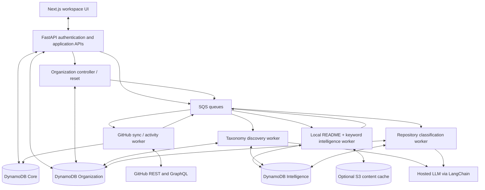
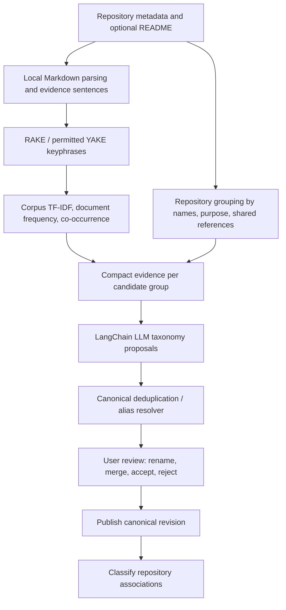
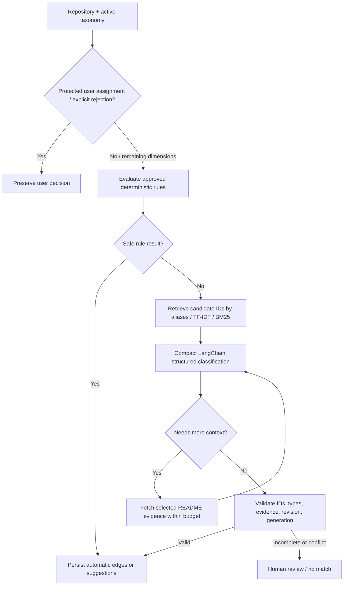

# GitHub Manager — MVP System Design

**Document:** `system-design.md`  
**Version:** 1.0 — consolidated MVP baseline  
**Date:** October 11, 2026  
**Status:** Architecture for implementation review  
**Primary stack:** Next.js / TypeScript · Python / FastAPI · AWS DynamoDB · SQS · LangChain · GitHub REST/GraphQL

> **Purpose.** Build a personal, cross-repository GitHub workspace that discovers *relevant* repositories, creates a reviewable AI-generated taxonomy, organizes repositories into user-managed domains/projects/topics/tags, monitors recent work, and supports repeatable reset/rediscovery demonstrations. This document consolidates all agreed MVP decisions; choices requiring integration testing are called out explicitly.

---

## 1. Executive design decision

### Architecture at a glance

| Area | MVP decision |
|---|---|
| Web UI | Next.js App Router, TypeScript, Tailwind; repository table/cards, project tree, drag-and-drop, bulk edit |
| Application API | FastAPI with Pydantic request/response models, cookie-based app session |
| GitHub connector | REST + GraphQL via Python `httpx`; authentication adapter supports GitHub App and OAuth App |
| Persistence | **Three DynamoDB On-Demand tables**: `GitHubManagerCore`, `GitHubManagerIntelligence`, `GitHubManagerOrganization` |
| Background work | SQS, Python workers; EventBridge for refresh/reorganization scheduling |
| AI | LangChain + configurable hosted LLM; provider-native structured output where supported |
| Local document processing | Markdown parser, **RAKE or licensed YAKE**, corpus-level TF-IDF, deterministic evidence selection |
| Search / matching | Canonical aliases, token normalization, fuzzy matching, TF-IDF/optional BM25 candidate retrieval |
| Content taxonomy | Domains, projects, topics, tags; approved canonical registry with stable IDs and aliases |
| Classification | Existing manual decisions → deterministic rules → compact AI classification → human review when uncertain |
| Organization controller | Status, revision tracking, automatic threshold-triggered update, manual reorganization, history |
| Reset | Two independent scope checklists, preview, type `DELETE`, generation/epoch fencing, physical cleanup |
| Deployment | AWS (e.g., ECS/Fargate for API/workers, or Lambda where appropriate) plus DynamoDB/SQS/S3/Secrets Manager |

**Explicitly excluded from MVP:** KeyBERT, locally deployed embedding models, vector DBs, source-code-wide indexing, LLM fine-tuning, AI GitHub write operations, shared multi-user workspaces, and automatic modification of GitHub repositories.

### Key invariants

1. **GitHub is authoritative** for repository identity, URL, metadata, GitHub topics, access, stars/watches and GitHub-derived activity. AI never writes GitHub-owned fields.
2. **The user is authoritative** for accepted taxonomy and manual relationships. AI suggestions must not silently override accepted or rejected user decisions.
3. **Taxonomy discovery and repo classification are separate workflows** that share a persisted repository intelligence profile.
4. **The canonical registry is persistent memory**, not an LLM conversation. All accepted classifications reference stable concept IDs.
5. **User-visible repos do not wait for AI.** Ingestion, evidence extraction, taxonomy discovery and classification are asynchronous stages.
6. **Reset is scoped to organization state**, unless another explicit account-data deletion workflow is invoked. It never deletes a GitHub repository.
7. **Background writes are generation-fenced** so a delayed worker cannot recreate mappings invalidated by reset.
8. **All DynamoDB reads use known access patterns**, workspace scoping and pagination. No routine whole-table scans.

## 2. Scope and user experience

### 2.1 Main application views

| View | Semantics |
|---|---|
| **My Repos** | Owned repositories, confirmed direct collaborator grants, confirmed team grants, and accessible repositories with identified user contribution. Do **not** indiscriminately include everything publicly readable or organization-readable. |
| **Favorites** | Union of repositories starred or watched by the authenticated user; may include repos absent from My Repos. |
| **Latest Work** | Smart collection for eligible *user-authored* commit/PR/review/issue/push work in a configurable window, default **14 days**. Another developer's push does not count. |
| **Uncategorized** | Repositories with no active project association; classification can independently be pending/reviewed/no-match. Tags alone do not remove a repo from Uncategorized. |
| **Domains / Projects** | Domain → logical projects → associated repositories. One repo can belong to **multiple projects**, including projects in different domains. |
| **Topics / Tags** | Independent cross-cutting many-to-many labels. GitHub-native topics are retained separately from local taxonomy topics. |
| **AI Organization** | Current state, coverage, taxonomy freshness, active job progress, suggestions, prior runs and manual controls. |
| **Settings → Content** | Create/edit/archive/merge domains, projects, topics, tags; aliases, descriptions, organization rules and local repo mappings. |
| **Settings → AI Organizer → Reset & Rediscovery** | Selective destructive reset with server-preview, explicit typed confirmation and optional restart. |

### 2.2 Taxonomy semantics

- **Domain:** a broad technical or business category (e.g., *Platform Engineering*).
- **Project:** an actual solution, product, initiative or related group of repositories (e.g., *GitHub Manager*); each project has one primary domain; each repository can belong to multiple projects.
- **Topic:** a reusable capability or subject (e.g., *Data Harmonization*, *RAG*).
- **Tag:** a specific technology or descriptive label (e.g., *Python*, *FastAPI*, *Experimental*).
- **GitHub topic:** externally sourced `topics[]`; evidence for classification, **not** the same entity as a local Topic/Tag.
- **Smart view:** Favorites, Latest Work and Uncategorized are computed/materialized views, not user-editable canonical projects.

### 2.3 Non-goals and boundaries

- Do not treat GitHub's project-planning feature as this app's logical project taxonomy.
- Do not duplicate raw code or entire READMEs into the LLM prompt.
- Do not promise lifetime contribution history from GitHub's recent-contribution APIs.
- Do not promise full team grant provenance if the selected authentication mode lacks permission to enumerate teams.
- Do not assume watch/subscription endpoint coverage is complete; GitHub changed watching-related API restrictions in 2026 [R4].

---

## 3. Logical component architecture



### Deployable boundaries

- **Next.js web:** views, filters, project tree, taxonomy review, AI status; no GitHub access tokens in browser.
- **FastAPI API:** session/auth, authorization, read models, taxonomy CRUD, manual associations, job orchestration, reset preview/execute, SSE.
- **GitHub sync worker:** discover repo set, enrich metadata, activity, favorites, permission reconciliation, per-user view projections.
- **Intelligence worker:** parse selected README sections, extract keywords, build corpus statistics / candidate groups; no LLM required for extraction.
- **AI worker:** LangChain taxonomy discovery and repository association with structured output, confidence/evidence capture and strict persistence validation.
- **Organization controller:** auto-triggering, taxonomy revision, active-run serialization, reset generations and cleanup. This is a module in the existing Python codebase, **not another mandatory microservice**.

### Event/job types

`GITHUB_INITIAL_SYNC`, `GITHUB_INCREMENTAL_SYNC`, `INTELLIGENCE_EXTRACT`, `TAXONOMY_DISCOVERY`, `TAXONOMY_CONSOLIDATION`, `REPOSITORY_CLASSIFY`, `ORG_RECLASSIFY`, `AUTO_TRIGGER_EVALUATE`, `RESET_CLEANUP`, `RECONCILE_PROJECTIONS`.

Use idempotent `jobId`/`idempotencyKey` and workspace-specific concurrency controls; queues are at-least-once delivery. Log trace IDs across API, queue and workers.

---

## 4. GitHub authentication and repository discovery

### 4.1 Authentication decision gate

GitHub recommends GitHub Apps for finer permission control and shorter-lived tokens [R1, R2]. However, GitHub App user token access is the **intersection** of the user's permissions and the app's installation access [R2]. This can hide repositories from organizations that have not installed the app.

**Implementation:** define `GitHubConnectionAdapter` with `GitHubAppAdapter` and `OAuthAppAdapter`. Prefer a read-only GitHub App where installs are practical. For cross-organization personal aggregation where installation approval is impossible, evaluate an OAuth App MVP connector with explicit user/organization authorization and carefully documented broad-scope implications. Validate the primary integration choice against at least two representative organizations before production rollout. Do not silently fall back to a more privileged token.

- OAuth state, redirect allowlist, CSRF protections, PKCE where supported.
- Server-side HttpOnly/Secure/SameSite session cookie.
- Store credentials server-side encrypted (Secrets Manager/appropriately KMS-encrypted storage); DynamoDB stores only a connection secret reference and status.
- Support expiration, refresh (GitHub App user tokens), revoked access and reauthorization.
- Least-privilege read permission for metadata and optional README (`Contents: read` for GitHub Apps). Additional user permissions for stars/watches/team data are independently assessed.

### 4.2 Discovery sources

| Source | Purpose | Limitation / special handling |
|---|---|---|
| `GET /user` | Durable user identity | Never infer identity from display name alone |
| `GET /user/repos` | Owner/collaborator/organization-member candidates | `organization_member` can include broadly accessible organization repositories [R3] |
| `GET /user/teams` + team repo endpoints | Verify team-granted access | Team membership visibility/permissions vary |
| GraphQL `viewer.repositoriesContributedTo` | Recently contributed-to repositories | Not complete lifetime contribution history [R5] |
| `GET /user/starred` | Favorites starred | Requires suitable token/user permissions [R4] |
| `GET /user/subscriptions` where supported | Favorites watched | Validate 2026 watching-related restrictions/deprecation; mark coverage partial [R4] |
| Repository metadata, topics, languages | UI and local intelligence | Additional requests for language distribution |
| `GET /repos/{owner}/{repo}/readme` | Optional content evidence | `Contents:read`; returns SHA for cache checking [R6] |
| GraphQL refs or paginated branch list | Branch count | Extra/optional query; may be unknown until enrichment |
| User contribution aggregates / selected events | Latest Work | Track who performed the action, not simply `pushed_at` |

**Eligibility model:** store `accessSources[]` (OWNER, DIRECT_COLLABORATOR, TEAM, CONTRIBUTOR, ORG_GENERAL), `effectivePermission`, `accessVerification` (CONFIRMED/INFERRED/UNKNOWN), `eligibleForMyRepos`, `lastAccessCheckedAt`. Default My Repos includes confirmed relevant relationships, not generic public repos. Allow users to explicitly include a repo if visibility is known but direct/team attribution cannot be verified, and show a coverage warning.

**Repo key:** `(githubHost, githubNumericRepoId)`; do **not** use `full_name` as the durable key. On rename/transfer, refresh the external `html_url` and display name, retaining all local organization edges.

### 4.3 Two-stage sync

1. **Fast discovery:** paginate candidates, stars/watches and contribution sources; deduplicate by stable GitHub ID; write trusted metadata and view entries; immediately render My Repos/Favorites.
2. **Enrichment:** selectively retrieve README/languages/branch count/contribution details with rate-limit-aware backoff; record unknown fields as `null` instead of invented values.
3. **Intelligence processing:** queue when profile is missing or content/extractor version changed.
4. **Taxonomy bootstrap:** only when no approved taxonomy exists or the user explicitly requests rediscovery.
5. **Association:** classify new/changed or impacted repos against the active taxonomy.
6. **Reconcile:** incrementally refresh repository eligibility, revoked permissions, and materialized view indexes.

Use conditional HTTP requests where available and GitHub rate-limit headers. No global eager fetch of all full READMEs.

### 4.4 Latest Work

- Default window **14 days**, user-configurable.
- Qualifying activities: user's commits, created/updated PRs, PR reviews, issues, and attributable pushes (configurable in later iterations).
- Explicitly exclude other users' pushes, starring and watching.
- Maintain `lastUserActivityAt` and contribution-type counts; compute membership by comparing activity date to the requested window.
- GitHub GraphQL contribution collections provide a starting point; available history and event coverage have limits. Display activity freshness and uncertainty.

---

## 5. First-run taxonomy intelligence

### 5.1 Purpose and lifecycle

Taxonomy bootstrap is **not** one LLM classification per repo. It discovers a concise collection-wide vocabulary and logical repository groups, then lets the user review and publish it.



### 5.2 Local keyword processing (no model deployment)

- Parse README headings with a Markdown parser; keep Title, Overview/About/Purpose, Features, Use Cases and selective Architecture sections.
- Exclude badges, install instructions, massive code blocks, logs, changelogs and license text from classification evidence.
- **Primary pragmatic default:** RAKE using an appropriately licensed implementation; **YAKE is optional only after AGPL/commercial licensing review** [R7]. Neither requires deploying a semantic model.
- Extract an initial top ~15–25 candidate phrases per repo; retain normalized phrase, original phrase, score, evidence source and extraction version.
- Aggregate **distinct-repository document frequency** and TF-IDF, not just raw word occurrences (a repeated phrase in one README should not overwhelm the corpus).
- Preserve domain abbreviations (MES, LIMS, RAG), multiword technical phrases, and manually maintained stopwords/synonyms.
- Use shared names/owners, README repo links, purposes and co-occurrence to propose related-repo groups; **shared programming language alone is weak project evidence**.
- Optionally use BM25 only for lexical section/candidate ranking; it does not itself extract semantics.
- Save profiles/term statistics in DynamoDB Intelligence; use cached content until SHA/profile version changes.

### 5.3 LLM taxonomy proposal

For each candidate group, pass only a compact summary: supporting repository IDs, names, short purpose evidence, aggregated concepts and relationship signals. Prompt for `DOMAIN`, `PROJECT`, `TOPIC`, `TAG` proposals, short definitions, aliases and supporting repo IDs.

For large accounts, process groups in batches, then run a second **proposal-only consolidation** pass; do not resend full README text. Draft proposals are *not published* until user approval.

**Privacy gate for taxonomy discovery:** keywords, cluster summaries and purpose sentences **derived from a private README are also private content**. Unless the user/organization permits sending private README-derived information to the hosted model, construct that repository's LLM-facing evidence from allowed GitHub metadata only; never bypass the privacy mode merely because text was transformed into keywords.

**Project caution:** avoid creating one project for every repo or one project for every common framework. Group only where purpose/naming/cross-reference evidence supports a logical initiative.

### 5.4 Review and publishing

UI first-run review supports select/unselect, edit name/description, assign project domain, merge aliases, mark distinct (`DO_NOT_MERGE`), add manual concepts, approve. Publish atomic concepts and canonical reservations to the Organization table (in bounded transactions); initialize taxonomy revision 1 and trigger association jobs. Outliers remain uncategorized rather than creating unsupported projects.

A normal **Reorganize with AI** uses the approved taxonomy; **Rediscover Taxonomy** is a distinct operation that generates a reviewable expansion draft.

---

## 6. Canonical taxonomy registry and user ownership

### 6.1 Registry item semantics

Each concept has `conceptId`, `workspaceId`, `kind`, `canonicalName`, `normalizedName`, `description`, `aliases[]`, `status`, `origin` (AI_BOOTSTRAP/USER/AI_SUGGESTION), `userManaged`, `parentDomainId` (for projects), `createdAt`, `updatedAt` and `lastChangedRevision`.

Use stable **concept IDs**, not names, in all association outputs. An alias `RAG` can map to canonical Topic `Retrieval-Augmented Generation`; rename does not change associations.

### 6.2 Deduplication sequence

1. Normalize Unicode, case, whitespace, punctuation and selected technology spelling; normalize without destroying significant distinct terms.
2. Directly look up canonical name or alias reservation within `(workspaceId, kind, activeTaxonomyEpoch)`.
3. If no exact match, fuzzy-check existing concepts (e.g., RapidFuzz). A small workspace taxonomy can be retrieved by DynamoDB `Query`, not a table scan.
4. If semantically ambiguous, ask hosted LLM for an **equivalence verdict**, not to create a new canonical concept autonomously.
5. Resolve to existing, add alias, create draft, or request human review.
6. Persist canonical/alias reservations via DynamoDB **conditional transactional writes** so concurrent requests cannot claim the same normalized term.

Do not merge across kinds automatically: `RAG` Topic and `RAG` Tag may coexist. Similarity is not identity (`Data Integration` versus `Data Harmonization`). Persist `DO_NOT_MERGE` distinctions and user rejections.

### 6.3 After-bootstrap user controls

Under Settings → Content, users can **create, rename, edit description/aliases, archive/remove, merge, change project domain, and manually associate repositories** for domains/projects/topics/tags. New concepts become available for immediate manual assignment; AI reorganization may run later.

- Manual edits publish a new meaningful taxonomy revision. Cosmetic icon/color/reorder changes do not.
- Normal removal uses **archive** and dependent association invalidation; full-reset selection uses destructive deletion.
- Archiving retains relevant term reservations/block suggestions to avoid repeated AI recreation.
- A merge keeps the target ID and reconciles source associations in controlled batches; never assume a single large transaction.
- If removing a domain but keeping projects, move those projects to an explicit Unassigned domain, and preview that impact.
- Accepted AI proposals and accepted AI assignments are treated as **user-confirmed** state from that point onward.

---
## 7. Reusable repository intelligence profile

The Taxonomy Intelligence and Repository Classifier share one compact, cached profile per repo. **Local keyword extraction may inspect more of the README than will ever be transmitted to the LLM**, subject to repo privacy and size policies.

Example (synthetic):

```json
{
  "repoKey": "github.com#123456789",
  "profileVersion": "1.0",
  "githubMetadataFingerprint": "sha256-...",
  "readmeSha": "git-sha-...",
  "extractorVersion": "rake-tfidf-v1",
  "privacyMode": "METADATA_AND_APPROVED_EXCERPTS",
  "keyphrases": [
    {"id": "KP1", "text": "MES integration", "source": "README_OVERVIEW"},
    {"id": "KP2", "text": "data harmonization", "source": "README_FEATURES"},
    {"id": "KP3", "text": "FastAPI", "source": "GITHUB_METADATA"}
  ],
  "evidence": [
    {"id": "E1", "section": "Overview", "text": "Extracts manufacturing batch data and transforms it into standardized templates."}
  ],
  "contentHash": "sha256-...",
  "lastExtractedAt": "2026-10-11T17:00:00Z"
}
```

**Caching rules:** distinguish raw README SHA, selected-evidence hash, GitHub metadata fingerprint and extractor version. If a README changes only in an install example and extracted evidence stays identical, reclassification is unnecessary. Profile history is optional; raw README may remain only in transient worker memory or encrypted S3 when needed.

**Privacy:** private README snippets are **not** sent to an external LLM by default. Provide opt-in at an appropriate organization/user scope and allow metadata-only classification. Treat README instructions as untrusted text (prompt injection). Never include tokens, credentials or secret-bearing excerpts.

## 8. Repository AI association

### 8.1 Decision order



**No second LLM extraction step** is needed to create keywords/purpose text. README purpose evidence is sourced from actual sentences selected locally.

### 8.2 Candidate selection

Select roughly **2–3 domains, 5–8 projects, 6–10 topics and 8–12 tags** using canonical aliases, exact matching, name/description similarity and lexical retrieval. The model can return `NO_MATCH` or `NEEDS_MORE_CONTEXT`; it is never forced to select an incorrect candidate. If candidate recall is inadequate, broaden the search and retry **once** when justified, not indefinitely.

### 8.3 LLM input budget

| Input segment | Default target tokens |
|---|---:|
| Repo name, description, topics, languages | 80–150 |
| 8–12 cached keyphrases | 40–100 |
| One or two purpose/capability sentences | 60–120 |
| Relevant candidate concept IDs/names/short descriptions | 150–300 |
| System instructions / format overhead | 200–300 |
| **Typical compact request** | **~530–970** |
| Further README evidence on escalation | Up to 300–500 tokens |
| Total input ceiling | ~2,000 tokens, with actual model/tool-schema counting |

The budget must be measured using the configured provider's tokenizer/counting support and include response format overhead. Output allocation depends on the number of assignments (e.g., 300–500 tokens), not a fixed 100 tokens for every repo.

### 8.4 Strict structured response

Use LangChain `with_structured_output(PydanticModel)` where supported, with provider-native structured output preferred. Example:

```python
from typing import Literal
from pydantic import BaseModel, ConfigDict, Field

Kind = Literal["DOMAIN", "PROJECT", "TOPIC", "TAG"]

class Assignment(BaseModel):
    model_config = ConfigDict(extra="forbid")
    kind: Kind
    concept_id: str
    confidence: float = Field(ge=0, le=1)
    evidence_ids: list[str] = Field(default_factory=list, max_length=5)
    reason: str = Field(max_length=240)

class ConceptSuggestion(BaseModel):
    model_config = ConfigDict(extra="forbid")
    kind: Kind
    proposed_name: str = Field(max_length=100)
    description: str = Field(max_length=300)
    supporting_evidence_ids: list[str] = Field(default_factory=list)

class RepoClassification(BaseModel):
    model_config = ConfigDict(extra="forbid")
    status: Literal["CLASSIFIED", "NO_MATCH", "NEEDS_MORE_CONTEXT"]
    assignments: list[Assignment] = Field(default_factory=list)
    new_concepts: list[ConceptSuggestion] = Field(default_factory=list)
    summary: str = Field(max_length=300)

classifier = llm.with_structured_output(RepoClassification)
# Result is parsed/validated by provider integration and Pydantic.
# The backend MUST still validate every returned taxonomy ID and rule.
```

**The model does not return** `repoId`, GitHub URL, GitHub language, branch count, timestamps, permission, owner or other GitHub metadata. The job attaches the trusted repository key to the result.

**Mandatory application validation:**

- Every concept exists, is ACTIVE, belongs to the workspace, has the matching `kind` and appeared among allowed candidates.
- Every evidence reference belongs to the actual supplied profile.
- No result overrides a locked USER edge or `REJECT` feedback.
- Project→domain relationship is taken from the canonical registry; domains are usually derived from selected projects.
- A suggestion is **not a canonical concept** until deduplication and approval.
- Classification result uses active taxonomy epoch/revision and organization generation; transactional commit fencing required.
- Validate `NO_MATCH` or `NEEDS_MORE_CONTEXT` semantics and maximum assignment counts; never fabricate a mapping to fill a gap.

**Model confidence is not calibrated.** Initial MVP should expose configurable auto-apply versus review policy and benchmark per-type precision before turning on automatic AI application broadly. Rule-based mappings may apply directly; ambiguous AI assignments remain suggestions. Accepting an AI edge promotes it to user-confirmed state, preserving it across AI-only resets.

### 8.5 Provenance and learning

Edge `source` is one of `USER`, `RULE`, `AI`; status `ACTIVE`, `PROPOSED`, `REJECTED`, `REMOVED`. Explicit manual removal creates a rejection/tombstone so AI cannot recreate it. Store model/prompt/extractor versions, evidence hash, input hash, reason and classification run ID. User correction samples can be selected as compact few-shot examples, or generalized to a new **user-approved** deterministic rule. No model fine-tuning is required.

---

## 9. DynamoDB physical data model

### 9.1 Table boundaries

All tables use `PK` (string), `SK` (string), `PAY_PER_REQUEST`. Keys below are **illustrative and normative in shape**; internal IDs should be opaque and safely encoded. All tenant-specific records are addressed through `workspaceId`.

- **`GitHubManagerCore`**: GitHub-authoritative data and personal view index projections. Preserved by organization reset.
- **`GitHubManagerIntelligence`**: extracted evidence and corpus keyword statistics; optionally reset.
- **`GitHubManagerOrganization`**: taxonomy, names/aliases, manual/automatic relationships, run state, feedback and reset.

S3 is optional for transient/large raw README or discovery artifacts. Never embed entire README blobs in DynamoDB (400 KB maximum item size; keep profiles much smaller).

### 9.2 Core table keys

| Entity / access | PK | SK | Notes |
|---|---|---|---|
| User profile | `USER#U1` | `PROFILE` | GitHub identity |
| Connection | `USER#U1` | `GITHUB_CONNECTION#github.com` | Auth mode, secret reference, status |
| Workspace | `WS#W1` | `META` | Owner and UI defaults |
| Canonical repo snapshot | `WS#W1#REPOS` | `REPO#github.com#987` | Stable GitHub ID + full metadata |
| My Repos view item | `WS#W1#VIEW#MY` | `PUSH#<ISO8601>#REPO#github.com#987` | Eligible repo only; lightweight |
| Favorites view item | `WS#W1#VIEW#FAVORITES` | `NAME#<normalizedName>#REPO#github.com#987` | Starred OR watched |
| Latest Work view item | `WS#W1#VIEW#LATEST` | `ACT#<ISO8601>#REPO#github.com#987` | Personal activity timestamp |
| Activity aggregate | `WS#W1#ACTIVITY` | `REPO#github.com#987` | Counts, `lastUserActivityAt` |
| GitHub sync run | `WS#W1` | `SYNC#<timestamp>#<runId>` | Cursor/counters and error state |

A view item is an intentionally duplicated projection. If timestamp/name changes, delete old sort-key item and insert new one (ideally in a bounded transaction when dependent on same logical update). Store `viewKey`/prior-sort reference or regenerate projections via reconciliation. For Latest Work, `Query` with `SK >= ACT#<cutoff>` and reverse order yields the requested window; membership is dynamic by user preferences.

Favorites are an independent collection: a starred public repo need not meet My Repos eligibility. If access is lost, mark unavailable and purge restricted cached content according to retention/security policy.

### 9.3 Intelligence table keys

| Entity / access | PK | SK | Notes |
|---|---|---|---|
| **Current profile per workspace** | `WS#W1#PROFILES` | `REPO#github.com#987` | This partition allows paginated retrieval of all current workspace profiles; avoids table scans |
| Optional versioned evidence | `WS#W1#REPO#github.com#987` | `EXTRACT#<sourceHash>#<extractorVersion>` | History/versioned details, optional |
| Corpus keyword | `WS#W1#TERMS` | `TERM#<normalizedPhrase>` | Document frequency, score, *bounded* evidence refs |
| Candidate group | `WS#W1#CLUSTERS` | `CLUSTER#C7` | Representative repo IDs/phrases, compact evidence |
| Discovery input/run | `WS#W1#DISCOVERY` | `RUN#R1` | Version, input refs, model usage |

**Important:** do not store an unbounded array of supporting repo IDs on one term. Keep document frequency, a limited representative sample and/or paginated term→repo edge items if required. TF-IDF/corpus grouping is performed by the worker, not a native DynamoDB full-text query.

### 9.4 Organization table: control and canonical taxonomy

| Entity / access | PK | SK |
|---|---|---|
| Workspace organization control | `WS#W1` | `CONTROL` |
| Concept | `WS#W1#TAX#T4` | `CONCEPT#PROJECT#P01` |
| Reserved canonical or alias term | `WS#W1#TAX#T4` | `TERM#PROJECT#agent-framework` |
| User-approved rule | `WS#W1#TAX#T4` | `RULE#RULE01` |
| Taxonomy change event | `WS#W1#TAX#T4` | `CHANGE#<revision>#<id>` |
| `DO_NOT_MERGE` distinction | `WS#W1#TAX#T4` | `DISTINCT#<kind>#<pairHash>` |
| AI taxonomy proposal | `WS#W1#TAX#T4#PROPOSALS` | `PROPOSAL#PR01` |

**Canonical name uniqueness:** `TERM#<kind>#<normalizedName>` is a reservation pointing to a single `conceptId`. Use `TransactWriteItems` to write the concept and all term reservations atomically with conditional nonexistence (or same-owner check), and update `CONTROL.taxonomyRevision`. A conflicting alias produces a validation error, never a duplicate concept. Merging multiple associations is batched due to transaction limits.

### 9.5 Organization table: many-to-many associations

**Forward association, repo → concept:**

```text
USER edge:
PK = WS#W1#TAX#T4#REPO#github.com#987#USER
SK = PROJECT#P01

Automatic (AI or rule) edge:
PK = WS#W1#TAX#T4#REPO#github.com#987#AUTO#A9
SK = PROJECT#P02
source = AI | RULE
```

**Reverse association, concept → repo:**

```text
USER edge:
PK = WS#W1#TAX#T4#CONCEPT#PROJECT#P01#USER
SK = REPO#github.com#987

Automatic edge:
PK = WS#W1#TAX#T4#CONCEPT#PROJECT#P02#AUTO#A9
SK = REPO#github.com#987
```

Repeat the same keys with `DOMAIN`, `TOPIC`, `TAG`. Store one logical association in two records, written or removed with a **transaction**. Edges include provenance (`source`), status, createdAt, evidence/run IDs, and user lock state. Use condition checks on active generation/revision and on concept ACTIVE status in the same transaction when committing AI assignments. User acceptance promotes an AI edge to a USER edge; a rejected edge becomes USER feedback/tombstone.

**Per-repo projection for explorer:**

```text
PK = WS#W1#TAX#T4#REPO#github.com#987#STATE
SK = SUMMARY
manualProjectIds = [...]
automaticProjectIds = [...]
topicIds = [...]
tagIds = [...]
autoEpoch = A9
classificationStatus = CLASSIFIED
```

This is a compact read projection; forward/reverse edges remain authoritative. If the projection's auto epoch differs from the active `CONTROL.aiEpoch`, its automatic lists are ignored. `BatchGetItem` for the page of repo summaries avoids N+1 queries; reconcile projections after failed writes.

**Uncategorized:** derived from **zero active project edges** across USER and current AUTO namespaces. A materialized uncategorized partition is optional; for small MVP inventories a compact summary pass is sufficient. Do not classify a repo as organized solely because it has tags.

### 9.6 Organization table: status, runs, resets

| Entity | PK | SK |
|---|---|---|
| Run history | `WS#W1` | `ORGRUN#<timestamp>#<runId>` |
| Run counters/metadata | `WS#W1#RUN#R1` | `META` |
| Per-repository run result | `WS#W1#RUN#R1` | `REPO#github.com#987` |
| Feedback/rejection | `WS#W1#TAX#T4#REPO#github.com#987#USER` | `REJECT#PROJECT#P02` |
| Reset preview | `WS#W1` | `RESETPLAN#<id>` (short TTL only for preview) |
| Reset operation/audit | `WS#W1` | `RESET#<timestamp>#<id>` |
| UI notification | `WS#W1` | `NOTICE#<timestamp>#<id>` |

**Control item example:**

```json
{
  "PK": "WS#W1",
  "SK": "CONTROL",
  "organizationGeneration": 8,
  "taxonomyEpoch": 4,
  "aiEpoch": 9,
  "intelligenceCacheEpoch": 3,
  "taxonomyRevision": 16,
  "lastProcessedRevision": 15,
  "status": "UPDATES_AVAILABLE",
  "pendingChangeScore": 4,
  "pendingChangedEntities": 2,
  "nextEvaluationAt": "2026-10-11T18:30:00Z",
  "activeRunId": null,
  "autoOrganizeEnabled": true
}
```

For automatic trigger scheduling, one **optional sparse GSI** can index only pending controls using `GSI1PK = AUTO#PENDING` and `GSI1SK = <nextEvaluationAt>#<workspaceId>`; periodically query due items and revalidate `CONTROL` before queueing. GSI reads are eventually consistent, so never use the index alone to approve a reset or classify a result.

### 9.7 Access-pattern matrix (implementation contract)

| UI/service requirement | Table | Query/write path |
|---|---|---|
| List My Repos / Favorites / Latest Work | Core | `Query` dedicated view partition, page by `LastEvaluatedKey` |
| Get metadata for repo IDs | Core | `BatchGetItem` (chunk and retry unprocessed keys) |
| Read entire workspace evidence corpus | Intelligence | `Query WS#W1#PROFILES`, paginate; no scan |
| Read single evidence profile | Intelligence | `GetItem` current profile |
| List active taxonomy by type | Organization | `Query PK=WS#W1#TAX#T4` with `SK begins_with CONCEPT#<kind>` |
| Resolve exact name/alias | Organization | `GetItem TERM#<kind>#<normalizedName>` |
| Get all mappings for repo | Organization | `Query` USER and active AUTO forward partitions |
| Get all repos for project/tag/topic | Organization | `Query` USER and active AUTO reverse partitions; merge IDs |
| Show organization on a repo page | Organization | `BatchGetItem` summary projections |
| Add/remove association | Organization | Transactional forward/reverse writes plus guarded projection update/reconciliation |
| AI status | Organization | `GetItem CONTROL` + optional active run `META` |
| Run history/detail | Organization | `Query` `ORGRUN#` and run-item partition |
| Auto reorganization | Organization | `CONTROL` pending state; optional sparse GSI; worker recheck |
| Reset preview | Organization/Intelligence | Workspace-scoped paginated queries/count projections and dependency expansion |
| Reset execute | Organization | Conditional epoch/generation update, explicit cleanup jobs |

DynamoDB `Query` reads up to **1 MB per page**, and `FilterExpression` does not reduce read units for evaluated items [R8]. `TransactWriteItems` permits **up to 100 actions and 4 MB** [R9]. Design bounded transactions, retry throttling/transaction conflicts with backoff, and avoid assuming `BatchWriteItem` is transactional.

### 9.8 Search/filtering MVP strategy

- Exact search: repo name, owner, language, canonical tag/topic/project names and aliases.
- Small workspace text search: retrieve compact metadata views/page(s), apply in-memory filters and optional local inverted keyword indexes.
- Project view: query reverse edges first, then batch-hydrate GitHub metadata and summaries.
- Combined arbitrary server-side filters/sorts are **not** free DynamoDB joins. Validate behavior and latency at realistic repo counts (100, 1,000 and 5,000).
- No OpenSearch or vector index for MVP. Add a search service only after workload measurements demonstrate need.

---

## 10. Organization controller, revisions, user-initiated update

### 10.1 Organization status model

Track **three independent aspects**:

- **Execution:** `IDLE`, `QUEUED`, `RUNNING`, `COMPLETED`, `PARTIAL_FAILED`, `FAILED`, `CANCELLED`.
- **Coverage:** repo count, project-organized count, uncategorized count, review count, failed count. Tags/topics do not imply project coverage.
- **Freshness:** current taxonomy revision vs last successfully processed revision; pending meaningful changes; stale profile counts.

Workspace setup states: `UNINITIALIZED → SYNCING_GITHUB → DISCOVERING_TAXONOMY → AWAITING_TAXONOMY_APPROVAL → CLASSIFYING → READY`. `UPDATES_AVAILABLE` and `RESETTING` are explicit surfaced states. A completed job can still leave unresolved/uncategorized repos.

### 10.2 Change events and automatic thresholds

Every meaningful Settings → Content change emits a `taxonomy_change_event` with `entityId`, `kind`, `changeType`, `revision`, `impactWeight`, `source` and timestamp.

**Suggested default trigger policy (configurable):**

- 15-minute accumulation window; wait for **90 seconds of inactivity** before action.
- Auto-trigger when weighted change score **≥6 across 3+ entities**, **or ≥2 new projects**.
- Minimum 30 minutes between automatic organization runs.
- Example weights: new project 3, renamed/meaningfully edited project 2, new domain 2, new topic/tag 1, rule update 2, cosmetic edits 0, manual repo drag-and-drop 0.
- Manual **Reorganize with AI** is always available (subject to concurrency/rate limits), even if only one change occurred or no changes are detected.
- AI-generated *unapproved* proposals do not count as changes; avoid self-triggering loops.

### 10.3 Reorganization modes

| Mode | Scope | Typical trigger |
|---|---|---|
| `INCREMENTAL` | Uncategorized/low-confidence/stale repos, candidate matches for changed concepts, and relevant existing associations | Automatic or manual default |
| `FULL_CLASSIFICATION` | All eligible repositories against **existing** approved taxonomy, using cached profiles where valid | Explicit manual request |
| `REDISCOVER_TAXONOMY` | New draft concepts from repo inventory, subject to canonical dedup and user approval | Explicit user request or first-time bootstrap |

New projects must be able to attract **previously categorized** repos. Do not limit incremental runs to Uncategorized. A new project can be an *additional* membership: AI can suggest new edges, but should never remove manually accepted edges automatically.

**Concurrent run policy:** one active organization run per workspace. Additional triggers coalesce into pending revisions. Run starts with snapshot `(organizationGeneration, taxonomyEpoch, aiEpoch, taxonomyRevision, profile/extractor version)`. If relevant control changes during execution, old results are rejected at commit and affected work is queued again; maintain a `STALE` count rather than misreporting success.

### 10.4 UI progress, notifications, history

AI Organization dashboard displays:

- Taxonomy status and active revision; count of domains/projects/topics/tags.
- Last successful run, last attempt, reason (INITIAL/AUTO/MANUAL/RESET_RESTART), model and tokens used (optional advanced detail).
- Live stage (queued, preparing evidence, classifying, reconciling); eligible/processed/skipped/failed counts.
- Existing associations, new associations, proposals awaiting review, no-match and errors.
- Changes since last successful organization and a **Reorganize with AI** action.
- Run history and per-repo outcome/explanation.

Use `GET /api/v1/organizer/runs/{id}/events` for SSE; implement periodic status polling as a fallback. Notify the user when automatic organization begins and when it ends, with an affected/review count. Do not claim success before the worker commits the outcome.

---

## 11. Reset & Rediscovery — explicitly destructive operation

### 11.1 Two independent selection groups

**Checklist A — AI Organization Data** (normal demo reset; defaults: associations, suggestions and run history selected):

- [ ] AI/rule-derived repository associations (not confirmed user associations)
- [ ] AI taxonomy drafts and pending classification suggestions
- [ ] AI organization job/run history and detailed status (preserve minimum audit record)
- [ ] AI learning feedback and rejected AI suggestions (optional; distinguish from protected manual assignments)
- [ ] Extracted keyword/evidence/classification caches (optional; triggers local re-extraction)

**Checklist B — User Taxonomy and Content Organization** (all unchecked by default):

- [ ] Domains
- [ ] Projects
- [ ] Topics
- [ ] Tags
- [ ] Organization rules

Deleting a selected concept kind necessarily deletes/invalidates dependent associations, irrespective of provenance. For example, deleting Projects also deletes user project memberships. Preview must disclose those dependencies. A user-approved AI concept is a taxonomy concept and is **not** removed by AI-only reset.

### 11.2 End-user safety flow

1. User selects checkboxes and optionally **Restart after reset** with mode `RECLASSIFY_EXISTING` or `DISCOVER_AND_RECONCILE`.
2. API computes **server-side impact preview**: concept counts, USER vs AUTO edges, proposals, feedback, run records, caches, dependent project moves, preserved repo count.
3. UI displays an explicit statement of what is preserved: GitHub account connection, repo URL/metadata, favorites and activity.
4. User must type **exactly `DELETE`**; UI posts the unmodified confirmation text and an expiring server-issued reset-plan ID.
5. API verifies authenticated ownership, plan version/scope/hash/expiry, CSRF protection, `DELETE`, and idempotency key; if workspace changed since preview, reject and require a new preview.
6. Backend marks `RESETTING`, fences running jobs, logically invalidates selected namespaces, queues **explicit physical deletion**, and reports cleanup progress.
7. Optional restart begins only against new active state. Full reset requires new taxonomy discovery and approval; AI-only reset can immediately reclassify against approved taxonomy.

**Do not use DynamoDB TTL as the reset deletion mechanism.** TTL deletion is asynchronous and can be delayed more than 48 hours [R10]. Only claim deletion completed after explicit cleanup has actually finished and been verified.

### 11.3 Generation and epoch semantics

| Counter | Increment when | Purpose |
|---|---|---|
| `organizationGeneration` | **Every confirmed reset** | Invalidate in-flight organization jobs and stale queued work |
| `taxonomyEpoch` | Full replacement of all taxonomy/user organization | Hide old taxonomy, names/aliases and user mappings immediately |
| `aiEpoch` | Reset of AI-derived classification/rule associations | Hide old AUTO edges while preserving user taxonomy and USER edges |
| `intelligenceCacheEpoch` | Reset of extraction caches | Hide old keyword/evidence profiles and prevent stale re-creation |
| `taxonomyRevision` | Meaningful approved taxonomy changes | Indicate staleness of classification results; reset to 0 only for a new taxonomy epoch |

**Do not increment an epoch unnecessarily:** clearing only run history should not invalidate otherwise retained AI associations. A partial reset of only Projects/Topics/Tags remains in the current taxonomy epoch, marks selected concepts as deleting/inactive and explicitly removes dependent edges and projections. Clearing run history still increments the organization generation to fence in-flight writers; if an unaffected run was cancelled by that fencing, the controller may enqueue a replacement run while retaining committed associations.

**Example AI-only reset:** generation 8→9; AI epoch 9→10; taxonomy epoch stays 4; manual mappings remain active. **Example full reset:** generation 9→10; taxonomy epoch 4→5; AI epoch 10→11; taxonomy revision resets to 0.

### 11.4 Transactional worker fencing

For every organization result commit, include a DynamoDB `TransactWriteItems` **ConditionCheck** on `Organization.CONTROL` for `(organizationGeneration, taxonomyEpoch, aiEpoch, taxonomyRevision, status)` and the association/review writes in the **same** transaction. The reset operation atomically advances the control item before cleanup, so a transaction using the old generation fails even if an SQS message arrives late.

- Do not check generation once, then perform unguarded writes later; that introduces a reset race.
- Read `CONTROL` consistently where correctness matters; never use the pending-work GSI for authorization.
- A worker seeing stale generation discards results and records `CANCELLED_STALE` without retrying old writes.
- For long runs, check periodically to save unnecessary LLM cost; only the transactional commit check guarantees correctness.
- If reset also clears Intelligence cache, profile writes must validate `intelligenceCacheEpoch` or use versioned cache keys.

### 11.5 Physical cleanup and partial reset

- **Full reset:** new taxonomy epoch creates an empty active namespace immediately; cleanup worker paginates the obsolete epoch and deletes records in batches, with verified counts and error retry. Old approved terms do not leak into new discovery.
- **AI-only reset:** new AI epoch logically hides old automatic edges; cleanup deletes AUTO partitions/projections and selected drafts/history according to scope. USER edges remain.
- **Partial taxonomy reset:** archive/deactivate targeted concept types, suppress them from candidate retrieval, remove forward/reverse edges and maintain user-visible preview of dependent effects. Use resumable jobs and reconciliation.
- **Caches:** if the user retains intelligence, reuse evidence. If cleared, rerun local extraction from allowed cached source or selectively refetch GitHub content.
- **Audit:** preserve minimal reset operation identity/scope/timestamp/outcome even if run history is cleared. Provider retention and backups are governed by separate policies.
- **No GitHub deletion:** deletion affects only application organization state.

### 11.6 Reset state machine

`PREVIEWED → CONFIRMED → RESETTING → LOGICALLY_RESET → PHYSICAL_CLEANUP → RESET_COMPLETED → (DISCOVERING_TAXONOMY | CLASSIFYING | READY)`.

If cleanup and rediscovery overlap, UI must distinguish **logical reset** from **physical deletion completed**. If the selected retention policy requires verified deletion before AI restarts, gate restart on cleanup completion.

---

## 12. FastAPI endpoint contract

All routes below are examples of final functional boundaries. Prefix `/api/v1` and require authenticated workspace authorization; user IDs must come from the session, not arbitrary request headers.

### GitHub/session/repository

| Method | Route | Behavior |
|---|---|---|
| `GET` | `/auth/github/start` | GitHub authorization redirect |
| `GET` | `/auth/github/callback` | Validate state, complete token exchange, create user/session, enqueue sync |
| `GET` | `/me` | User/connection/permission coverage |
| `POST` | `/sync` | Enqueue incremental/full GitHub sync |
| `GET` | `/sync/{jobId}` | Progress/cursor/errors |
| `GET` | `/repos?view=my|favorites|latest|uncategorized` | Paginated, filtered repo explorer |
| `GET` | `/repos/{repoKey}` | Trusted GitHub metadata + combined local organization |
| `GET` | `/activity/latest?days=14` | User activity smart collection |
| `POST` | `/webhooks/github` | Verified webhook receiver where GitHub App installed |

### Taxonomy, association and learning

| Method | Route | Behavior |
|---|---|---|
| `POST` | `/taxonomy/bootstrap` | Discover initial draft from inventory |
| `GET` | `/taxonomy/drafts` | Draft domains/projects/topics/tags with evidence |
| `PATCH` | `/taxonomy/drafts/{id}` | Review/edit/merge/reject draft |
| `POST` | `/taxonomy/drafts/publish` | Publish canonical revision; enqueue classification |
| `GET/POST` | `/taxonomy/concepts` | List/create approved concepts |
| `PATCH/DELETE` | `/taxonomy/concepts/{id}` | Edit/archive concept with dependency validation |
| `POST` | `/taxonomy/concepts/resolve` | Duplicate/alias check for create/rename |
| `POST` | `/taxonomy/concepts/merge` | Merge reviewed concepts |
| `PUT/DELETE` | `/repos/{repoKey}/projects/{conceptId}` | Manual membership write/remove |
| `PUT/DELETE` | `/repos/{repoKey}/topics/{conceptId}` | Manual topic association |
| `PUT/DELETE` | `/repos/{repoKey}/tags/{conceptId}` | Manual tag association |
| `GET/POST` | `/content/rules` | Approved deterministic organization rules |
| `GET` | `/organizer/suggestions` | Pending AI decisions with evidence |
| `POST` | `/organizer/suggestions/{id}/accept` | Promote accepted mapping to USER |
| `POST` | `/organizer/suggestions/{id}/reject` | Persist protected rejection |

### Organization status and reset

| Method | Route | Behavior |
|---|---|---|
| `GET` | `/organizer/status` | Coverage, freshness, current generation/revision, active run |
| `GET` | `/organizer/changes` | Pending meaningful taxonomy changes |
| `POST` | `/organizer/reorganize` | `INCREMENTAL` or `FULL_CLASSIFICATION` run |
| `POST` | `/taxonomy/rediscover` | New taxonomy **draft**, not destructive reset |
| `GET` | `/organizer/runs` | Recent jobs |
| `GET` | `/organizer/runs/{id}` | Detailed run state and counters |
| `GET` | `/organizer/runs/{id}/events` | SSE live status updates |
| `GET/PATCH` | `/organizer/settings` | Policy thresholds/window and auto-apply settings |
| `POST` | `/organizer/reset/preview` | Compute impact; issue short-lived plan ID |
| `POST` | `/organizer/reset/execute` | Require plan ID and exactly `DELETE`; return reset operation ID |
| `GET` | `/organizer/reset/{id}` | Logical/physical deletion and restart status |

### Response examples

**`GET /repos?view=my&limit=50`** (each result is assembled from trusted records):

```json
{
  "items": [{
    "repoKey": "github.com#987",
    "github": {
      "fullName": "engineering/agent-api",
      "htmlUrl": "https://github.com/engineering/agent-api",
      "description": "Agent execution API",
      "language": "Python",
      "defaultBranch": "main",
      "branchCount": 8,
      "pushedAt": "2026-10-10T13:00:00Z",
      "visibility": "private"
    },
    "userRelationship": {
      "starred": true,
      "watched": false,
      "accessSources": ["TEAM"],
      "lastUserActivityAt": "2026-10-10T13:00:00Z"
    },
    "organization": {
      "projectIds": ["P01"],
      "topicIds": ["TOP1"],
      "tagIds": ["TAG1"],
      "status": "CLASSIFIED",
      "needsReview": false
    }
  }],
  "nextCursor": null
}
```

**`POST /organizer/reorganize`:**

```json
{"mode": "INCREMENTAL", "forceReclassification": false}
```

Response `202 Accepted` with `runId`, `status=QUEUED`, `taxonomyRevision`, `organizationGeneration`; do not hold the HTTP request until the LLM completes.

**`POST /organizer/reset/preview`:**

```json
{
  "scope": {
    "ai": {
      "associations": true, "suggestions": true,
      "runHistory": true, "feedback": false, "extractionCache": false
    },
    "taxonomy": {
      "domains": false, "projects": false, "topics": false,
      "tags": false, "rules": false
    }
  },
  "restartAfterReset": true,
  "restartMode": "RECLASSIFY_EXISTING"
}
```

Server returns an expiring `resetPlanId`, exact affected/dependent item counts and `confirmationRequired="DELETE"`. `POST /organizer/reset/execute` accepts the same plan and `confirmationText="DELETE"`, validating it **on the server**, not only in Next.js.

---

## 13. Frontend specification

### 13.1 Navigation

Left sidebar: **My Repos**, **Favorites**, **Latest Work**, **Uncategorized**, then expandable **Domains → Projects**, Topics, Tags, AI Organization, Settings. Content settings expose canonical descriptions and aliases, plus add/edit/archive/merge operations. Project drag-and-drop **adds** an association rather than moving it; removing is explicit. Bulk select is supported.

### 13.2 Repository explorer

- Default compact table with optional cards. Show repo name (link opens a trusted GitHub URL in new tab), owner, description, language, default branch, branch count (or unknown), last GitHub push, last personal activity, starred/watched indicators, project/topic/tag chips and AI provenance/status.
- Clicking the row or details icon opens local details without navigating away; link click opens GitHub separately.
- Search/filter on owner, name, language, project, topic, tag, visibility, updated date, provenance; support pagination and multi-select assignment.
- Render repo rows immediately while AI organization is `PENDING`/`RUNNING`.

### 13.3 Taxonomy and organization screens

- First-run discovery wizard: repository scan → proposed domain/project/topic/tag tree → duplicate/alias warnings → user edits → approve → watch classification progress.
- Settings → Content: user has full post-bootstrap CRUD; validate duplicates on create and rename; immediately show saved concepts.
- AI Organization: coverage, taxonomy freshness, active task progress, previous runs, proposed additions, reasons and review queue, **Reorganize with AI** and **Rediscover Taxonomy** as separate controls.
- Reset & Rediscovery: two independent selection groups, live server-side preview, clear preservation/dependency messages, exact typed `DELETE`, final confirmation, progress and optional restart.
- App notifications: initial sync, new batch-triggered auto organization, completion with counts, incomplete GitHub coverage, reset completion/failure.

### 13.4 Accessibility/interaction

Support keyboard alternative to drag/drop, visible focus, screen-reader labels, clear destructive action text, and responsive narrow-screen behavior. Preserve user search/filters across status updates. A dashboard notification must not block user work.

---

## 14. Security, privacy and reliability

| Risk / control area | Requirement |
|---|---|
| OAuth tokens | Server-side encrypted and rotated/refreshed when applicable; never expose to browser or model |
| Sessions | Secure HttpOnly cookies, CSRF/state validation, authorization on every workspace operation |
| Multitenancy | Every repo/profile/edge scoped to active authenticated workspace; never trust submitted workspace ID alone |
| GitHub link | Use validated GitHub-provided `html_url` for known connection host; external new-tab links use safe `rel` values |
| GitHub access change | Refresh/revoke eligibility, hide inaccessible private content, clear cached derived data according to policy |
| LLM privacy | Metadata-only for private READMEs by default; explicit policy for external-model snippets; no secrets |
| Prompt injection | Treat README as untrusted data; LLM classifier gets no GitHub mutation tools |
| Structured output | Pydantic/provider schema + backend semantic checks + transactional commit checks |
| Queue duplicates | Idempotent run/item IDs; retry with backoff; dead-letter queues and visibility timeout sizing |
| GitHub webhook | Verify HMAC signature, deduplicate delivery IDs, reconcile missed events with polling |
| DynamoDB transactions | Atomic control/association/alias writes; retry conditional conflicts only after state re-read |
| Reset | Exact typed confirmation, expiring preview, generation fencing, verifiable physical cleanup |
| Encryption/audit | TLS, DynamoDB and S3 encryption at rest, limited IAM roles, redacted logs, audit trail |
| Data retention | Define retention for evidence, run history, backups, and model-provider prompts separately |

### Failure and recovery cases

- GitHub API 403/429/rate limits: backoff, persist cursor, continue partial sync and display incomplete status.
- README missing/private forbidden: metadata-only profile, do not fail entire sync.
- AI invalid output: retry with corrected schema only within bounded attempts, then mark `NEEDS_REVIEW`/error.
- New taxonomy revision during run: stale-result commit blocked; queue incremental re-evaluation.
- Reset during worker run: old generation commit rejected; logically reset immediately; cleanup tracked separately.
- Failed mirror edge/projection update: bounded transaction or reconciliation task repairs derived projections.
- DynamoDB throttling/partial batch operations: exponential backoff and `UnprocessedKeys/UnprocessedItems` retry.
- GitHub account disconnected: stop token use and relevant sync/AI jobs, enforce separate app-data retention/deletion workflow.

---

## 15. Performance, cost and observability

### 15.1 Performance assumptions / targets (to validate)

- Primary MVP workspace: **100–1,000 repositories**, with a stress scenario of **5,000**.
- Repo explorer first page: aim for **sub-second cached response at p95** in a typical region; test rather than guarantee.
- Manual mapping operation: aim for **p95 below 500 ms** excluding UI rendering/network variability.
- Initial GitHub discovery and AI taxonomy are asynchronous and should show progress; never block login response on classification.
- Avoid N+1 requests through compact view entries and `BatchGetItem` organization summaries.
- DynamoDB query pages are bounded by 1 MB; use `LastEvaluatedKey` consistently [R8].
- Track read/write units consumed **per feature**; bidirectional edges mean write amplification is real.

### 15.2 Cost model

DynamoDB On-Demand generally fits low-duty-cycle personal workspaces. Cost is driven by billed read/write units, storage and indexes, with added cost for transactions, replicated edges and view materializations. Do not estimate from the number of API calls alone. Other costs: always-on FastAPI ECS tasks (if used), on-demand workers, SQS, EventBridge, Secrets Manager, S3, network, logs and LLM inference. DynamoDB being serverless does **not** make an always-running ECS API free.

Configure CloudWatch metrics and per-run telemetry to compare actual options. For aggressive idle-cost reduction, evaluate FastAPI via API Gateway/Lambda, while keeping long-running/batch workers on SQS/Lambda or on-demand ECS tasks where appropriate; deployment mode is a cost/latency decision separate from the data model.

### 15.3 Observability

Collect `github_sync_discovered/eligible/failed`, auth coverage, user/team contributor source distribution, `readme_fetch_count/cache_hit`, keyword-extraction time, `taxonomy_proposals/deduplicated/approved`, `classification_input_tokens/output_tokens`, token dollars if supplied by provider, candidate recall, acceptance/rejection rate, `organization_revision_lag`, `organization_generation`, reset deletion pending, DynamoDB consumed capacity, transaction retries, SQS DLQ depth and API p50/p95.

Record `runId`, `repoKey`, `workspaceId`, `generation`, `taxonomyEpoch`, `aiEpoch`, `taxonomyRevision`, `modelVersion`, `promptVersion`, `extractorVersion`, `inputHash`, `evidenceIds` and outcome for reproducibility, but do not log sensitive README text/tokens indiscriminately.

---

## 16. Implementation sequence and deliverables

| Phase | Scope | Demonstrable outcome |
|---|---|---|
| **1. Foundation** | Next.js/FastAPI skeleton, sessions, IAM/environment, DynamoDB three tables and repository abstractions | Health/API and secured workspace skeleton |
| **2. GitHub Integration** | Auth adapter, user/repos/stars/watches/contributions, metadata enrichment, cached views | My Repos, Favorites and GitHub links work without AI |
| **3. Intelligence Profiles** | README parser, RAKE or licensed YAKE, keyword cache, corpus TF-IDF/grouping | Inspect reusable per-repo evidence and group summaries |
| **4. Canonical Taxonomy** | Registry, aliases/reservations, dedup, user CRUD and review UI | Stable domain/project/topic/tag IDs; uniqueness test |
| **5. First-Run AI Discovery** | LangChain taxonomy proposals, consolidated drafts, user approval, revision publication | Discover/review/publish useful taxonomy |
| **6. Repository Association** | Candidate matching, structured output, app validation, bidirectional edges, manual overrides | Automatic and manual multi-project associations |
| **7. Status and Reorganization** | Change score, debounce/cooldown, status/SSE, run history, manual incremental/full run | User sees and controls reorganization |
| **8. Latest Work / Sync Hardening** | User-activity aggregation, periodic refresh, access reconciliation | Activity-based smart view stays current |
| **9. Reset & Rediscovery** | Two checklists, server preview, `DELETE` confirmation, generation/epoch writes, cleanup, restart | Repeatable demo without reconnecting GitHub |
| **10. Validation / Deployment** | Integration, security, concurrency, throughput, token budget and cost tests | MVP readiness decision |

### Suggested Python package boundaries

```text
backend/app/
  api/{auth,repositories,taxonomy,organizer,reset,webhooks}.py
  github/{client,oauth_app,github_app,discovery,metadata,activity}.py
  intelligence/{readme_parser,keyword_extractor,corpus_index,profile_builder}.py
  taxonomy/{discovery,deduplicator,registry,review}.py
  organizer/{context_builder,classifier,validator,controller,feedback}.py
  persistence/{dynamodb_client,keys,core,intelligence,organization}.py
  workers/{sync_worker,intelligence_worker,taxonomy_worker,organization_worker,cleanup_worker}.py
  schemas/{repo,taxonomy,classification,jobs,reset}.py
```

Use one Python codebase with separate API/worker entrypoints. Hide DynamoDB key construction in `persistence`, not in UI routes or LLM chains. DynamoDB boto3 operations are typically synchronous; use appropriate threadpool/worker execution if invoked from async FastAPI paths.

---

## 17. End-to-end tests and MVP acceptance criteria

### 17.1 GitHub integration

- Owned, direct-collaborator, team-granted and recently contributed repos are discovered as permitted; generic broadly readable repos are excluded by default.
- Starred and watched are modeled independently, with coverage limitations displayed.
- Repo rename/transfer preserves organization associations through stable GitHub ID.
- GitHub URL, branch, language, permission and timestamps survive failed AI runs unchanged.
- Partial GitHub API failures do not erase previously imported accessible data; access revocation hides restricted content.

### 17.2 Taxonomy and AI

- Initial LLM draft includes correct domains/projects/topics/tags for a manually labeled benchmark sample and supporting repo evidence.
- Distinct naming variants converge to one canonical term; similar but **not equivalent** concepts remain distinct.
- A project has one primary domain; repo can be associated with multiple projects and tags/topics.
- User can create, rename, edit, archive and merge all four concept kinds after first-run discovery.
- User correction/rejection is never silently overwritten by subsequent AI organization.
- `with_structured_output` schema errors, invented IDs, incorrect concept kind or stale taxonomy revisions never persist associations.
- Only bounded metadata/phrases/representative purpose text are sent to the model; private README snippets require policy opt-in.
- Benchmark A: metadata+phrases; B: +1–2 purpose sentences; C: +up-to-300 README evidence. Evaluate multi-label precision/recall, candidate recall, reviewer correction rate and tokens per correct association on **100–200 reviewed repos**. Select thresholds from measurement.

### 17.3 Status and updates

- One project change makes update manually available without forcing auto-run.
- A batch of significant edits triggers **one** automatic run after debounce; AI suggestions alone do not cause loops.
- New projects can receive **already-categorized** relevant repos; user mappings remain intact.
- Run history differentiates completed, partial failure, no-match, stale and cancelled.
- Latest Work includes user activity, not another person's pushes.

### 17.4 DynamoDB correctness and reset

- Concurrent canonical alias creates cannot produce two owners for the same normalized term.
- Bidirectional edges remain consistent after add/remove/merge; reconciliation catches simulated projection faults.
- Workspace repo listing for 1,000 repos uses `Query` and batched hydration without table scans.
- Invalid reset confirmation or stale preview deletes **nothing**.
- AI-only reset preserves approved taxonomy and USER mappings; full reset preserves GitHub Core while clearing organization.
- Partial reset deletes selected concept kinds and dependent associations without orphan references.
- Start classification, confirm reset, then deliver delayed stale queue messages: **no old association may reappear**.
- UI reports *logical invalidation* separately from verified physical deletion.
- Re-run taxonomy discovery/classification after reset with preserved repo metadata and (if selected) cached intelligence.

### 17.5 Quality gate

Before launch, record actual results for: median/p95 repository list and association latency, DynamoDB billed read/write units, GitHub API coverage, initial sync completeness, AI project precision/recall, user correction rate, candidate retrieval recall, token cost per classified repo, reset cleanup success and stale-worker rejection.

---

## 18. Outstanding implementation decisions / design review actions

These do not change the architecture but should be explicitly resolved in early spikes.

| Priority | Question | Recommended validation |
|---|---|---|
| **P0** | GitHub App versus OAuth App for personal cross-org repo visibility | Test real user permissions and installed/uninstalled organizations; compare coverage and scopes |
| **P0** | Is authenticated watch-subscription listing complete under current API policy? | Exercise actual token and endpoints, provide partial-coverage UI |
| **P0** | What constitutes confirmed team-granted/individual access with limited org permissions? | Build affiliation/provenance fixture and policy toggle |
| **P0** | Private README privacy policy and retention | Default metadata-only, opt-in and organizational restrictions |
| **P0** | RAKE vs YAKE licensing | Use MIT-compatible RAKE baseline; obtain review/license before YAKE production use |
| **P1** | Automatic AI association versus review-first threshold | Benchmark 100–200 human-labeled repos and calibrate per concept kind |
| **P1** | Does candidate shortlist preserve correct project recall? | Measure recall and implement one bounded expansion step |
| **P1** | How many association summaries can be updated per run transaction? | Load-test transaction conflicts/cost and reconciliation |
| **P1** | Cleanup-before-restart policy for destructive demo resets | Match UX wording and retention requirements |
| **P2** | API hosting: always-on Fargate versus Lambda | Compare idle cost, wake latency, SSE needs and GitHub callback behavior |
| **P2** | Advanced compound filters beyond MVP repo volume | Measure client/server filtering before adding search infrastructure |

### Decision log

- **D-001:** DynamoDB replaces PostgreSQL for MVP; three tables, On-Demand.
- **D-002:** Keep GitHub metadata authoritative and independent of AI output.
- **D-003:** Local keyword intelligence included; KeyBERT/embeddings excluded.
- **D-004:** Initial taxonomy AI-generated as a draft, then user-approved canonical registry.
- **D-005:** Users can change all four taxonomy concept types after initialization.
- **D-006:** Multi-project/topic/tag associations via bidirectional DynamoDB relationship records.
- **D-007:** LangChain classification uses strict Pydantic structured output and app validation.
- **D-008:** Organization Controller supports status, auto threshold and manual reorganization.
- **D-009:** Reset uses two scope checklists, `DELETE` preview/confirmation and generation fencing.
- **D-010:** GitHub authentication implementation selected after practical permission-coverage spike, with connector abstraction retained.

---

## 19. External technical references

These are primary implementation references, not assertions about a user's own GitHub account.

- **[R1]** GitHub, *Deciding when to build a GitHub App*: https://docs.github.com/en/apps/creating-github-apps/about-creating-github-apps/deciding-when-to-build-a-github-app
- **[R2]** GitHub, *Generating a user access token for a GitHub App* (access intersection): https://docs.github.com/en/apps/creating-github-apps/authenticating-with-a-github-app/generating-a-user-access-token-for-a-github-app
- **[R3]** GitHub, *REST API endpoints for repositories* (`GET /user/repos`, affiliation): https://docs.github.com/en/rest/repos/repos
- **[R4]** GitHub, *REST API endpoints for starring* and *watching* (2026 restrictions): https://docs.github.com/en/rest/activity/starring and https://docs.github.com/en/rest/activity/watching
- **[R5]** GitHub, *GraphQL Users* (`repositoriesContributedTo` is recent): https://docs.github.com/en/graphql/reference/users
- **[R6]** GitHub, *REST API endpoints for repository contents* (README SHA): https://docs.github.com/en/rest/repos/contents
- **[R7]** YAKE licensing: https://github.com/INESCTEC/yake/blob/master/LICENSE ; RAKE-NLTK: https://github.com/csurfer/rake-nltk
- **[R8]** AWS DynamoDB, *Query pagination*: https://docs.aws.amazon.com/amazondynamodb/latest/developerguide/Query.Pagination.html
- **[R9]** AWS DynamoDB, *TransactWriteItems*: https://docs.aws.amazon.com/amazondynamodb/latest/APIReference/API_TransactWriteItems.html
- **[R10]** AWS DynamoDB, *Data modeling building blocks / TTL*: https://docs.aws.amazon.com/amazondynamodb/latest/developerguide/data-modeling-blocks.html
- **[R11]** AWS DynamoDB, *Read consistency*: https://docs.aws.amazon.com/amazondynamodb/latest/developerguide/HowItWorks.ReadConsistency.html
- **[R12]** LangChain, *Structured output documentation*: https://docs.langchain.com/oss/python/langchain/structured-output

---

**Summary:** The MVP is a GitHub-authenticated repository explorer and AI-powered *personal organization* system. It separates authoritative GitHub data, locally computed intelligence and user-controlled organization; generates a reviewable initial taxonomy, enforces stable canonical associations, allows iterative user edits and automatic/manual reorganization, and supports safe repeatable resets. The three-table DynamoDB design and generation-fenced SQS workers underpin these behaviors without requiring PostgreSQL, embeddings or a vector index.
