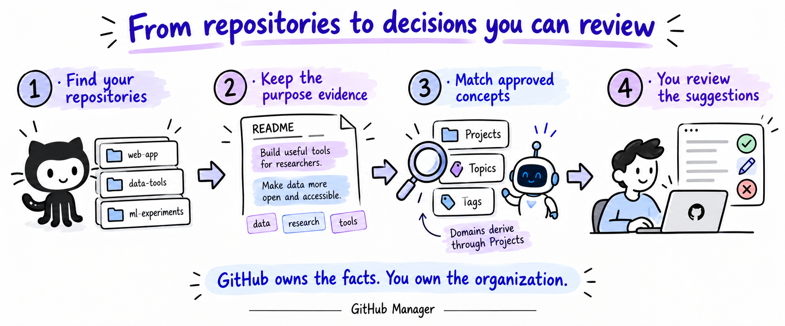
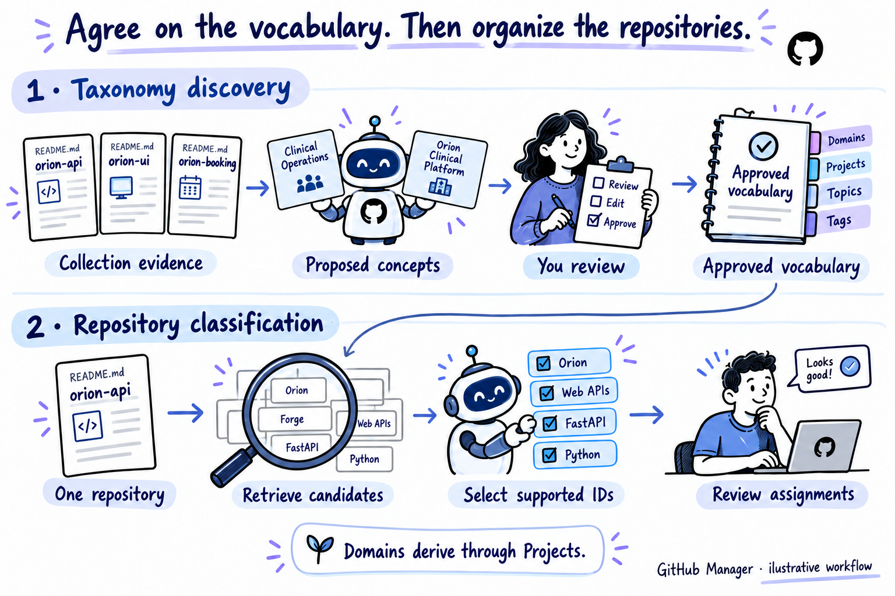
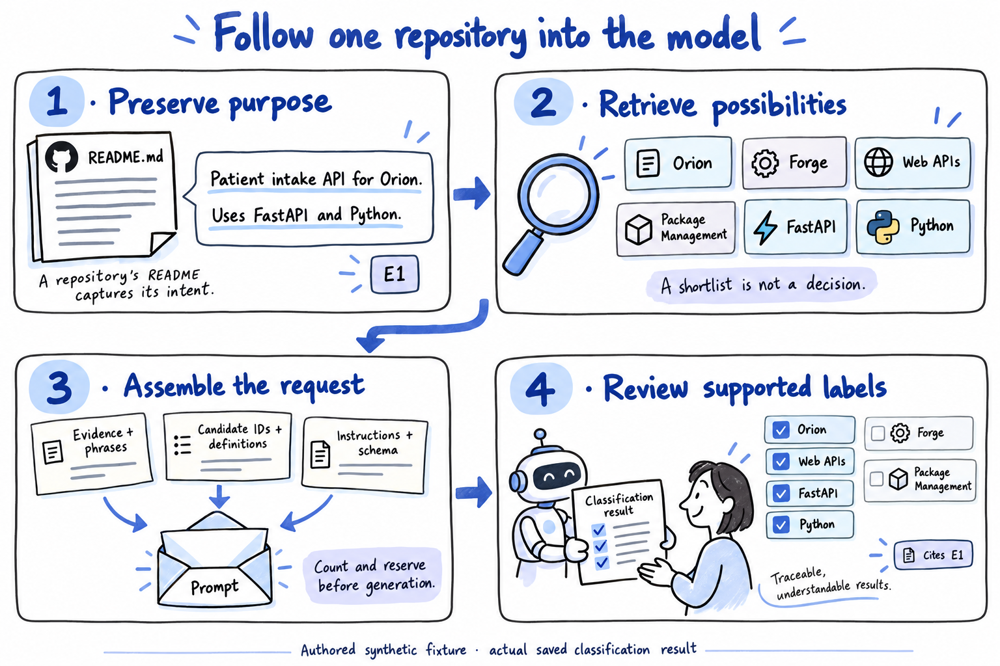
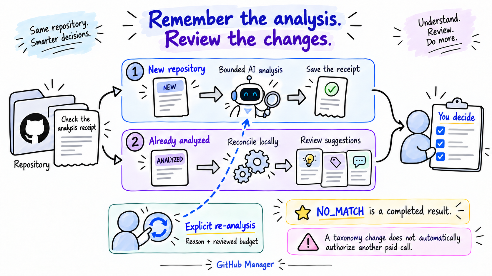

# Making Sense of Your GitHub Repositories

*How GitHub Manager turns repository evidence into an organization you can review, and what the build teaches about context, retrieval, memory and bounded AI.*

Suppose you're starting a new API project. You have your own repositories, some shared with collaborators, and libraries you've starred for later. You want to gather what's useful, see which pieces belong together and keep that organization current.

A repository list gives you names, descriptions and programming languages. The harder work is understanding the relationships. Two repositories can both use Python and FastAPI while serving entirely different purposes. A useful library might belong in your reference collection without belonging to any project you're building.

GitHub Manager is the local application we built around that problem. You connect GitHub, discover repositories and review an organization suggested from their evidence. You can browse by initiative, subject or technology, accept useful relationships, reject misleading ones and reorganize as your work changes.

Building it meant making several decisions that reach beyond repository management: what context an AI model should see, what retrieval should return, who owns the final decision and when the system should ask the model again.

We can make those decisions concrete. [FastAPI](https://github.com/fastapi/fastapi) is a public library sample. `orion-api` is an authored synthetic repository used in real API tests. Both mention FastAPI and Python. Only the latter explicitly describes itself as a patient-intake service for the Orion Clinical Platform. That difference is where our story begins.



*The intended outcome is a workspace whose relationships you can inspect and change. GitHub remains the source of repository facts; the user owns the organization.*

## Give the organization a vocabulary people can understand

Before asking a model to organize anything, we needed to define what an organizational relationship means.

For Orion, “uses Python” and “belongs to the clinical platform” are both useful facts, but they answer different questions. Combining them into one undifferentiated label collection would make browsing confusing and classification difficult to evaluate.

GitHub Manager uses four concept types:

| Concept | The question it answers | Example |
|---|---|---|
| **Project** | Which product or initiative does this repository support? | Orion Clinical Platform |
| **Domain** | Which broader area groups that Project? | Healthcare, in the benchmark registry |
| **Topic** | What capability or subject is this repository primarily about? | Web APIs |
| **Tag** | What technology or descriptive label helps characterize it? | Python; FastAPI when used by an application |

A repository can support more than one Project. Domains derive through Project membership, so they are not independently assigned by the classifier. Topics and Tags remain useful when no Project applies. The app's Topics are also separate from the native topics supplied by GitHub.

This gives a practical way to browse the collection: use Projects to gather the pieces of an initiative, Domains to move between broader areas, Topics to find similar capabilities and Tags to find relevant technologies. Sharing a language makes two repositories comparable on one dimension; it does not make them part of the same initiative.

There are two AI jobs behind that experience. **Taxonomy discovery** proposes a vocabulary for a collection. You review it. **Classification** selects supported relationships from an approved vocabulary for individual repositories. Keeping those jobs separate means a classifier cannot quietly invent a new Project while assigning a repository.



*This diagram shows the architectural relationship between the phases. The saved discovery draft and the classification benchmark discussed below are separate experiments, with different vocabulary provenance.*

## Start with the sentence that explains what a repository does

The Orion fixture's README Overview contains this sentence:

> Patient intake API for the Orion Clinical Platform. Uses FastAPI and Python.

That small amount of text carries several relationships: a purpose, an initiative and two technologies. We want to preserve those relationships while removing material that is unlikely to help organization.

Our local extractor parses the README into Markdown blocks. It selects purpose-related headings and text, skips sections such as installation or license material, cleans bounded text and attaches evidence IDs. It also creates a metadata record from the repository's name, description, native GitHub topics and language.

For Orion, the selected evidence is straightforward:

```text
E0 · GITHUB_METADATA
orion-api. Patient intake API for the Orion Clinical Platform.
Uses FastAPI and Python. Topics: . Language: unknown

E1 · overview
Patient intake API for the Orion Clinical Platform.
Uses FastAPI and Python.
```

The fixture's language metadata is empty. Python is supported by the prose; the system should not pretend GitHub supplied a language value it did not have.

Next, RAKE extracts phrases from that selected text. In this example, `patient intake api` and `orion clinical platform` each receive a phrase score of 9. The single-word phrases `fastapi` and `python` each receive 1. These are extraction weights, not probabilities that a label is correct.

RAKE breaks text around stopwords and punctuation, then uses word frequency and co-occurrence to score candidate phrases. Our configuration considers phrases of one to four words and keeps up to twenty ranked candidates before checking their provenance. The profile retains phrases only when they can be matched back to selected evidence. For example, `patient intake api` occupies characters `[0, 18)` in E1.

Those offsets point into cleaned selected text. They are not original README line numbers. The distinction matters if a reviewer follows a citation or an engineer tries to reconstruct the decision.

For generation, the context becomes smaller again: metadata, up to two selected README records and up to eight phrase strings. The complete profile retains the richer extraction details locally. YAKE was evaluated as an alternative phrase extractor in the offline pretests; it is not an additional production model call.

This selection process is our practical form of chunking: bounded Markdown blocks chosen by headings, followed by compact packing. It does not use semantic embeddings to discover chunk boundaries or an LLM to summarize every README. It is easy to inspect, but its simplicity creates tradeoffs. A character limit can cut a sentence, and an early block can crowd out a better explanation later in the document.

We also encountered format noise: Markdown parsing could retain reStructuredText directives and badges. The application received a separately versioned cleanup wrapper. The original benchmark profiles stayed frozen, preserving what the earlier measurements actually evaluated.

Choosing this evidence, its representation and its constraints is what **context engineering** means in this system. We are shaping the information available for a decision, rather than assuming a long README automatically produces a better answer.

## First ask the model to propose a useful vocabulary

A single repository can reveal its purpose. A collection can reveal a larger structure.

The saved taxonomy test supplied thirty compact repository profiles: ten public samples and twenty authored fixtures. The collection included Orion's API, UI, booking and audit repositories, alongside unrelated libraries and other synthetic initiatives.

The request's human message had this structure:

```text
source: PUBLIC_AND_SYNTHETIC
private: false
collection:
  - repo_id
  - selected evidence records
  - retained phrase strings
```

There was no canonical candidate search at this stage. The model's task was to propose concepts from the collection, with short definitions, aliases, supporting repository IDs and a proposed Domain parent for each Project. The instructions said to use purpose and relationship evidence, allow unrelated outliers and avoid creating a Project for every repository or common framework.

The current app also packs planned collections into a conservative byte allowance before the exact token count, pruning phrases and shortening records when necessary. The saved test used its original direct compact-profile collection; its token figures belong to that request. Both paths need to preserve the evidence required for a useful draft.

One actual proposal from the saved answer was:

```json
{
  "kind": "PROJECT",
  "name": "Orion Clinical Platform",
  "description": "Connected patient intake API, dashboard, appointment scheduling and shared audit bridge.",
  "aliases": ["Orion"],
  "parent_domain": "Clinical Operations",
  "supporting_repo_ids": [
    "synthetic/orion-api",
    "synthetic/orion-ui",
    "synthetic/orion-booking",
    "synthetic/orion-audit"
  ]
}
```

The answer also proposed Clinical Operations as a Domain. The model had enough collection context to describe a connected initiative instead of treating four repositories as four unrelated projects.

The recorded call used `gpt-6.1-sol`, counted 4,897 input tokens and returned 2,106 output tokens. Its twenty proposals were a draft for review. A valid supporting ID proves that the named repository was supplied; it does not prove that every proposed relationship is semantically correct.

Publication is a separate application action. You can edit names, definitions and aliases, examine conflicts and accept the concepts you want. The app checks normalized names and aliases, including reservations retained by archived concepts. A term can therefore conflict with an alias or archived item even when no visible active concept has the same displayed name. Conflict details and opt-in repair make that situation inspectable.

Only after review does publication create or reuse canonical concepts and resolve their relationships. The model itself does not publish the vocabulary or change GitHub.

For the classification experiment that follows, we used a separately authored and approved registry with 42 concepts, including Orion under Healthcare. Those fixture IDs did not come from this generated draft. The two records illustrate the two jobs faithfully without pretending they were one historical publish-and-classify run.

## Retrieve the possibilities before deciding which ones fit

Once a vocabulary is approved, classification can ask a narrower question: which of these known concepts are supported for this repository?

The repository evidence becomes the search query. The searchable documents are the canonical concepts' names, definitions and aliases. Four Domains are excluded, leaving 38 searchable Projects, Topics and Tags in the benchmark registry.

Our baseline is sparse lexical retrieval. The code calls it `tfidf`, but the precise implementation is **binary-IDF cosine**. It cares whether a term occurs, weights less common terms more strongly and normalizes the query/document overlap. Repeating a word does not keep increasing its contribution as a term-frequency count would.

There is also an alias boost: if all tokens in a concept name or alias occur in the query, add 3. The boost applies once, even if several aliases match. Results are ranked separately by kind, with caps of eight Projects, ten Topics and twelve Tags.

Here is the entire Orion shortlist, recomputed from the preserved profile and registry:

| Retrieved candidate | Why it surfaced | Score |
|---|---|---:|
| Orion Clinical Platform | Initiative name and purpose words; alias boost | 3.738168 |
| Forge Build Platform | The shared word `platform` | 0.111179 |
| Web APIs | The alias `FastAPI` | 3.119897 |
| Package Management | The shared word `python` | 0.119067 |
| fastapi | Explicit framework name | 3.244630 |
| python | Explicit technology name | 3.157589 |

These are ranking scores, not membership probabilities. Orion's score combines cosine overlap of approximately 0.738168 with the boost of 3. Forge gets only a weak lexical match. Nevertheless, it is a positive-scoring candidate and can enter the shortlist.

That is useful information for the next stage: retrieval has assembled possibilities, including distractions. It has not decided that Orion belongs to Forge or that a patient-intake API is primarily about package management.

We also compared BM25 and alias-only matching. BM25 accounts for term frequency with saturation and document-length normalization; the binary cosine baseline treats presence more simply. On the small development comparison, candidate coverage tied, and the simpler baseline was retained. On the evaluation partition, both lexical methods retrieved all expected labels, while alias-only matching missed four expected Topic labels.

The registry was small and the shortlist limits generous. This establishes useful feasibility, not a general sparse-versus-dense retrieval result. Candidate recall also says nothing by itself about whether the final assignments are correct.

## Augment the request with evidence, definitions and a decision policy

Retrieval gives us six candidates for Orion. We now need to tell the classifier what those candidates mean and what counts as support.

The augmented human-message payload combines the repository's compact evidence, phrase strings and candidate records. Each candidate contains its canonical ID, kind, name and description. The aliases helped retrieval, but the candidate objects sent to the model do not include them.

This is an excerpt of the actual Orion payload; E0 metadata, trusted revision/hash/policy fields and the remaining candidate definitions are present in the complete [request artifact](examples/orion-api.json):

```json
{
  "source": "SYNTHETIC",
  "private": false,
  "repo_id": "synthetic/orion-api",
  "evidence": [
    {
      "id": "E1",
      "section": "overview",
      "text": "Patient intake API for the Orion Clinical Platform. Uses FastAPI and Python."
    }
  ],
  "phrases": [
    "patient intake api", "orion clinical platform",
    "language unknown", "topics", "python", "orion-api", "fastapi"
  ],
  "candidates": [
    {
      "id": "p-orion",
      "kind": "PROJECT",
      "name": "Orion Clinical Platform",
      "description": "Patient scheduling, intake and clinical services"
    }
  ]
}
```

The system message supplies the policy. Select supported canonical IDs only. A shared framework does not prove initiative membership. Respect negation and user decisions. Choose primary-purpose Topics and primary implementation/dependency Tags. A library's own name does not become its dependency Tag. Allow multiple Projects, return NO_MATCH when unsupported, and request more context when ambiguity prevents a decision.

The response schema supplies the shape:

```text
status: CLASSIFIED | NO_MATCH | NEEDS_MORE_CONTEXT
assignments:
  - kind
  - concept_id
  - confidence
  - evidence_ids
  - reason
summary
```

LangChain binds the strict Pydantic schema to the hosted model's structured-output format. Its role here is integration and schema binding. Retrieval, input policy, budgets, execution and persistence belong to the application.

The serialized request includes the messages, JSON schema, model, reasoning setting, maximum output tokens, `store: false`, non-streaming mode and the selected service tier. The harness counts the input from that assembled request before admitting generation, so schema and instruction overhead are included. Structured output constrains the answer's format; its factual support still needs validation. [OpenAI structured-output documentation](https://developers.openai.com/api/docs/guides/structured-outputs?api-mode=responses).

In the saved Orion call, the counted input was 760 tokens and the returned output was 195. The actual Luna answer selected four IDs:

```text
p-orion   → Orion Clinical Platform
t-api     → Web APIs
g-fastapi → fastapi
g-python  → python
```

All four assignments cited E1. The Project explanation was: “Described as a patient intake API for the Orion Clinical Platform, matching the project’s intake services.” Forge and Package Management were omitted.



*The drawing shortens the README wording; the text and linked artifacts retain the verbatim E1 evidence. Orion is synthetic, and its displayed classification is a saved real provider result.*

This is **retrieval-augmented structured classification**. The retrieved items are vocabulary entries, and the repository provides the query and supporting evidence. We use a bounded retrieval-and-generation path with application memory. There is no autonomous retrieval agent, neural reranker or iterative search tool loop in this version. Adaptive spending controls, discussed later, do not turn it into a researched Adaptive-RAG architecture.

## The awkward examples show where the boundaries matter

Orion is a clean example. Two other cases make the tradeoffs easier to see.

The negated API fixture describes a Python HTTP client for solar measurements, then says it is **not part of Helios or Orion** and is not a web API server. Our retriever still gives Helios a score of 3.300038 and Orion 3.162874. Their names appear in the text, so the alias boosts fire.

RAKE also extracts phrases such as `web api server`, alongside the initiative names. A bag of those phrases cannot preserve the relationship expressed by “not.” The original prose can. The recorded classification selects HTTP Clients and Python, with neither Project assigned.

This explains why keywords support matching but cannot replace purpose evidence. A high-scoring candidate can be explicitly excluded by the sentence that retrieved it.

FastAPI reveals a different weakness. The full selected profile includes its purpose statement as E3, but the compact model input contains E0 metadata and E1/E2 documentation/source links. The extractor labels pre-heading material `TITLE`; the compacting code compares that marker with lowercase `title`. The links therefore qualify and occupy the two README slots.

Retrieval still uses the full profile. It even surfaces a Go Tag from a README performance comparison, which does not establish that FastAPI is implemented in Go. The model's saved answer selects Web APIs and Python, citing E0 metadata.

The correct answer is useful, but it does not make that evidence selection ideal. A repository with weaker metadata could expose the gap more sharply. It also demonstrates a mismatch worth evaluating: retrieval can see a passage that the compact generation context omits.

An earlier FastAPI result had selected Data Validation and a `fastapi` Tag as well. Those were valid registry concepts, but the user wanted primary labels. Clarifying that policy led to the intended result in the later regression round. Because the case was reused, we cannot present the change as a measured causal improvement on unseen repositories.

## A valid answer still needs a place in the application

After generation, the app checks that each selected ID exists, is active, belongs to the workspace, has the right kind and was allowed in the candidate set. It rejects duplicate assignments, protected rejections, oversized fields and invalid evidence references.

Before applying a result, it also checks the workspace's versioned state. If the taxonomy, repository evidence, privacy policy or user decisions changed while the request was in flight, the answer may no longer be safe to incorporate. These checks prevent an old result from overwriting a newer decision.

Human authority persists after review. Manual relationships take precedence. Rejecting or removing a relationship leaves a protected record, so ordinary AI organization does not recreate it behind the user's back. Approved local rules provide another explicit source of assignments.

These mechanisms make the workflow consistent, but they do not prove that every answer is true. A real evidence ID can cite irrelevant text. The model's 0.99 confidence is also not a calibrated accuracy estimate for this task.

The source audit identified specific validation gaps. The live app currently allows evidence IDs from the full profile, even when compaction transmits fewer records; that check should be narrowed to the exact transmitted set. The taxonomy prompt asks for at most twenty proposals, while the general validator allows fifty. Both are concrete next steps, rather than improvements this article claims to have shipped.

## Remember completed analysis when the organization changes

Now imagine accepting Orion's suggested relationships and later removing its Project assignment. The Web APIs Topic and technology Tags may still be useful. The completed analysis has also still happened.

An earlier interface treated “no Project” too much like “not classified.” That interpretation made it hard to distinguish incomplete work from a valid no-match, a repository outside the current initiatives or a deliberate user change.

We separated four dimensions: **assigned relationships, completed analysis, freshness and review status**. The system records an analysis receipt independently of accepted labels, optional run history and the provider replay cache.

A successful NO_MATCH is therefore completed work. Removing a Project does not erase processing history. A taxonomy change can make prior analysis stale without automatically authorizing another paid request. Failed, uncertain or unknown prior attempts also require deliberate review instead of an automatic retry disguised as new work.

An isolated replay with the saved Orion result makes the distinction visible:

| Step | Relationships | Ordinary paid inference eligibility |
|---|---|---|
| New repository | None | Eligible for first analysis, subject to other gates |
| Analysis completes | Answer recorded; acceptance is separate | Already analyzed; reconcile offline |
| User accepts four relationships | Orion, Web APIs, fastapi, python | Already analyzed; reconcile offline |
| User removes Orion | Topic/Tags remain; Project rejection protected | Already analyzed; reconcile offline |

This replay uses actual application functions in memory; the acceptance/removal steps are illustrative user actions, not historical account activity.

Local reconciliation can apply approved rules, reuse compatible stored assignments or offer canonical/alias matches for review. Its provenance stays visible. Explicit re-analysis is still available when the user wants a fresh decision, with a reason and reviewed execution budget.



*A change can create useful review work without creating permission for another paid call.*

This is our form of **loop engineering**: define when to run, skip, reconcile, require authorization or discard a stale result. Automatic organization has configurable change-type, weighted-count and distinct-entity thresholds, together with quiet and cooldown windows. Those controls trigger an organization workflow; they do not silently override no-repeat admission for previously analyzed repositories.

The memory is durable application state: concepts, accepted relationships, rejections, rules, evidence profiles and receipts. It is not a claim that the LLM remembers earlier conversations.

## Make the cost of a decision part of its execution contract

Receipts control whether new inference is appropriate. The harness controls whether an admitted request can execute within its allowance.

Before generation, it inspects the actual serialized LangChain body and calls the input-token-count endpoint. It enforces the input ceiling and reserves a conservative maximum based on counted input, possible output and the configured rate snapshot. Known usage settles that reservation. Unknown usage keeps the hold instead of becoming a free retry. [Input-token-count API](https://developers.openai.com/api/reference/resources/responses/subresources/input_tokens/methods/count).

For the saved Orion case, 760 counted input tokens were admitted with a 2,048-token output ceiling, although the response used only 195 output tokens. This is why reservation and settlement are different operations: admission must account for what the call could consume, then record what was reported.

The harness disables automatic SDK retries, restricts provider destinations/models and excludes tools or conversation continuation. Fixed request allowances and finite adaptive dollar budgets share the cumulative cap. Resetting application organization does not replenish the monetary ledger.


*“Adaptive” describes bounded spending admission here. It is neither unlimited execution nor an autonomous reasoning loop.*

Privacy belongs in the same contract. The application can list accessible private repositories, but hosted model input is restricted to verified public sources and labeled synthetic fixtures. GitHub access alone does not authorize sending a private README or its derived phrases elsewhere.

The working product uses Next.js, FastAPI and local SQLite persistence. The planned AWS production architecture remains deferred. Local validation demonstrates these local controls; it does not demonstrate distributed production operation.

## Evaluate retrieval, decisions and workflow separately

The latest frozen API round evaluated twenty reused cases: eight public samples and twelve synthetic fixtures. Reference labels were approved and withheld from the model.

Across 52 expected assignments, the model returned 50 correct assignments, no unexpected assignments and missed two. That corresponds to 100.0% micro precision, 96.2% micro recall and **98.0% micro F1 on this regression set**. It is not general accuracy. Some reused cases had informed the primary-label clarification; public samples were concentrated in the Python ecosystem, and all Project-positive cases were synthetic. A broader independent evaluation is still needed. [Saved round report](../../../../docs/validation/phase-0-5-round-2-results.md).

Candidate recall measured a different layer: whether expected labels reached the shortlist. Good retrieval was necessary, but could not establish that generation would choose those labels or cite a supportive passage. Neither classification F1 nor contract tests establish that the proposed taxonomy is useful to a person. The taxonomy/extraction review received qualitative acceptance, without completed numerical human rubric scores.

The round recorded 16,041 input tokens and 3,414 output tokens, including reasoning tokens in the output total. Its inference ledger estimate was US$0.003319 at the saved rates. That figure excludes infrastructure, source fetching and human review, and is not an independently reconciled invoice. Twenty generations also involved twenty separate input-count requests: forty HTTP operations in total.

One earlier FastAPI representation check is equally instructive. Purpose/metadata context used 932 input tokens; adding RAKE phrases used 988. Under that earlier prompt, both produced the same assignments. The extra phrases increased this request's token count without changing its result. One case cannot settle RAKE's usefulness or identify a broad extraction winner, but it makes the right unit of measurement concrete: the assembled request and its outcome.

Runtime tests answer additional questions: does a stale result get fenced out, does a rejection survive reconciliation, does reset preserve the spending cap, and can uncertain outcomes avoid silent paid retries? These are workflow properties, separate from semantic label quality.

For a more complete RAG evaluation, we should measure decisive-passage inclusion and citation support alongside candidate recall and assignment quality. For the product, we should measure human corrections, useful accepted relationships, abstentions, review effort and work completed without fresh inference. A good local retrieval score is one piece of that evidence.

## Improve the evidence path before adding another model layer

The next changes have concrete failure cases to target.

Sentence-aware packing could preserve negation and keep a purpose paragraph intact. Better heading handling could prevent FastAPI's documentation links from displacing its actual purpose. Candidate-aware packing could include the passage that justified a retrieved concept. Tighter validation could restrict citations to exactly what the model received and align prompt limits with validator limits.

Retrieval experiments should follow demonstrated misses. Dense embeddings could be tested for concepts expressed through paraphrases or different languages. A hybrid search could combine semantic candidates with exact aliases, but its fusion and shortlist limits would need evaluation. A reranker adds another chance to improve relevance and another chance to discard a correct candidate. Its value depends on downstream quality, latency and cost.

Anthropic's Contextual Retrieval is a relevant comparison, not something this app already uses. It adds document-specific context to chunks before indexing them for embedding and lexical retrieval. Our current preservation of headings and repository identity is a simpler mechanism. For short taxonomy entries, richer definitions or aliases might be enough; for long README evidence, contextual enrichment might help. Either way, generating extra context adds cost and can introduce mistakes, so it needs a controlled comparison. [Anthropic Contextual Retrieval](https://www.anthropic.com/engineering/contextual-retrieval).

The planned 100–200 reviewed-repository benchmark should include broader languages, realistic initiatives, hard near-neighbors, absent evidence and explicit exclusions. Keep related repositories together when splitting data, so evaluation does not quietly become recognition of an already familiar initiative.

The purpose of these experiments is to find which errors the next layer fixes. The existing implementation's value comes from making each stage visible enough to ask that question.

## Jev offers a different experiment for bounded judgments

There is another possibility once the vocabulary and candidate set are known: use a model designed to return decisions rather than generated explanations.

TypeSafe AI's Jev accepts state and typed questions. Its interface provides Choice, Score and Noul primitives for bounded judgments. That makes candidate support, passage relevance or review routing plausible experiments for GitHub Manager. It does not establish that Jev would improve this application. [Jev introduction](https://typesafe.ai/blog/introducing-system-one-models-and-jev), [typed primitives](https://docs.typesafe.ai/primitives).

The shape of the question matters. Orion audit genuinely supports two Projects. A single Choice among every Project would force a winner and change the task. An experiment could instead judge support for each candidate separately, preserve uncertainty and combine the results in application code.

Open-ended taxonomy discovery would still need a generative step to propose new names, definitions and aliases. A decision model might help review duplicate proposals or evaluate candidate relationships after those options exist. Budget arithmetic, access policy, canonical-ID validity and user authority would remain deterministic application responsibilities.

Confidence would also need a new evaluation. Jev's Choice confidence is computed from a probability distribution; it is not the same quantity as a classifier writing `0.99` in a response. We would test calibration and high-confidence errors on held-out data, then measure the tradeoff between automatically handled cases and cases sent for review. [Confidence documentation](https://docs.typesafe.ai/confidence).

The useful outcome is a correct organization that preserves the user's decisions. Another provider introduces credentials, data-handling terms, latency, failures, rate changes and fallback spending. If it rejects a correct candidate or frequently falls back to the existing LLM, a faster individual call may not improve that outcome. A recent agent-workflow preprint reports this kind of uneven transfer from decision savings to task success in other settings; that is a reason to measure the whole workflow here. [Ling et al., preprint](https://arxiv.org/abs/2610.13092v1).

Our [Jev research note](decision-model-research.md) proposes a shadow evaluation against the existing baseline, including multi-label accuracy, abstention, evidence support, calibration, reviewer corrections and total cost per useful outcome. No Jev integration or live Jev test has been performed.

## Bring the design back to the repository you wanted to find

Return to that API project. You want to find relevant libraries, gather the repositories belonging to an initiative and understand why the system grouped them. You also want your corrections to last.

GitHub Manager's pipeline gives each part of that task a place: source evidence explains purpose, approved concepts make the organization consistent, retrieval narrows the possibilities, generation proposes supported relationships, review establishes authority and receipts preserve completed work.

For your next AI feature, try tracing one real example before changing the architecture. Put the source passage, retrieved candidates, assembled request, returned answer and resulting application state beside one another. Then change one user decision and follow the next run. That exercise can expose missing context, unclear policy and unnecessary repeat work in a way that an aggregate score alone cannot.

[Watch the GitHub Manager walkthrough](https://nkaul.github.io/github-manager-demo/) · [Explore the architecture deep dive](https://nkaul.github.io/github-manager-demo/deep-dive/)

---

*Method note, October 15, 2026: this article describes the implemented local app, inspected source and preserved public/synthetic preflight records. The worked examples pair saved provider answers with deterministic logical-request reconstructions checked against their historical cache keys. Serialized bodies were captured offline using the same installed dependency versions, not recovered original wire logs. The lifecycle example is an isolated replay with illustrative user actions. No benchmark was rerun, no paid model call was made and no Jev integration was added for this article. Illustrations are AI-assisted and reviewed against the documented behavior. Full inputs, outputs and provenance are in the [workflow companion](workflow-examples.md); the earlier [academic](../../github-manager-ai-system-design.md) and [illustrated](../../illustrated/github-manager-ai-system-design-illustrated.md) editions remain preserved.*
